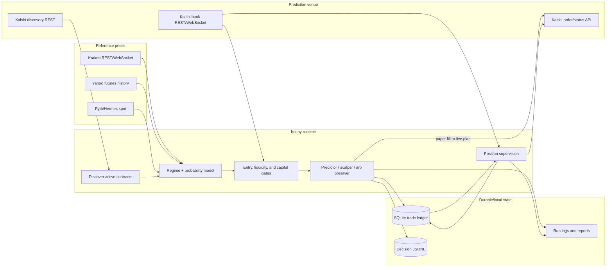
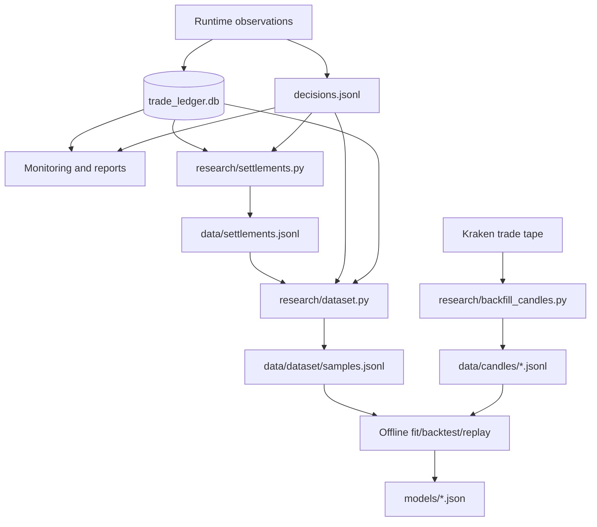

# KX15: Kalshi 15-Minute Market Trading Bot

KX15 is an asynchronous Python research and execution system for Kalshi's
15-minute crypto and commodity prediction markets. It discovers the currently
open contract, obtains reference-market candles, estimates the probability of a
YES settlement, applies liquidity and portfolio risk gates, and either records a
paper fill or submits a bounded live order.

The project began as a fork/evolution of
[aulekator/Polymarket-BTC-15-Minute-Trading-Bot](https://github.com/aulekator/Polymarket-BTC-15-Minute-Trading-Bot).
The active system is no longer the upstream seven-phase Polymarket bot: execution
is Kalshi-native, Kraken/Pyth/Yahoo provide reference prices, SQLite is the
operational record, and the Polymarket integration is read-only data collection.
Some upstream modules remain in the tree for reference and are explicitly
classified as legacy in [the architecture guide](docs/ARCHITECTURE.md).

> [!WARNING]
> Paper trading is the default, but this repository contains a real-money order
> path. Live trading requires both `--live` and `ENABLE_LIVE_TRADING=true`.
> Review the risk controls, use Kalshi's demo environment first, and never assume
> that a backtest, paper result, or model probability guarantees a profit.

## Project status

This documentation describes the workspace as audited on **2026-08-27**.

| Area | State | Notes |
| --- | --- | --- |
| Kalshi paper/live runtime | Active | `bot.py`, `config.py`, active strategy and execution modules |
| Predictor, scalper, take-profit, salvage, strategy lab | Active or configuration-gated | The pair-arbitrage engine is deliberately paper-only; ladder arbitrage is disabled by default |
| Kraken, Yahoo, and Pyth reference data | Active | Kraken is used for crypto; Yahoo history plus Pyth spot are routed for commodities |
| Read-only Polymarket collection | Standalone research path | It cannot place orders and is not imported by `bot.py` |
| SQLite ledger and decision log | Active | The ledger is canonical for trades; the JSONL decision log is a rotating diagnostic stream |
| Built-in Web UI and Prometheus exporter | Implemented | Can run directly with `python -m monitoring.server` |
| Docker Compose + Grafana | Needs repair before relying on it | See [the observability/data plan](docs/OBSERVABILITY_DATA_PIPELINE_PLAN.md) |
| Automated collection, labelling, normalization, and dataset builds | Partial/manual | Individual tools exist, but no scheduler or end-to-end data job currently exists |
| Upstream Nautilus/Polymarket seven-phase tree | Legacy/unwired | Not reachable from the active bot entry point |
| Storefront, licensing, and installers | Local packaging subsystem | Present in this workspace but ignored by Git; a clean public clone will not contain them unless the release boundary is changed |
| Repository metadata | Pre-publication | This checkout has no commit, branch, or configured remote; maintainers must initialize/publish it before others can clone it |

The Python test suite's 1,298 collected tests complete successfully in the
audited workspace. That does not prove that a clean clone is reproducible:
`.gitignore` currently excludes some packaging code and model artifacts that
local tests can see. This gap is documented rather than hidden.

## Supported markets

The default configuration evaluates these Kalshi series:

| Asset | Series | Reference-price route |
| --- | --- | --- |
| BTC | `KXBTC15M` | Kraken one-minute spot candles |
| ETH | `KXETH15M` | Kraken one-minute spot candles |
| SOL | `KXSOL15M` | Kraken one-minute spot candles |
| HYPE | `KXHYPE15M` | Kraken one-minute spot candles |
| DOGE | `KXDOGE15M` | Kraken one-minute spot candles |
| XRP | `KXXRP15M` | Kraken one-minute spot candles |
| BNB | `KXBNB15M` | Kraken one-minute spot candles |
| NEAR | `KXNEAR15M` | Kraken one-minute spot candles |
| ZEC | `KXZEC15M` | Kraken one-minute spot candles |
| GOLD | `KXGOLD15M` | Yahoo futures history with recent Pyth prices |
| SILVER | `KXSILVER15M` | Yahoo futures history with recent Pyth prices |
| WTI | `KXWTI15M` | Yahoo futures history with recent Pyth prices |

The maps in `config.py` are authoritative. Availability still depends on the
exchange listing an open market and on the reference feed returning fresh data.

## Quick start from source

### Requirements

- Git
- Python 3.13 or newer
- [`uv`](https://docs.astral.sh/uv/) (recommended) or `pip`
- Internet access for a real read-only scan
- Kalshi API credentials only for authenticated/live operations

Clone the repository URL supplied by its maintainer. No `origin` is configured
in the audited checkout, so the placeholder below cannot yet be replaced with a
verified fork URL.

```bash
git clone https://github.com/<OWNER>/Polymarket-BTC-15-Minute-Trading-Bot.git
cd Polymarket-BTC-15-Minute-Trading-Bot

uv sync
cp .env.example .env
uv run pytest -q
uv run python bot.py --once --assets BTC
```

`--once` performs one public discovery/model pass and exits. Paper mode is the
default. The run may create local SQLite/JSONL state; those files are ignored
because they can contain financial history.

For research/model-fitting dependencies:

```bash
uv sync --extra research
```

The fallback installation is:

```bash
python3.13 -m venv .venv
source .venv/bin/activate
python -m pip install -r requirements.txt
pytest -q
```

`uv.lock` is the reproducible dependency source. `requirements.txt` includes the
runtime and basic test packages, but not every optional research or storefront
dependency.

## Running the bot

```bash
# One paper-mode scan.
uv run python bot.py --once

# A short bounded paper session.
uv run python bot.py --session-seconds 300 --session-passes 30 --assets BTC,ETH

# Continuous paper mode.
uv run python bot.py --continuous --strategy predictor

# Isolate the scalper.
uv run python bot.py --continuous --strategy scalper

# Observe complementary-pair states; this mode is paper-only.
uv run python bot.py --strategy arb --assets BTC \
  --session-seconds 7200 --session-passes 1440 --silent
```

`--strategy all` is the default and enables the predictor, scalper, paper
strategy-lab policies, and the non-executing pair-arbitrage observer. Use an
isolated strategy when measuring its performance; all strategies otherwise
share capital and market observations.

### Live-mode interlock

Live execution requires all of the following:

1. `KALSHI_ENVIRONMENT` and the endpoints are correct.
2. `KALSHI_API_KEY` is present.
3. `KALSHI_PRIVATE_KEY_PATH` points to a readable owner-only private key.
4. `ENABLE_LIVE_TRADING=true` is set.
5. The process is explicitly launched with `--live`.

```bash
chmod 600 /absolute/path/to/private_key.pem
# Edit .env deliberately; do not paste credentials into shell history.
uv run python bot.py --live --once --strategy predictor --assets BTC
```

Do not enable continuous live mode until the one-pass demo/production output,
balance partition, ledger path, and order budget have all been reviewed.

## How the active system works



For each pass, the runtime:

1. Discovers the current contract for each configured asset and reads its strike,
   close time, fee multiplier, and exchange index.
2. Services open positions and resting orders before admitting new risk.
3. Retrieves recent one-minute reference candles. Crypto uses Kraken; commodity
   history is routed through Yahoo/Pyth. A stale final candle fails closed.
4. Extracts volatility, trend, impulse, reversal, and candle-shape features and
   classifies the market regime.
5. Estimates `P(YES)` from strike distance, remaining time, momentum, volatility,
   regime adjustments, and any validated optional directional/regime artifact.
6. Compares the model with executable YES/NO prices. It applies probability,
   divergence, quote-sanity, edge, settlement-distance, liquidity, correlation,
   circuit-breaker, and capital checks.
7. Ranks admitted predictor candidates. Before placement it re-reads the book,
   rechecks edge and balance, and clips size to executable depth.
8. Records the decision whether it traded or not. A live order uses a stable
   client order ID and reconciles ambiguous responses rather than blindly
   resubmitting.
9. Supervises every open position using sequenced book updates and REST fallback.
   Take-profit, winner-hold, optional salvage, settlement, and partial-exit logic
   update the ledger using venue-confirmed quantities.

Money and contract quantities are `Decimal`; model mathematics uses floats only
inside its numerical feature/probability calculations.

### Strategies and exits

- **Predictor:** crosses the executable book only after the model and every risk
  gate admit the candidate. The best candidates are bounded by per-cycle and
  correlation-cluster limits.
- **Scalper:** evaluates favourite-priced contracts and can use taker or
  post-only maker behavior. Under `bot.py`, strategy selection overrides the
  standalone `SCALP_ENABLED` value; pass `--strategy predictor` to turn it off.
- **Pair-arbitrage observer:** measures apparent same-market YES/NO pair states.
  Kalshi exposes one netted YES book and no atomic two-leg order, so this path is
  intentionally paper-only.
- **Strategy lab:** gives alternative paper policies independent wallets while
  feeding them the same observations. It is diagnostic and does not authorize
  additional live orders.
- **Take profit:** evaluates executable exit depth and fees, with explicit
  high-bid/high-confidence winner-hold vetoes.
- **Salvage:** optional, default-off deep-longshot exit based on executable price,
  not a general “model reversal” stop.

The complete gate ordering and module ownership are in
[docs/ARCHITECTURE.md](docs/ARCHITECTURE.md).

## State, datasets, and generated artifacts



The operational state has different durability rules:

| Artifact | Role | Durability |
| --- | --- | --- |
| `trade_ledger.db` | Canonical trades, fills, orders, snapshots, signals, quality events, and persistent risk state | Back up; never edit by hand while the bot runs |
| `trades.jsonl` | Secondary append-only trade audit | Retain with the ledger |
| `decisions.jsonl` | Detailed “why” stream for every evaluation | Rotates by `DECISION_LOG_RETENTION_HOURS`; not a permanent dataset |
| `strategy_lab.db` | Paper-policy experiment state | Keep only for experiments that must be reproducible |
| `data/settlements.jsonl` | Venue settlement labels | Rebuildable only while the relevant venue history remains available |
| `data/dataset/` | Normalized evaluation-level dataset | Currently built manually and ignored by Git |
| `data/candles/` | Kraken candle backfill | Rebuildable from the public trade tape |
| `models/*.json` | Offline-fitted artifacts loaded by the runtime | Ignored by Git in the current workspace; provenance must accompany deployment |
| `archive/`, `reports/`, `logs/` | Operator evidence and generated analysis | Generated/private; do not treat as source code |

Current data automation is incomplete. Run the existing pipeline manually with:

```bash
uv run python research/settlements.py
uv run python research/dataset.py
uv run python research/dataset.py --report
```

The production implementation sequence, schema contract, retention policy, and
acceptance criteria are specified in
[docs/OBSERVABILITY_DATA_PIPELINE_PLAN.md](docs/OBSERVABILITY_DATA_PIPELINE_PLAN.md).

## Monitoring

The built-in monitoring service is independent of the trading loop and opens the
ledger read-only:

```bash
uv run python -m monitoring.server \
  --host 127.0.0.1 \
  --port 8787 \
  --ledger trade_ledger.db \
  --decisions decisions.jsonl \
  --paper
```

Available endpoints include:

- `http://127.0.0.1:8787/` — Web UI
- `/healthz` — liveness/derived data health
- `/metrics` — Prometheus text exposition
- `/api/overview`, `/api/trades`, `/api/equity` — JSON views
- `/api/chart?asset=BTC` — candles, indicators, trades, and decisions
- `/api/mode` — paper/live mode request when control is enabled

The Web UI and exporter work directly, but the audited Docker/Grafana deployment
is not yet a reliable clean-clone workflow. In particular, the image build and
secret boundary, service health/readiness, configuration mounts, mode-control
write path, dashboard validation, and historical-metric semantics need to be
fixed together. Do not expose ports 8787, 9090, or 3000 publicly; bind to
loopback and use an SSH tunnel.

## Configuration

Copy `.env.example` to `.env` and edit the copy. `config.py` validates values at
startup. The template is long because safety thresholds are explicit; start by
reviewing these groups:

- **Venue/auth:** `KALSHI_ENVIRONMENT`, endpoints, API key, key paths, subaccount.
- **Execution permission:** `ENABLE_LIVE_TRADING` plus the `--live` flag.
- **Assets/timing:** `TRADING_ASSETS`, entry window, minimum close time, polling.
- **Risk:** fixed trade budget, probability/edge limits, slippage, fee reserve,
  drawdown and loss breakers, concurrent positions, and correlation clusters.
- **Models:** candle freshness, optional regime/commodity artifact paths.
- **Strategy behavior:** scalper, take-profit, salvage, strategy lab, arb observer.
- **Data/state:** ledger, trade log, decision log, mode file, recording controls.
- **Operator output:** log directory, rotation, console verbosity, reports.

Some values remain parseable only for backward compatibility and are inert for
new sizing (`POSITION_FRACTION`, `KELLY_FRACTION`, confidence multipliers, and
`LIVE_CAPITAL_LIMIT_USD`). The fixed `TRADE_BUDGET_USD` ceiling is authoritative.
`.env.example` also contains storefront settings that `bot.py` does not read.

Never commit `.env`, PEM files, SQLite ledgers, JSONL trading history, licensing
secrets, or generated customer/storefront state.

## Developer documentation

| Document | Purpose |
| --- | --- |
| [Architecture and complete source map](docs/ARCHITECTURE.md) | Runtime flows, boundaries, storage, every source package, dead/unused code, and known inconsistencies |
| [Contributing](CONTRIBUTING.md) | Setup, branch workflow, tests, commits, push to `origin`, and pull requests to `main` |
| [Development guide](docs/DEVELOPING.md) | Code invariants and how to change gates, models, assets, UI, and releases |
| [Observability and data-pipeline plan](docs/OBSERVABILITY_DATA_PIPELINE_PLAN.md) | Repair phases for Grafana/Prometheus, ingestion, normalization, storage, automation, and validation |
| [Windows guide](docs/WINDOWS.md) | Native Windows and WSL installation details |
| [Licensing design](docs/LICENSING.md) | Local packaging/licensing subsystem, when included in a distribution |
| [Brand guide](docs/BRAND.md) | Logo and theme assets |

`CLAUDE.md` is a dense internal invariant/history record. It is useful context,
but the documents above are the maintained contributor entry points.

## Tests and quality checks

```bash
# Entire suite. Tests mock network/order boundaries.
uv run pytest -q

# Focused examples.
uv run pytest tests/test_risk_gate.py -q
uv run pytest tests/test_monitoring.py tests/test_monitoring_mode_api.py -q
uv run pytest tests/test_dataset.py tests/test_replay_events.py -q

# Active runtime, adapters, research, monitoring, and configured tests.
uv run ruff check bot.py config.py core/strategy_brain/strategies execution \
  data_sources/kraken data_sources/yahoo data_sources/pyth \
  data_sources/polymarket data_sources/venues monitoring reporting research tests

# Whole-workspace audit. This currently also reports legacy-tree findings.
uv run ruff check .
```

Tests inside `core/**/test_*.py` and `data_sources/test.py` are legacy executable
smoke scripts; `pyproject.toml` intentionally collects only `tests/`.

## Contributing

The short version is:

```bash
git clone https://github.com/<YOUR-USER>/Polymarket-BTC-15-Minute-Trading-Bot.git
cd Polymarket-BTC-15-Minute-Trading-Bot
git switch -c docs/describe-current-architecture

# Make and verify the change.
uv sync
uv run pytest -q

git add README.md CONTRIBUTING.md docs/
git commit -m "docs: describe current architecture"
git push -u origin docs/describe-current-architecture
```

Then open a pull request from that branch into `main`, describe the operational
risk of the change, and include the commands used to verify it. See
[CONTRIBUTING.md](CONTRIBUTING.md) for the fork/upstream workflow and PR checklist.

## Known limitations

- Model outputs are estimates, not calibrated guarantees across every asset or
  regime. Existing runs are too small to establish durable profitability.
- Kalshi settlement indexes can differ from spot/futures reference feeds.
- Fees, slippage, latency, exchange-index cash partitions, basis, stale data, and
  thin books can erase apparent edge.
- A rotating decision log loses counterfactual training rows unless they are
  materialized before rotation.
- Grafana/Prometheus currently observe reconstructed totals, not a fully durable
  event-time analytical store.
- The repository's current ignore/release boundary prevents a clean clone from
  reproducing every local packaging/storefront test.
- There is no `LICENSE` file in the audited workspace. The maintainer must choose
  and add a license before presenting this fork as open source; the upstream
  repository's availability does not automatically define this fork's terms.

## Security and disclaimer

This software can place financial orders. Treat all environment files, keys,
ledgers, decision logs, reports, and dashboards as sensitive. Keep services on
loopback, use least-privilege credentials, protect private keys with owner-only
permissions, and test changes in paper/demo mode.

Trading can lose the entire amount committed. Past paper or live performance is
not a promise of future returns. You are responsible for exchange eligibility,
taxes, compliance, operational security, and every order submitted from your
account.
