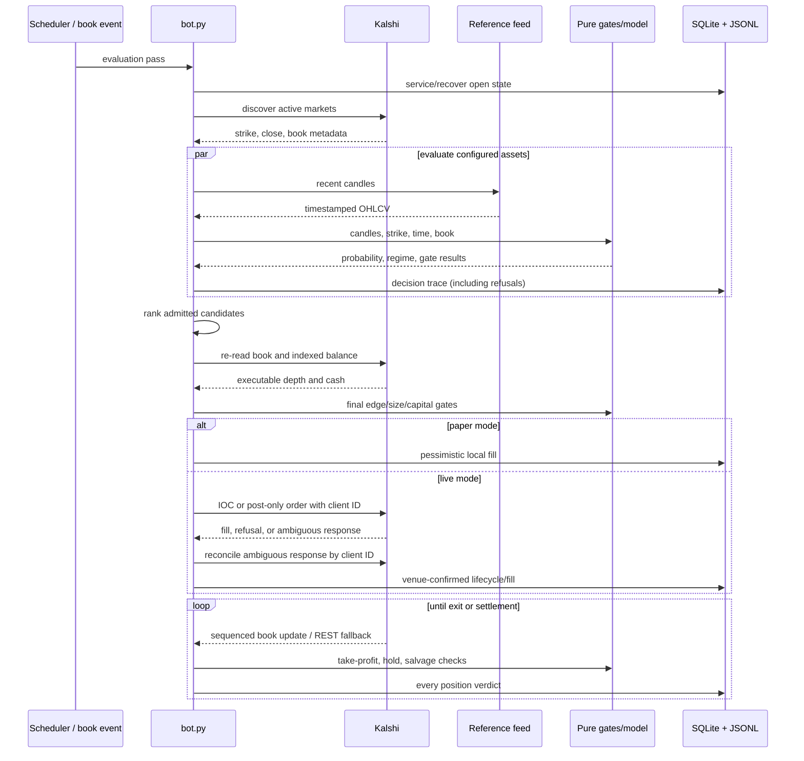

# Architecture and source map

This document describes the code present in the workspace on 2026-08-27. It is
the contributor-facing map of what runs, what stores data, what is an offline
tool, and what remains from the upstream Polymarket design but is not connected
to the current application.

The distinction matters: a Python file being present does not mean that
`bot.py` imports it or that it can affect an order.

## System boundaries

The active application has five boundaries:

1. **Venue boundary:** Kalshi market discovery, books, balances, orders,
   positions, and settlement status.
2. **Reference-data boundary:** Kraken for crypto candles; Yahoo/Pyth for
   commodity history and recent spot data.
3. **Decision boundary:** pure model, order-book analytics, and risk gates.
4. **Execution/state boundary:** order lifecycle, open-position supervision,
   SQLite ledger, JSONL decision/audit logs, and runtime mode control.
5. **Observer boundary:** monitoring, Prometheus, reports, and research read
   state but must not be imported by or block the order path.

```mermaid
flowchart TB
    subgraph External
        KREST[Kalshi REST]
        KWS[Kalshi WebSocket]
        KR[Kraken]
        YH[Yahoo Finance]
        PY[Pyth / Hermes]
    end

    subgraph Orchestration
        BOT[bot.py / KalshiCryptoBot]
        CLIENT[execution/kalshi_client.py]
        BOOK[execution/kalshi_book_stream.py]
    end

    subgraph PureDecision[Pure decision logic]
        MODEL[crypto_15min_predictor.py]
        REGIME[market_regime.py + optional regime_model.py]
        OB[orderbook.py]
        RISK[risk_gate.py + scalp_gate.py]
        EXIT[take_profit.py + salvage.py]
    end

    subgraph RuntimeStrategy[Stateful strategy orchestration]
        SCALP[scalp_engine.py]
        TP[execution/take_profit.py]
        SALV[execution/salvage_exit.py]
        ARB[pair_arb_engine.py]
        LAB[strategy_lab.py]
    end

    subgraph State
        LEDGER[(trade_ledger.db)]
        DECISIONS[(decisions.jsonl)]
        MODE[(runtime_mode.json)]
        LOGS[run logs / PDF reports]
    end

    subgraph Observers
        MON[monitoring.server]
        PROM[/metrics]
        WEB[Web UI]
        REPORT[reporting + research]
    end

    KREST <--> CLIENT
    KWS --> BOOK
    KR --> BOT
    YH --> BOT
    PY --> BOT
    CLIENT --> BOT
    BOOK --> BOT
    BOT --> MODEL
    MODEL --> REGIME
    BOT --> OB
    BOT --> RISK
    BOT --> SCALP
    BOT --> TP
    BOT --> SALV
    BOT --> ARB
    BOT --> LAB
    TP --> EXIT
    SALV --> EXIT
    BOT --> LEDGER
    BOT --> DECISIONS
    BOT <--> MODE
    BOT --> LOGS
    LEDGER --> MON
    DECISIONS --> MON
    MODE <--> MON
    MON --> PROM
    MON --> WEB
    LEDGER --> REPORT
    DECISIONS --> REPORT
```

The arrows into monitoring and research are one-way reads, except for the mode
control request. The monitoring process cannot submit an order; it can only ask
the bot to change modes. The bot validates the live prerequisites itself before
honoring that request.

## Runtime lifecycle

`main()` in `bot.py` loads `.env`, constructs `KalshiSettings`, configures
logging, creates `KalshiCryptoBot`, and installs graceful signal handling.



Important ordering rules:

- Open positions, settlement, and resting orders are serviced before new risk.
- Discovery and price-feed failures block new entries for the affected scope but
  do not abandon already-open positions.
- The discovery quote is never accepted as the execution quote. The book and
  indexed cash balance are re-read immediately before placement.
- Definitive order refusals become lifecycle records; transport ambiguity is
  reconciled by the existing client order ID and is not blindly resubmitted.
- Shutdown stops new submissions, completes reconciliation already in flight,
  drains tasks, marks incomplete data runs, and preserves open positions for
  recovery.

## Model and risk path

`Crypto15MinutePredictor` consumes timestamped `PriceCandle` objects, the exact
market strike, and remaining time. It combines:

- current distance from the strike;
- recent momentum and realized volatility;
- regime features such as efficiency, autocorrelation, compression, impulse,
  retracement, wick rejection, and travel;
- optional validated Gaussian-mixture regime multipliers;
- optional offline-fitted directional priors;
- shrinkage intended to keep extreme small-sample probabilities bounded.

Its output is an estimate, not an execution decision. `bot.py` and the pure gate
modules subsequently check:

- entry time and candle freshness;
- minimum and maximum plausible executable edge;
- model-versus-market divergence;
- quote movement/sanity;
- minimum probability and late-entry conditions;
- strike distance in terminal volatility units;
- spread, toxicity, book depth, and immediate-exit stress for scalps;
- correlation cluster, per-strategy concurrency, fixed budget, available cash,
  per-exchange-index cash, drawdown, daily loss, and consecutive-loss breakers;
- duplicate/re-entry policy and order-failure cooldowns.

New gates should remain pure functions returning a structured result and should
be written into the decision trace whether they pass or fail.

## State and data model

### Operational SQLite ledger

`execution/trade_ledger.py` owns schema creation and migrations. The current
database contains these logical groups:

| Table/group | Purpose |
| --- | --- |
| `ledger_metadata` | Schema and ledger metadata |
| `trades`, `trade_exit_fills` | Position-level entry, partial exit, settlement, exact cost/P&L |
| `data_runs` | Collection run status and provenance hashes |
| `market_snapshots`, `orderbook_levels` | Normalized market and full-depth observations |
| `portfolio_snapshots` | Balance/exposure snapshots |
| `pair_arb_observations` | Paper-only complementary-pair measurements |
| `book_events`, `public_trades` | Sequenced raw/near-raw exchange events when enabled |
| `signal_evaluations` | Queryable probability-bearing decisions |
| `orders`, `order_transitions`, `fills` | Strict order lifecycle and venue-confirmed fills |
| `position_evaluations`, `exit_counterfactuals` | Hold/exit decisions and shadow alternatives |
| `probability_calibrations` | Settlement-linked probability buckets |
| `data_quality_events` | Gaps, stale data, sequence faults, and ingestion quality |
| `persistent_risk_state` | Durable breaker state across restarts |

SQLite is the canonical operational store. WAL files may exist while it is open.
Observers use read-only URI mode; writers must go through `TradeLedger`.

### JSONL and generated state

- `decisions.jsonl` is the human/audit-rich evaluation stream. It is rotated and
  therefore cannot be the only long-term training source.
- `trades.jsonl` is a secondary append-only trade audit; SQLite remains canonical.
- `runtime_mode.json` plus its lock is a request/status channel, not authority to
  place an order.
- `strategy_lab.db` is separate experimental accounting.
- log/PDF/report files are outputs for people, not inputs to execution.

### Offline dataset path

The current manual path is:

```text
decisions.jsonl + trade_ledger.db
        |
        +--> research/settlements.py --> data/settlements.jsonl
        |
        +--> research/dataset.py --> data/dataset/samples.jsonl + schema.json
                                      |
                                      +--> backtest / replay / fitting
```

Rows represent evaluations rather than only trades, retaining refused
counterfactuals. Labels must record their source; venue settlement is
authoritative. Prices and money remain exact strings in JSON, while numerical
features are floats. Automation and durable materialization before decision-log
rotation are not implemented yet.

## Complete source layout

Generated data, databases, logs, reports, caches, `.env`, and key files are
described after the code map; they are intentionally not expanded file by file.

### Root entry points and configuration

| Path | Status | Responsibility |
| --- | --- | --- |
| `bot.py` | Active | Main async application, scheduling, strategy orchestration, gate ordering, placement, supervision, shutdown |
| `config.py` | Active | Asset/series maps, environment loading, typed settings, defaults, startup validation, live interlock |
| `15m_bot_runner.py` | Active packaging helper, Git-ignored | Restarts `bot.py` after exit and forwards termination; Docker entry point |
| `view_decisions.py` | Active operator tool, Git-ignored | Summarizes gates, recent evaluations, and calibration from decision JSONL |
| `view_paper_trades.py` | Active operator tool, Git-ignored | Displays paper trades and ledger summary |
| `view_strategy_lab.py` | Active operator tool | Prints strategy-lab wallet results |
| `kalshi_history.py` | Standalone operator tool, Git-ignored | Reconstructs bounded account history from Kalshi APIs |
| `pyproject.toml` | Active | Package metadata, Python 3.13 floor, runtime/research/dev/storefront dependency groups, pytest/ruff settings |
| `uv.lock` | Active | Locked dependency graph |
| `requirements.txt` | Active fallback | Runtime plus basic test dependencies for pip/Docker; does not mirror every optional group |
| `.env.example` | Active template | Runtime, model, strategy, data, logging, and local storefront configuration reference |
| `.gitignore` | Active but problematic | Protects secrets/state; also excludes source/packaging directories needed by local tests and release flows |
| `.dockerignore` | Active packaging helper, Git-ignored | Excludes repository/state noise from image context; currently does not establish a safe secret-injection design |
| `Dockerfile` | Needs repair | Builds runtime image; currently copies key files during build and depends on ignored local packaging files |
| `compose.yaml` | Needs repair | Bot, monitoring, Prometheus, and Grafana topology |
| `bot.service` | Deployment example | Hardened systemd unit with local absolute paths |
| `harden.sh` | Deployment helper, Git-ignored | Host hardening/install support; inspect before use |
| `CLAUDE.md` | Internal reference, Git-ignored | Dense invariants, incident history, and packaging notes; not the public documentation entry point |

### Active strategy core

`core/strategy_brain/strategies/` contains side-effect-free or artifact-loading
decision logic:

| File | Responsibility |
| --- | --- |
| `candles.py` | Shared immutable one-minute OHLCV shape |
| `crypto_15min_predictor.py` | Probability estimate and prediction diagnostic payload |
| `market_regime.py` | Pure feature extraction and hand-tuned regime classification |
| `regime_model.py` | Validated JSON Gaussian-mixture artifact and posterior blending |
| `commodity_model.py` | Pure scorer for offline-fitted directional priors (also used for configured altcoin artifacts) |
| `orderbook.py` | Pure top-of-book/depth, imbalance, toxicity, microprice, slope, and crowd analytics |
| `scalper.py` | Pure quote construction, EV, sizing, requote, and exit rules |
| `take_profit.py` | Pure executable take-profit and winner-hold decision |
| `salvage.py` | Pure optional deep-longshot salvage rule and outcome-book conversion |
| `oversight.py` | Pure exposure-based supervision schedule; default settings keep the additional behavior inert |
| `pair_arb.py` | Pure same-market complementary-pair assessment for the paper observer |
| `ladder_arb.py` | Pure monotonicity/convexity detector for multi-strike daily ladders; not wired to live orders and disabled by default |
| `__init__.py` | Package marker |

### Execution and durable state

| File | Responsibility |
| --- | --- |
| `execution/kalshi_client.py` | Async SDK wrapper, discovery, quote/depth reads, balances, order plans, authentication, bounded retries, ambiguous-order reconciliation |
| `execution/kalshi_book_stream.py` | Sequenced WebSocket book reconstruction and REST-fallback cache |
| `execution/risk_gate.py` | Pure predictor/general admission, freshness, probability, edge, and capital-breaker gates |
| `execution/scalp_gate.py` | Pure scalper-specific price/spread/depth/pattern/toxicity/capacity gates |
| `execution/scalp_engine.py` | Stateful maker/taker scalp assessment, quote lifecycle, fills, and funnel logging |
| `execution/order_lifecycle.py` | Resting quote state machine and pessimistic paper maker fills |
| `execution/take_profit.py` | Runtime book reads, exit order/fill handling, and take-profit logging |
| `execution/salvage_exit.py` | Runtime scheduling and execution for optional salvage exits |
| `execution/pair_arb_engine.py` | Isolated paper-only arb observation orchestration |
| `execution/strategy_lab.py` | Independent paper wallets/policies over shared observations |
| `execution/trade_ledger.py` | SQLite schema, migrations, transactions, trades, fills, snapshots, signals, data quality, and risk state |
| `execution/decision_log.py` | Rotating JSONL decision traces with structured gate outcomes |
| `execution/position_book.py` | Lock-guarded open-position/capital reservations across strategies |
| `execution/mode_control.py` | Atomic file/lock protocol for requested and active paper/live modes |
| `execution/paper_session.py` | Bounded-session performance summary |
| `execution/provenance.py` | Secret-free source/config/model fingerprints for collection runs |
| `execution/run_log.py` | Console filtering, rotating human logs, counters, hourly summaries, and ledger audit |
| `execution/__init__.py` | Package marker |
| `execution/risk_engine.py` | **Legacy/unwired** upstream float-based risk manager; do not extend for active execution |

### Active reference and venue data

| File | Status | Responsibility |
| --- | --- | --- |
| `data_sources/kraken/rest.py` | Active runtime | Public one-minute crypto OHLC adapter |
| `data_sources/kraken/stream.py` | Active runtime | WebSocket candle cache with freshness-aware REST fallback |
| `data_sources/kraken/__init__.py` | Active | Package marker/documentation |
| `data_sources/yahoo/rest.py` | Active runtime | Async Yahoo futures chart history and commodity route wrapper |
| `data_sources/yahoo/__init__.py` | Active | Package marker |
| `data_sources/pyth/rest.py` | Active runtime | Recent Pyth/Hermes commodity prices layered into candle history |
| `data_sources/pyth/__init__.py` | Active | Package marker |
| `data_sources/polymarket/client.py` | Standalone collection | Read-only Gamma discovery and CLOB book normalization |
| `data_sources/polymarket/collector.py` | Standalone collection | Periodically stores Polymarket up/down market/book observations |
| `data_sources/polymarket/__init__.py` | Standalone collection | Explicit read-only package surface |
| `data_sources/venues/base.py` | Experimental read-only | Venue-neutral market/book contracts |
| `data_sources/venues/adapters.py` | Experimental read-only | Kalshi/Polymarket adapters plus explicit refusing stubs |
| `data_sources/venues/eligibility.py` | Experimental read-only | Operator-declaration eligibility gating (not legal advice) |
| `data_sources/venues/registry.py` | Experimental CLI | Catalog/status report for additional venues |
| `data_sources/venues/__init__.py` | Experimental | Package exports |
| `data_sources/__init__.py` | Package marker | No runtime behavior |

### Monitoring and reporting

| File | Responsibility |
| --- | --- |
| `monitoring/server.py` | Threaded read-only HTTP server, JSON API, static UI, Prometheus endpoint, and optional mode request |
| `monitoring/sources.py` | Read-only SQLite trade loader and incremental decision-log tail |
| `monitoring/performance_tracker.py` | Pure P&L, ROI, drawdown, streak, calibration, funnel, regime, and health calculations |
| `monitoring/grafana_exporter.py` | Prometheus text exposition derived from loaded ledger/decision state |
| `monitoring/chart.py` | Kraken chart payload plus runtime-consistent indicators and trade/evaluation markers |
| `monitoring/webui/index.html` | Built-in dashboard shell |
| `monitoring/webui/app.js` | API polling, mode request, tables/charts, and UI behavior |
| `monitoring/webui/styles.css` | Dashboard styling |
| `monitoring/webui/favicon.svg` | Dashboard icon |
| `monitoring/__init__.py` | Package marker |
| `reporting/report.py` | Read-only portfolio window calculations and PDF report composition/CLI |
| `reporting/pdf.py` | Dependency-free PDF 1.7 drawing/writer primitives |
| `reporting/theme.py` | Shared colors and numeric formatting |
| `reporting/__init__.py` | Reporting package exports |

### Grafana and Prometheus deployment assets

| File | Responsibility / current caveat |
| --- | --- |
| `grafana/prometheus.yml` | Scrapes `monitoring:8787/metrics` every 30 seconds |
| `grafana/dashboard.json` | Provisioned dashboard for health, P&L, model quality, and gate funnel |
| `grafana/provisioning/datasources/prometheus.yml` | Fixed-UID Prometheus data source at `http://prometheus:9090` |
| `grafana/provisioning/dashboards/dashboards.yml` | File dashboard provider for the mounted JSON |
| `grafana/import_dashboard.py` | Manual HTTP import when Grafana is not file-provisioned |
| `grafana/grafana.ini` | Optional local config; **not mounted by current Compose**, so it has no effect there |

### Offline research tools

Nothing in `research/` is imported by `bot.py`. Model artifacts cross into the
runtime as validated JSON, not imported fitting code.

| File | Responsibility |
| --- | --- |
| `research/settlements.py` | Finds evaluated/traded tickers and fetches authoritative Kalshi settlement labels |
| `research/dataset.py` | Joins decisions, settlements, and trades into normalized evaluation-level JSONL plus schema |
| `research/backfill_candles.py` | Rebuilds auditable one-minute candles from Kraken's public trade tape |
| `research/download_commodity_data.py` | Downloads rolling one-minute Yahoo OHLCV datasets and manifest |
| `research/fit_commodity_models.py` | Fits/validates per-asset directional priors and writes JSON artifacts |
| `research/fit_regime_model.py` | Fits and walk-forward-validates Gaussian mixtures and writes JSON artifacts |
| `research/backtest.py` | Reconstructs market/model observations and compares risk/model variants |
| `research/replay.py` | Checks whether sizing, prices, and accounting reproduce recorded behavior |
| `research/replay_events.py` | Conservative replay of normalized Kalshi events under assumed arrival latency |
| `research/analyze_simulation.py` | Executable-opportunity analysis for one strict simulation ledger |
| `research/final_experiment_analysis.py` | Reproducible multi-run August 2026 experiment analysis |
| `research/build_analysis_notebook.py` | Generates and executes the analysis notebook |
| `research/build_analysis_report.py` | Builds a portable analysis-report artifact |
| `research/__init__.py` | Package marker |

### Packaging, licensing, storefront, and deployment

These paths exist in the audited workspace but are ignored by `.gitignore`.
They are not available to contributors from a clean clone unless the maintainer
changes the publication boundary or distributes them separately.

| Path | Responsibility |
| --- | --- |
| `licensing/activate.py` | Fail-open cached license activation used by installers/launcher, never imported by `bot.py` |
| `licensing/fingerprint.py` | Salted opaque machine/install fingerprint and device report |
| `licensing/setup_wizard.py` | Interactive `kx15 config` credential/key setup |
| `licensing/__init__.py` | Package boundary documenting isolation from trading |
| `storefront/app.py` | Flask HTTP layer for checkout, fulfilment, downloads, and operator routes |
| `storefront/stripe_gateway.py` | Checkout calls and webhook signature verification |
| `storefront/licenses.py` | License issuance and idempotent storefront SQLite records |
| `storefront/downloads.py` | Signed, expiring, nonce-backed download links |
| `storefront/email_delivery.py` | Mailtrap delivery and templates |
| `storefront/fraud.py` | License-sharing risk inputs, policy, signals, and decision |
| `storefront/fingerprint_pro.py` | Optional server-verified device-intelligence integration |
| `storefront/security.py` | Security modes, headers, CSRF, input cleanup, and route authorization |
| `storefront/developer.py` | HMAC developer test tokens and local pin management |
| `storefront/performance.py` | Ledger-derived published performance snapshot |
| `storefront/model_stats.py` | Model calibration/statistical snapshot |
| `storefront/verified.py` | Exchange-record verification and projections |
| `storefront/release.py` | Buyer tarball allow/exclude rules and secret scanning |
| `storefront/server.py` | Deprecated compatibility entry point delegating to Flask |
| `storefront/web/` | Static storefront JavaScript, HTML, CSS, terms, icons, install template |
| `storefront/emails/` | Plain-text and HTML license-delivery templates |
| `storefront/package/` | Generated/staged buyer-package content; not authoritative source |
| `storefront/dist/` | Generated release tarball; never edit directly |
| `deploy/Dockerfile.storefront` | Storefront image |
| `deploy/compose.storefront.yaml` | Storefront deployment topology |
| `deploy/deploy.sh` | Deployment helper |
| `deploy/nginx/` | HTTP/TLS reverse-proxy templates and common policy |
| `scripts/e2e.sh` | End-to-end packaging, storefront, install, run, and update test |
| `scripts/install.ps1` | Native Windows installation/update/launcher script |
| `scripts/reconcile_series.py` | Compares configured series with current public Kalshi series |
| `scripts/reset_paper_stats.py` | Archives state before removing only paper history |
| `scripts/scalp_report.py` | Read-only strategy performance report generator |
| `assets/*.svg` | Product and documentation logo/icon assets; intentionally trackable so GitHub renders the README |

### Data, models, state, and generated artifacts

These paths are part of the workspace layout but are not application source.
Most contain private, mutable, derived, or large data and should not be committed
without an explicit small-fixture policy.

| Path | Classification and purpose |
| --- | --- |
| `data/yfinance_1m/*.csv` + `manifest.json` | Downloaded one-minute OHLCV inputs for commodity/altcoin directional-model fitting |
| `data/commodities/yfinance_15m/` | Older 15-minute commodity download retained as historical input; the current improvement path uses one-minute data |
| `data/candles/` | Rebuildable Kraken trade-tape candle backfill; ignored by Git |
| `data/dataset/` | Generated normalized samples/schema; ignored by Git and currently built manually |
| `data/settlements.jsonl` | Generated authoritative settlement cache; ignored and operationally important for labels |
| `data/simulations/<run>/` | Per-experiment ledgers, decisions, reports, and logs; evidence/output rather than runtime code |
| `data/trade_ledger.db` | A data-local ledger copy; contributors must pass explicit paths to avoid confusing it with the root operational ledger |
| `models/*.json` | Validated fitted artifacts loaded by optional runtime settings; ignored by Git under the current release policy |
| `trade_ledger.db` plus `-wal`/`-shm` | Root operational SQLite state and active WAL sidecars; private and ignored |
| `strategy_lab.db` plus `-wal`/`-shm` | Root strategy-lab experiment state; private and ignored |
| `trades.jsonl`, `decisions.jsonl`, `decisions.jsonl.*` | Current and retained audit/decision streams; private. Named historical copies visible at root should be archived or removed before publication |
| `runtime_mode.json` + `.lock`, `bot_state.json` | Mutable process/control state; ignored |
| `archive/` | Archived ledgers, logs, decisions, and reports. Some artifacts are currently visible to Git because ignore rules are inconsistent; review before initial commit |
| `reports/` | Generated HTML, notebooks, artifacts, screenshots, and text analyses; not source of runtime truth |
| `logs/`, `kalshi-stats.txt`, `scalp_report.md` | Generated operator/analysis output; `scalp_report.md` is currently visible and should be classified before publication |
| `2026-001.pdf` | Root research/reference PDF; its provenance/license and publication intent must be reviewed before commit |
| `.env`, `private_key.pem`, `public_key.pem` | Local configuration and key material. Never commit; inject keys at runtime, not image build time |
| `storefront/storefront.db`, `.secret`, pins/snapshots/verified records | Local commercial/customer state and generated publication snapshots; keep outside a public source tree unless sanitized fixtures are intentionally created |
| `.claude/`, `.venv/`, `__pycache__/`, `.pytest_cache/`, `.ruff_cache/` | Tool/editor/environment caches; ignored and disposable |

### Tests

`pyproject.toml` sets `testpaths = ["tests"]`. The suite is organized as follows:

- **Runtime/config/logging/scheduling:** `test_environment_loading.py`,
  `test_bot_logging.py`, `test_scheduler.py`, `test_shutdown.py`,
  `test_mode_control.py`, `test_mode_switch.py`, `test_safe_mode.py`,
  `test_performance_timing.py`.
- **Model and pure strategy:** `test_predictor.py`, `test_market_regime.py`,
  `test_regime_model.py`, `test_commodity_model.py`, `test_orderbook.py`,
  `test_oversight.py`, `test_pair_arb.py`, `test_scalper.py`, `test_salvage.py`,
  `test_take_profit.py`, `test_risk_gate.py`, `test_projection.py`.
- **Execution/state/transport:** `test_client_auth.py`,
  `test_kalshi_book_stream.py`, `test_kalshi_order_plans.py`,
  `test_transport_resilience.py`, `test_placement.py`,
  `test_position*` behavior through runtime tests, `test_trade_ledger.py`,
  `test_decision_log.py`, `test_paper_session.py`, `test_strategy_lab.py`,
  `test_scalp_runtime.py`, `test_salvage_runtime.py`, `test_persistent_risk.py`,
  `test_run_log.py`, `test_provenance.py`.
- **Data/research/monitoring/reporting:** `test_commodity_sources.py`,
  `test_polymarket.py`, `test_venues.py`, `test_asset_registry.py`,
  `test_backfill_candles.py`, `test_dataset.py`, `test_replay_events.py`,
  `test_research_backtest_filters.py`, `test_research_settlements.py`,
  `test_fit_regime_model.py`, `test_analyze_simulation.py`,
  `test_final_experiment_analysis.py`, `test_monitoring.py`,
  `test_monitoring_mode_api.py`, `test_reporting.py`,
  `test_model_stats.py`, `test_kalshi_history.py`.
- **Local packaging/storefront/licensing:** `test_activation_client.py`,
  `test_fingerprint_pro.py`, `test_fraud.py`, `test_installer.py`,
  `test_license_keys.py`, `test_storefront.py`, `test_storefront_app.py`,
  `test_windows_installer.py`. These depend on source that `.gitignore` currently
  excludes from a public clone.

The older `core/ingestion/test_ingestion.py`,
`core/nautilus_core/test_nautilus.py`, `core/strategy_brain/test_strategy.py`, and
`data_sources/test.py` are executable upstream smoke scripts, not part of the
configured pytest suite.

## Legacy and unwired code

The following tree originated in the upstream Polymarket/Nautilus seven-phase
architecture and is not reachable from `bot.py`'s import graph:

```text
core/ingestion/
├── adapters/unified_adapter.py
├── managers/rate_limiter.py
├── managers/websocket_manager.py
└── validators/data_validator.py

core/nautilus_core/
├── data_engine/engine_wrapper.py
├── event_dispatcher/dispatcher.py
├── instruments/btc_instruments.py
└── providers/custom_data_provider.py

core/strategy_brain/
├── fusion_engine/{divergence_processor.py,signal_fusion.py}
├── signal_processors/
│   ├── base_processor.py
│   ├── deribit_pcr_processor.py
│   ├── divergence_processor.py
│   ├── orderbook_processor.py
│   ├── sentiment_processor.py
│   ├── spike_detector.py
│   └── tick_velocity_processor.py
└── strategies/btc_15min_strategy.py

data_sources/
├── binance/websocket.py
├── coinbase/adapter.py
├── news_social/adapter.py
└── solana/rpc.py

execution/risk_engine.py
feedback/learning_engine.py
```

Specific caveats:

- Several modules are placeholders or incomplete adapters.
- The legacy tree uses assumptions and float-based risk semantics that do not
  match the active Kalshi `Decimal` execution path.
- Its local smoke scripts are not collected by the configured test suite.
- There are two divergence processor files in different legacy folders.
- `core/strategy_brain/signal_processors/divergence_processor.py` retains an
  unused compatibility argument.
- `feedback/learning_engine.py` mutates fusion weights, but the active predictor
  does not use that fusion engine.

Do not build new production behavior on these modules. Either delete them in a
dedicated cleanup PR after confirming no external consumer, or port the small
needed behavior into an active pure module with tests and update this map.

## Configuration that is intentionally inert or conditional

“Present but not currently changing execution” is not always dead code:

- `POSITION_FRACTION`, `KELLY_FRACTION`, `LIVE_CAPITAL_LIMIT_USD`, and the old
  confidence-sizing variables remain accepted for backward-compatible `.env`
  files, but fixed `TRADE_BUDGET_USD` sizing is authoritative.
- Order-book crowd/depth adjustments can be configured with zero weights so
  their tested mechanism remains inert by default.
- The optional learned regime artifact is unused unless `REGIME_MODEL_PATH` is
  supplied and validated.
- Oversight, salvage, ladder arbitrage, queue-aware paper fills, and raw book
  event persistence are configuration-gated and default off.
- `SCALP_ENABLED` is read by `KalshiSettings.from_env`, but `bot.py` replaces it
  according to `--strategy`; its value is not the control for the main CLI.
- `grafana/grafana.ini` is a valid standalone config but is not consumed by the
  current Compose service.

## Known architecture/repository inconsistencies

These are current-state facts contributors should account for:

1. The local Git repository has no commit, current branch, or remote.
2. All visible project files are untracked; major local source directories are
   additionally ignored. A maintainer must define the public/release boundary.
3. The runtime Dockerfile copies private/public key files into an image layer.
   Keys must instead be runtime secrets/read-only mounts.
4. A clean clone would not have those keys or ignored `15m_bot_runner.py`, so
   the current Docker build is not reproducible as documented.
5. Compose starts services on dependency order only; it has no readiness checks
   proving the ledger, exporter, Prometheus target, or provisioned dashboard work.
6. The monitoring volume is read-only even though mode control is enabled; the
   mode endpoint needs a narrow writable control mount or `--no-control`.
7. `.env.example` mixes bot and private storefront concerns and includes
   deprecated settings, making first-time configuration harder to audit.
8. Prometheus totals are reconstructed from bounded local sources. Decision-log
   rotation can make “total” evaluation series decrease, and older event-time
   history cannot be reconstructed from the latest scrape alone.
9. Settlement labelling and dataset builds are manual; rotating decisions can be
   lost before materialization.
10. There is no root `LICENSE` file.

The ordered repair work is in
[OBSERVABILITY_DATA_PIPELINE_PLAN.md](OBSERVABILITY_DATA_PIPELINE_PLAN.md).

## Safe extension points

- Add a risk condition in `execution/risk_gate.py` or `scalp_gate.py`, test the
  exact boundary, and attach it to `DecisionTrace` in `bot.py`.
- Add model features in pure strategy modules and persist their inputs/output in
  the decision record before fitting on them.
- Add a reference feed behind the candle-source interface; freshness and time
  normalization remain mandatory.
- Add a read-only venue through `data_sources/venues/` only after eligibility is
  explicit. Adding execution requires a separate venue-specific order model and
  cannot reuse Kalshi's one-YES-book assumptions blindly.
- Add monitoring metrics from durable, bounded-cardinality fields. Never put
  ticker IDs, order IDs, exception text, or account identifiers into labels.
- Evolve the SQLite schema only through idempotent migrations and add old-schema
  upgrade tests.

See [DEVELOPING.md](DEVELOPING.md) and [../CONTRIBUTING.md](../CONTRIBUTING.md)
before changing an execution or storage boundary.
