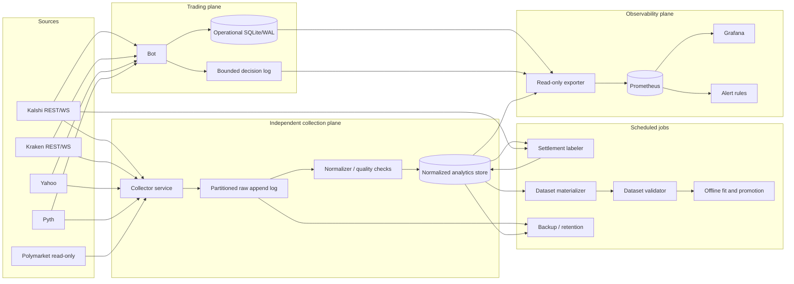

# Observability and data-pipeline implementation plan

This plan fixes the Grafana/Prometheus deployment and turns the existing manual
collection, settlement, normalization, and dataset tools into a durable pipeline.
It is ordered to protect the trading process first: no observability or research
job may gain the ability to delay orders, mutate positions, or corrupt the
operational ledger.

The plan describes work to implement; it does not claim those changes are
already present.

## Outcome

When complete, a clean paper-mode clone should be able to run one command and
obtain:

- a healthy bot and separate read-only monitoring service;
- Prometheus scrapes that survive monitoring restarts;
- a provisioned Grafana dashboard whose panels have validated queries;
- continuous, provenance-tagged market/reference observations;
- scheduled settlement labelling before source data expires;
- idempotent normalization into versioned schemas;
- durable operational, raw, and analytical storage with explicit retention;
- automated dataset materialization before the decision log rotates;
- freshness, gap, reject, lag, and job-status metrics with alerts;
- reproducible model artifacts that name their dataset and configuration hashes.

## Current-state diagnosis

### What already exists

- `monitoring.server` exposes `/healthz`, JSON APIs, the built-in Web UI, and
  `/metrics`. It reads SQLite in read-only mode and incrementally tails decisions.
- `monitoring.grafana_exporter` emits P&L, trade, calibration, gate-funnel,
  regime, and health metrics without adding a runtime dependency.
- Prometheus and Grafana configuration files exist, including automatic data
  source/dashboard provisioning.
- `TradeLedger` already has normalized operational tables for runs, snapshots,
  order-book levels, public trades, signals, orders, fills, position evaluations,
  calibration, and data-quality events.
- The bot records run/config/model provenance and can persist periodic books and
  public prints according to configuration.
- `research/settlements.py`, `research/dataset.py`, candle backfill, commodity
  download, fitting, backtest, and replay tools exist.
- `data_sources.polymarket.collector` is a read-only standalone collector.

### Confirmed deployment/data gaps

1. **The container secret boundary is unsafe and non-reproducible.** The
   Dockerfile copies PEM files into image layers, while the broader build context
   can include local `.env` and ignored source/state. A clean clone has no valid
   keys or configured `.env`; an operator's workspace does.
2. **One image has conflicting roles.** The bot and monitoring service share a
   Dockerfile/entry point designed around the restart wrapper. Compose overrides
   the monitoring command, but image construction still assumes local packaging
   files and secrets.
3. **Startup order is not readiness.** `depends_on` does not prove the ledger
   exists, monitoring can read it, Prometheus has a healthy target, or Grafana
   provisioned the expected dashboard.
4. **Mode control conflicts with a read-only mount.** Monitoring is started with
   control enabled by default but mounts `/app/state` read-only. A POST can read
   state but cannot atomically write the request/lock files. Either control must
   be disabled or a narrow writable path must be provided.
5. **`grafana.ini` is not mounted by Compose.** Its anonymous-view setting and
   path configuration therefore do not affect the container. The environment
   settings and Grafana defaults are what actually run.
6. **No automated smoke test crosses all services.** Unit tests cover exporter
   output and monitoring APIs, but no check currently proves
   `ledger -> exporter -> Prometheus query -> Grafana provisioned dashboard`.
7. **The metrics contract has no version/fixture validation.** Dashboard queries
   can drift from exporter metric names or labels without a CI failure.
8. **Scraped totals are not event-time storage.** Prometheus samples the current
   reconstructed state. It cannot recover observations that occurred between
   scrapes, and a newly started Prometheus has no older history.
9. **Decision retention can reduce the source population.** Gate/evaluation
   aggregates are derived from a bounded JSONL tail. When decisions rotate,
   reconstructed “total” values can decrease and older counterfactual rows can be
   lost before dataset materialization.
10. **Dataset steps are manual.** There is no service/timer for settlement
    refresh, decision compaction, dataset build, validation, backup, or artifact
    promotion.
11. **Storage responsibilities overlap.** The root ledger, `data/trade_ledger.db`,
    per-simulation ledgers, decision copies, archives, and generated reports have
    no machine-readable catalog or retention/backup owner.
12. **Reference sources use different schemas and clocks.** Kraken, Yahoo, Pyth,
    Kalshi, and Polymarket need explicit UTC timestamps, source IDs, received
    time, event time, interval semantics, precision, and quality flags before
    being joined safely.

## Target architecture



The trading and collection planes may reuse adapter and normalization code, but
they do not share blocking tasks, outbound request budgets, or a writable
database connection. Collection failure must never slow position supervision.

## Data contract

Define a versioned contract before adding another collector. At minimum, every
observation needs:

| Field | Meaning |
| --- | --- |
| `schema_version` | Integer contract version, migrated explicitly |
| `run_id` | Collection run with source/config/code/model provenance |
| `source` | Stable source enum (`kalshi`, `kraken`, `pyth`, `yahoo`, `polymarket`) |
| `venue` | Trading/reference venue where relevant |
| `asset` | Canonical asset enum from one registry |
| `instrument_id` | Source-native symbol/ticker/token ID |
| `event_time` | Source event timestamp normalized to UTC |
| `received_at` | Local UTC receipt timestamp |
| `sequence` | Source sequence number when available |
| `interval_seconds` | Candle/snapshot duration where relevant |
| `price` / OHLC | Exact decimal text at the storage boundary |
| `quantity` / volume | Exact decimal text plus source unit |
| `source_payload_hash` | Deduplication/audit hash without secrets |
| `quality_flags` | Gap, stale, out-of-order, synthesized, repaired, partial |

Use separate typed records/tables for:

- market metadata and settlement rules;
- top-of-book/full-depth snapshots;
- sequenced book deltas;
- public trades;
- reference candles/spot observations;
- model evaluations and all gate outcomes;
- orders, transitions, fills, positions, and settlements;
- dataset samples and label provenance.

### Time and precision rules

- Store timestamps as timezone-aware UTC with source precision. Never infer local
  time from a naive value.
- Keep both event time and receipt time to measure latency and detect lookahead.
- Define whether a candle timestamp is interval start or interval end.
- Store money/prices/quantities as decimal strings or scaled integers, never
  binary floats. Convert to float only inside documented analytical math.
- Keep the source-native identifier alongside the canonical asset mapping.
- Reject or quarantine impossible records; do not silently coerce them.

### Idempotency keys

- Candle: `(source, instrument_id, interval_seconds, interval_start)`.
- Market snapshot: `(run_id, ticker, observed_at, snapshot_kind)`.
- Book level: `(snapshot_id, side, price)`.
- Book event: `(source, ticker, channel, sequence)` when sequence exists; use a
  payload hash and received-time bucket only as an explicit fallback.
- Public trade: source trade ID, otherwise a documented composite plus payload
  hash.
- Evaluation: existing `decision_id`/`sample_id`.
- Settlement: `(venue, ticker)` with status/version history rather than silent
  overwrite.

## Storage design

Use three layers with different operational properties.

### 1. Operational store

Keep the bot's SQLite/WAL ledger for trading state and strict records. It is
small, transactional, inspectable, and already integrated. Requirements:

- one bot writer;
- short transactions and indexes for supervision queries;
- online backups through SQLite's backup API, not raw copy of a live main file;
- schema version and tested migrations;
- read-only monitoring connections with bounded query time;
- no analytical compaction or model fitting in the bot process.

### 2. Raw immutable store

Write source observations independently as append-only, UTC-date/source/asset
partitions. Start with compressed JSONL because the project already uses JSONL
and it preserves unknown source fields:

```text
data/raw/source=kalshi/date=2026-08-27/asset=BTC/part-<run>-<seq>.jsonl.gz
data/raw/source=kraken/date=2026-08-27/asset=BTC/part-<run>-<seq>.jsonl.gz
```

Each closed part receives a manifest row with byte count, record count, minimum
and maximum event times, schema version, SHA-256, completion state, and quality
summary. Write to a temporary filename, `fsync`, then atomically rename. Never
rewrite a closed raw partition.

### 3. Normalized analytical store

Phase 1 can use a dedicated SQLite database with the normalized schema and
idempotent upserts. Once volume makes scans or joins impractical, add partitioned
Parquet as a derived layer (requiring an explicit `pyarrow`/DuckDB dependency),
not as a replacement for the raw evidence. Partition by event date/source/asset;
avoid high-cardinality ticker partitions.

Dataset releases should be immutable directories:

```text
data/datasets/kx15-evaluations/v1/<dataset_id>/
├── manifest.json
├── schema.json
├── train.jsonl.gz (or parquet)
├── validation.jsonl.gz
└── test.jsonl.gz
```

`dataset_id` should derive from schema version, input manifest hashes, time
window, label policy, and build configuration. Never overwrite a promoted
dataset or model artifact.

## Implementation phases

Each phase should be a separate reviewable pull request or small series. Do not
start model automation before phases 0–4 establish trustworthy data.

### Phase 0 — repository and secret boundary

Goal: make clean-clone behavior deterministic without exposing operator state.

Tasks:

1. Decide which ignored source paths are public, private, or generated. Remove
   broad source-directory ignores; add precise ignores for actual secrets/state.
2. Split `.env.example` into bot and optional storefront templates, or clearly
   namespace and document both.
3. Replace the Dockerfile's key `COPY` operations with runtime read-only secret
   mounts. Ensure `.dockerignore` excludes `.env*`, `*.pem`, `*.key`, databases,
   JSONL, archives, reports, storefront secrets, and generated packages.
4. Create a runtime image whose default entry point is `python bot.py`; make the
   restart wrapper an explicit deployment choice, or track it as source.
5. Use a separate monitoring target/stage that contains no private keys and runs
   as a non-root read-only filesystem user.
6. Pin image versions by digest in deployment environments and add image metadata
   for source revision.
7. Add a license and initialize/publish the repository before advertising clone
   commands.

Acceptance criteria:

- `docker build` succeeds from a clean paper-mode clone without any PEM file.
- `docker history` and an exported image contain no `.env`, key, ledger, or log.
- The monitoring image contains no SDK credentials or order entry point.
- A leak-scan test covers the Docker build context and built layers.

### Phase 1 — stable metrics contract

Goal: define metrics and dashboard queries as tested APIs.

Tasks:

1. Add an exporter build/info metric with source revision and schema version,
   keeping label values bounded.
2. Separate state gauges from monotonic process counters. Metrics reconstructed
   from a rotating log must be named/windowed as gauges (for example,
   `decision_evaluations_window`) rather than presented as lifetime totals.
3. Materialize durable lifetime/day gate counts in SQLite if lifetime counters
   are required.
4. Export ingestion freshness, last successful event time, event/receipt lag,
   sequence gaps, rejected records, write errors, queue depth, job status,
   dataset age, and last successful backup.
5. Add `mode`, `source`, `asset`, `strategy`, and `gate` labels only from bounded
   registries. Never label by ticker, order ID, run ID, exception text, or path.
6. Create a machine-readable metric manifest (name, type, labels, unit, source,
   retention semantics) and a test that compares it with exporter output.
7. Add a dashboard-query test: parse `dashboard.json`, extract every PromQL
   expression, and assert referenced metric names/labels exist in the manifest.

Acceptance criteria:

- Prometheus' parser accepts the fixture exposition.
- Duplicate HELP/TYPE declarations and non-finite samples fail tests.
- A decision-log rotation test demonstrates that window gauges change honestly
  while durable counters never decrease.
- Every dashboard panel has a fixture that returns a meaningful value or a
  deliberate “no samples yet” state.

### Phase 2 — reliable Compose and Grafana deployment

Goal: one paper-safe command produces a healthy end-to-end observability stack.

Tasks:

1. Add container health checks:
   - bot: status/heartbeat file or a dedicated non-secret health endpoint;
   - monitoring: `/healthz` and a successful read of the intended ledger;
   - Prometheus: `/-/ready` plus target health;
   - Grafana: `/api/health` plus provisioned dashboard lookup.
2. Use health-based dependency conditions where supported, but keep services
   tolerant of restarts after initial startup.
3. Run monitoring with `--no-control` and a read-only state mount by default.
   If mode control is required, mount only a dedicated control directory
   read-write and keep the ledger read-only.
4. Mount the intended Grafana config or remove the unused file. Do not enable
   anonymous access accidentally; document the single supported authentication
   posture.
5. Provision the data source/dashboard with stable UIDs and `editable: false` in
   production. Treat JSON in Git as authoritative.
6. Add alerting rules for bot heartbeat, stale decisions, collector lag, scrape
   failure, sequence gaps, data rejection spikes, database/volume capacity,
   backup age, dataset age, and breaker activation.
7. Add a `make observability-smoke` or script that starts a temporary paper
   stack with a fixture ledger, queries raw exporter metrics, queries Prometheus,
   checks Grafana's API, and verifies key panel queries.
8. Document loopback-only ports, SSH tunneling, volumes, credentials, upgrade,
   backup, and rollback.

Acceptance criteria:

```bash
docker compose up -d --build
curl --fail http://127.0.0.1:8787/healthz
curl --fail http://127.0.0.1:8787/metrics
curl --fail http://127.0.0.1:9090/-/ready
curl --fail http://127.0.0.1:3000/api/health
```

- Prometheus reports the monitoring target `UP` within two scrape intervals.
- Grafana has exactly one expected data source and dashboard UID.
- Restarting monitoring, Prometheus, or Grafana does not change/open/close a
  trading position or corrupt the ledger.
- The default Compose stack cannot request live mode.

### Phase 3 — independent continuous collector

Goal: collect complete observations without sharing the trading loop's latency
or failure domain.

Tasks:

1. Introduce `collection/` with source-neutral envelopes, writer interfaces,
   validation, checkpoints, and a CLI. Reuse adapters, not the bot scheduler.
2. Add independent workers/request budgets for Kalshi market/book/public trade,
   Kraken candles/trades, Pyth, Yahoo, and optional read-only Polymarket.
3. Record event and receipt time, sequence/checkpoint, source payload hash, and
   provenance for every accepted record.
4. Implement bounded queues and explicit overflow policy. Never allow unbounded
   memory or block exchange/order tasks; this is a separate process.
5. Resume from durable checkpoints, detect gaps, and backfill only through
   source-supported historical endpoints.
6. Route invalid/out-of-order records to data-quality/quarantine storage with a
   reason and source hash.
7. Rotate/close raw partitions atomically and emit manifest/quality metrics.

Acceptance criteria:

- Kill/restart testing produces no duplicate normalized rows and reports any raw
  replay duplicates accurately.
- A forced sequence gap creates a quality event and degraded metric.
- A source outage applies bounded backoff and does not prevent other sources
  from advancing.
- The collector has no imports or credentials capable of creating an order.

### Phase 4 — deterministic normalization and quality gates

Goal: convert raw source data into one joinable, versioned contract.

Tasks:

1. Add pure normalizers per source and contract tests using recorded fixtures.
2. Centralize the asset/instrument/series registry. Validate unsupported symbols
   and preserve source-native IDs.
3. Normalize UTC, interval boundaries, outcome sides, YES-book complements,
   decimal precision, and units explicitly.
4. Deduplicate using the contract keys above; record duplicates rather than
   silently changing counts.
5. Validate OHLC consistency, non-negative volume/depth, binary prices within
   venue bounds, book monotonicity, sequence continuity, and candle completeness.
6. Join data using event-time/as-of rules that prohibit observations received
   after the evaluation/order cutoff.
7. Version schema migrations and retain golden input/output fixtures.

Acceptance criteria:

- Re-normalizing the same raw partitions produces byte-equivalent manifests and
  identical row counts/hashes.
- Property tests cover price/side complements and decimal round trips.
- Lookahead tests prove a later-received record cannot enter an earlier sample.
- Quality reports reconcile raw, accepted, rejected, duplicate, and output counts.

### Phase 5 — automated settlement and dataset materialization

Goal: preserve every usable evaluation and label it without manual intervention.

Tasks:

1. Materialize probability-bearing decisions from the runtime into SQLite at
   write time (the existing `signal_evaluations` table is the natural contract),
   so JSONL rotation cannot delete the only copy.
2. Schedule settlement refresh for unresolved tickers. Store status history,
   authoritative result, fetched time, and source/version.
3. Build datasets incrementally by sample ID and input manifest, never by blind
   append or overwrite.
4. Keep refused evaluations when features exist. Record failed gates and the
   executable quote separately from the discovery snapshot.
5. Add completeness checks for labels, features, source coverage, asset/regime
   distribution, null rates, duplicates, time leakage, and class balance.
6. Split train/validation/test chronologically by market close/event time, with
   purge/embargo around boundaries. Never random-split adjacent market events.
7. Publish immutable dataset manifests and a `latest-approved` pointer only after
   validation succeeds.

Suggested schedule:

| Job | Cadence | Behavior on failure |
| --- | --- | --- |
| Decision materialization | Continuous/in-process transaction | Record quality error; do not block position supervision on noncritical duplicate |
| Settlement refresh | Every 15 minutes for unresolved markets | Retry with bounded backoff; retain last status |
| Raw partition close/manifest | Hourly or size-based | Leave incomplete temp part quarantined/recoverable |
| Normalize/compact | Hourly | Idempotent replay from last manifest |
| Dataset incremental build | Daily after UTC boundary | Do not promote on validation failure |
| Quality report | Every build + daily | Alert and retain last approved dataset |
| Backup | Daily, with periodic restore drill | Alert on age/failure; never delete last verified backup |

Acceptance criteria:

- An evaluation remains present after decision-log rotation.
- Re-running settlement and dataset jobs changes no hashes when inputs are
  unchanged.
- A failed validation leaves the previous approved dataset/model untouched.
- Every sample links to source run, schema, label provenance, and code/config/model
  fingerprints.

### Phase 6 — backup, retention, and recovery

Goal: know what can be deleted, rebuilt, or must be restored.

Tasks:

1. Write a retention matrix for operational DB, WAL, raw partitions, normalized
   store, decisions, datasets, models, Prometheus, logs, reports, and archives.
2. Use SQLite online backup/checkpoint procedures. Encrypt backups and keep keys
   outside the repository and backup payload.
3. Apply a 3-2-1 policy to irreplaceable operational/market-at-time data; candles
   that are provably rebuildable may have shorter local retention.
4. Verify manifests and checksums before deletion/compaction.
5. Automate restore drills into a temporary directory and run integrity,
   row-count, and dataset-hash checks.
6. Expose backup success timestamp, restore-test timestamp, bytes/rows, and
   volume capacity as metrics.

Acceptance criteria:

- A documented drill restores the ledger and one dataset release on a clean
  machine without contacting a live trading account.
- `PRAGMA integrity_check` succeeds and manifest hashes reconcile.
- Retention never removes the last copy of a decision that has not been
  materialized or a market observation needed for an approved dataset.

### Phase 7 — controlled model build and promotion

Goal: automate reproducibility, not automatic live strategy changes.

Tasks:

1. Train only from an immutable approved dataset ID.
2. Record feature schema, split windows, hyperparameters, seed, library versions,
   source revision, calibration, and economic/backtest metrics.
3. Require walk-forward/out-of-sample, execution-cost, and sensitivity checks.
4. Write artifacts to a versioned registry/directory and validate them with the
   existing runtime loaders.
5. Shadow a candidate against the active artifact before manual promotion.
6. Keep promotion a reviewed config/deployment change; never let the daily data
   job silently replace the live model.

Acceptance criteria:

- The same dataset/config/seed reproduces artifact hashes or explains expected
  nondeterminism.
- Invalid or behaviorally inert artifacts are rejected.
- Rollback is a single artifact/config change with no data migration.

## Grafana dashboard design

Keep the dashboard operational first and analytical second.

### Row 1 — service and data health

- bot/monitoring/collector build info and heartbeat;
- Prometheus target up;
- seconds since latest decision, market event, reference candle, normalized row,
  settlement update, dataset build, and backup;
- sequence gaps, rejected records, queue pressure, recent errors;
- active breaker/safe mode and open positions.

### Row 2 — execution and portfolio

- net P&L, stake, fees, ROI, drawdown, win/loss/open by paper/live mode;
- order submissions, definitive refusals, ambiguous reconciliations, partial
  fills, exit latency, and settlement backlog;
- budget and exchange-index cash utilization.

### Row 3 — decision/model quality

- evaluation funnel by gate and strategy;
- probability calibration and Brier score with sample count;
- claimed edge versus realized ROI;
- results by asset/regime/outcome and late/ordinary window;
- explicit “insufficient sample” annotations instead of zero-looking success.

### Row 4 — ingestion and datasets

- observations per source and asset;
- event-to-receipt and receipt-to-storage lag percentiles;
- missing candle intervals, book gaps, invalid/duplicate rows;
- unresolved settlement count/age;
- normalized/raw reconciliation;
- last approved dataset ID, sample/label counts, null rates, and drift flags.

Dashboard variables should have bounded values (`mode`, `asset`, `strategy`,
`source`, fixed lookback). Queries should specify label filters and aggregation
explicitly so adding a mode/source does not silently double a panel.

## Alert policy

Start with alerts that imply missing supervision or untrustworthy data:

| Alert | Initial condition | Severity |
| --- | --- | --- |
| Bot heartbeat missing | More than two normal poll periods while expected running | Critical |
| Open position with stale book/reference | Freshness above configured safe threshold | Critical |
| Prometheus target down | Two consecutive scrapes | Warning/Critical by target |
| Collector sequence gap | Any unresolved gap | Warning |
| Data rejection spike | Rate/ratio above source baseline for 5–15 minutes | Warning |
| Settlement backlog | Unresolved beyond venue's normal settlement window | Warning |
| Decision materialization stale | Approaches half of JSONL retention window | Critical |
| Dataset build failed/stale | No approved daily build within agreed SLO | Warning |
| Backup stale | No verified backup in more than 24–48 hours | Critical |
| Disk/volume capacity | Less than 20% warning, less than 10% critical | Warning/Critical |

Alerts must include a runbook link and must not include credentials, order IDs,
raw exception payloads, or private financial details.

## Proposed pull-request sequence

1. `chore: define repository and container secret boundary`
2. `test: codify exporter metrics and dashboard PromQL contract`
3. `fix: make the paper observability stack health-checked and reproducible`
4. `feat: add source-neutral collection envelopes and raw writer`
5. `feat: add deterministic normalizers and quality reconciliation`
6. `feat: materialize decisions and schedule settlement labels`
7. `feat: build immutable validated dataset releases`
8. `ops: add retention backup restore and freshness alerts`
9. `feat: add reviewed model artifact registry and shadow promotion`

Do not combine container secret fixes with schema/model changes in one PR. The
rollback and review questions are different.

## Definition of done

The overall initiative is complete only when all of these are demonstrated from
a clean clone in paper mode:

- no secret or private state is required or copied into an image;
- all services become healthy and survive individual restarts;
- exporter metrics, Prometheus queries, and Grafana panels agree through CI;
- collection resumes idempotently after kill/restart and detects source gaps;
- raw-to-normalized reconciliation is deterministic and visible;
- decisions are materialized before rotation and settlements are automated;
- dataset releases are immutable, validated, provenance-linked, and recoverable;
- backups have passed a restore drill;
- the trading loop remains functional when every observer/research service is
  stopped;
- model promotion remains explicit, reviewed, and reversible.
