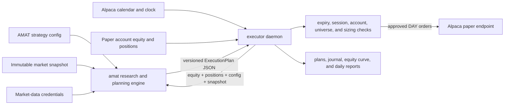

# AMAT Workspace

Research, planning, and Alpaca paper execution for the Adaptive Multi-Asset
Trend strategy.

This workspace contains two intentionally separate Python modules:

- [`amat/`](amat/README.md) researches, validates, backtests, and forms trading
  decisions. It cannot submit broker orders.
- [`executor/`](executor/README.md) schedules those decisions, reconciles them
  with an Alpaca paper account, submits approved orders, and reports measured
  paper performance.

> [!IMPORTANT]
> The separation is a safety boundary. AMAT owns the decision and its
> provenance; the executor owns the calendar, account, submission, and
> operational audit trail. The executor is **paper trading only**.

## Contents

- [Workspace layout](#workspace-layout)
- [Module responsibilities](#module-responsibilities)
- [How the modules work together](#how-the-modules-work-together)
- [The execution-plan contract](#the-execution-plan-contract)
- [Daily lifecycle](#daily-lifecycle)
- [Data and state ownership](#data-and-state-ownership)
- [Getting started](#getting-started)
- [Development workflow](#development-workflow)
- [Where to make a change](#where-to-make-a-change)
- [Safety boundaries](#safety-boundaries)
- [Module documentation](#module-documentation)

## Workspace layout

```text
amat-executor/
├── README.md              # this workspace-level guide
├── .gitignore             # shared ignore rules for both modules
├── amat/                  # research, data, strategy, simulation, and planning
│   ├── configs/           # data, experiment, news, and strategy configuration
│   ├── data/              # local market/news data and immutable snapshots
│   ├── docs/              # research methods, audits, and experiment records
│   ├── notebooks/         # reproducible analytical notebooks
│   ├── outputs/           # generated runs, reports, plans, and validation artifacts
│   ├── scripts/           # ingestion, audit, backtest, and experiment utilities
│   ├── src/amat/          # strategy and research engine
│   ├── src/deskreview/    # review/reporting interface over AMAT results
│   ├── src/newsdesk/      # isolated news ingestion and candidate discovery
│   └── tests/             # unit and integration coverage for research behavior
└── executor/              # Dockerized paper-account execution service
    ├── src/executor/      # scheduling, broker, plan parsing, submission, reporting
    ├── tests/             # safety, scheduler, plan, submission, and report tests
    ├── Dockerfile         # unprivileged Python 3.12 service image
    ├── docker-compose.yml # service, volumes, health check, and read-only AMAT mount
    └── state/             # local-only executor journal, plans, and reports
```

`amat/data/`, `amat/outputs/`, `executor/state/`, credentials, caches, and
rebuild backups are generated or operator-owned and are ignored by the root
`.gitignore`.

## Module responsibilities

| Concern | `amat` | `executor` |
|---|---|---|
| Market-data ingestion and validation | Owns | Does not implement |
| Immutable snapshots and data provenance | Owns | Reads the selected snapshot through the AMAT CLI |
| Feature, signal, regime, and risk logic | Owns | Does not reimplement |
| Backtests, simulations, stress tests, and research reports | Owns | Does not implement |
| Target weights and trade-intent formation | Owns | Consumes as JSON |
| Exchange clock, holidays, and half-days | Does not own | Reads from Alpaca |
| Current account equity and positions | Accepts as supplied plan inputs | Reads from Alpaca paper trading |
| Plan expiry and session preflight | Encodes in the plan | Validates before submission |
| Quantity compatibility and long-only clamping | Describes exact intent | Resolves broker precision/fractionability conservatively |
| Broker order submission | Prohibited | Owns, through one paper-only adapter |
| Execution journal and equity curve | Does not own | Owns |
| Daily paper-performance report and email | Does not own | Owns |

This prevents two dangerous forms of drift:

1. The executor cannot quietly use a different signal or sizing algorithm from
   the one that was backtested.
2. The research package cannot gradually acquire credentials or an endpoint
   capable of moving an account.

## How the modules work together



The dependency is deliberately a subprocess-and-artifact boundary:

1. The executor reads the paper account's equity and share quantities.
2. `executor.plan_source.build_plan` creates a temporary positions JSON file.
3. It runs the equivalent of:

   ```bash
   uv run --locked amat plan <strategy-config> \
     --snapshot <snapshot-directory> \
     --equity <paper-account-equity> \
     --positions <temporary-positions.json> \
     --json
   ```

4. The command runs with `amat/` as its working directory, allowing AMAT to
   resolve its own configuration, data, lockfile, and code provenance.
5. AMAT may extend the immutable snapshot with current market data, computes
   the strategy state, and prints an inert plan. It reaches no trading account.
6. The executor parses the artifact into its own `ExecutionPlan` type. It never
   imports the `amat` package or calls internal signal functions.
7. The executor archives the exact plan, performs its paper-account safety
   checks, and submits each approved intent through its Alpaca paper adapter.

In Docker, `executor/docker-compose.yml` makes this relationship concrete by
mounting `../amat` read-only at `/opt/amat`. Separate named volumes hold the
AMAT virtual environment and uv cache so the strategy checkout remains
read-only while the planning subprocess can still run efficiently.

## The execution-plan contract

The JSON plan is the integration API between the modules. It carries enough
information for the executor to act without knowing how the strategy reached
its decision.

Important plan fields include:

| Field | Why it crosses the boundary |
|---|---|
| `schema_version` | Lets the executor reject incompatible plan formats |
| `strategy_name` / `strategy_version` | Identifies the decision logic used |
| `config_sha256` | Binds the decision to the exact strategy configuration |
| `snapshot_id` / `appended_sessions` | Records the data foundation and any live extension |
| `code_revision` | Identifies the AMAT source revision when Git metadata is available |
| `as_of_session` | States the last session used to form the decision |
| `earliest_execution_session` | Prevents executing a close-derived signal too early |
| `expires_at` | Prevents stale signals from being traded later |
| `account_equity` / `current_positions` | Records the account state used for sizing |
| `target_weights` / `gross_target_exposure` | Describes the intended portfolio |
| `intents` | Lists symbols, sides, quantities, notionals, reference prices, and reasons |
| `unrecognized_holdings` | Forces full-plan refusal when account reconciliation is incomplete |
| `caveats` / `withheld` | Preserves limitations and intentionally omitted actions |

The artifact is a description of intent, not an order. Only the executor can
turn it into a broker request.

## Daily lifecycle

### Before and around the open

1. The executor asks Alpaca for the authoritative exchange calendar.
2. At `PLAN_LEAD_MINUTES` before the open, it reads paper account state.
3. It invokes `amat plan` using the configured strategy and snapshot.
4. AMAT forms a plan from completed information and returns the next executable
   session plus an expiry.
5. The executor archives and validates the plan.
6. In dry-run mode it journals what it would submit. Otherwise, it sends
   idempotently identified market DAY orders to Alpaca paper trading.
7. Late catch-up submissions are measured and surfaced in the daily report.

### After the close

1. The executor reads account equity, cash, positions, and that day's orders.
2. It appends at most one equity observation for the session.
3. It combines the archived AMAT plan with actual submission and fill results.
4. It computes measured paper returns, volatility, Sharpe, drawdown, exposure,
   and holdings while labeling short samples as not meaningful.
5. It writes Markdown and JSON reports, optionally emails the Markdown report,
   and prunes date-paired plans/reports outside the retention window.

## Data and state ownership

The two modules persist different kinds of evidence:

| Location | Owner | Contents | Lifecycle |
|---|---|---|---|
| `amat/data/` | AMAT | Raw/interim data, news database, immutable snapshots | Local evidence; never rewritten casually |
| `amat/outputs/` | AMAT | Backtests, experiments, plans, reports, validations, campaigns | Generated research artifacts |
| `executor/state/plans/` | Executor | Exact AMAT plan used for each paper session | Retention-window controlled |
| `executor/state/reports/` | Executor | Human and machine daily execution reports | Retention-window controlled |
| `executor/state/equity_curve.ndjson` | Executor | One account observation per trading session | Never pruned |
| `executor/state/journal.ndjson` | Executor | Append-only operational and order audit trail | Rotates at 32 MiB with one prior generation |
| Docker `executor-state` volume | Executor deployment | Authoritative container versions of all executor state | Survives image rebuilds/restarts |

The checked-out `executor/state/` directory is not the running container's
authoritative state when Docker Compose is in use; inspect the named volume
through `docker compose exec` instead.

## Getting started

### Prerequisites

- Git
- Python 3.12 or newer
- [`uv`](https://docs.astral.sh/uv/)
- Docker Engine and Docker Compose v2 for the paper executor
- Alpaca market-data credentials for online plan extension
- Separate Alpaca paper-trading credentials for the executor

### Clone and install

Replace `<workspace-repository-url>` with the GitHub group repository URL:

```bash
git clone <workspace-repository-url> amat-executor
cd amat-executor

cd amat
uv sync --locked

cd ../executor
uv sync --locked
cp .env.example .env
chmod 600 .env
```

Fill in `executor/.env`, select an existing snapshot under
`amat/data/snapshots/`, and keep `DRY_RUN=true` for initial validation.

### Validate the research module

From `amat/`:

```bash
uv run amat validate-config configs/strategy/amat_v6.toml
uv run pytest -q
uv run ruff check .
uv run mypy src
```

See [amat/README.md](amat/README.md) for ingestion, studies, simulations,
experiments, reports, and the full quality gate.

### Validate the executor integration

From `executor/`, after loading `.env`:

```bash
set -a
. ./.env
set +a

uv run executor check
uv run pytest -q
uv run ruff check .
uv run mypy src
```

`executor check` reads the paper account and builds a real plan but never
submits an order.

### Start the Dockerized executor

From `executor/`:

```bash
docker compose config --quiet
docker compose build executor
docker compose up -d executor
docker compose ps
docker compose logs -f executor
```

The relative read-only mount in `docker-compose.yml` requires `amat/` and
`executor/` to remain siblings under this workspace.

## Development workflow

Create branches from the workspace repository's default branch:

```bash
git switch main
git pull --ff-only origin main
git switch -c feat/short-description
```

Run the affected module's full quality gate. If a change touches the plan
schema, strategy planning, executor plan parsing, Docker integration, or shared
documentation, run both modules' tests before opening a pull request.

```bash
# From amat/
uv run ruff format --check .
uv run ruff check .
uv run mypy src
uv run pytest -q

# From executor/
uv run ruff format --check .
uv run ruff check .
uv run mypy src
uv run pytest -q
```

Never stage `.env`, `data/`, `outputs/`, `state/`, account captures, journal
files, or rebuild backups. The module README files contain the detailed GitHub
pull-request and operational-review guidance.

## Where to make a change

| Desired change | Primary module | Also review |
|---|---|---|
| Modify a signal, feature, regime rule, or portfolio constraint | `amat` | Backtests, validation, plan outputs |
| Add a strategy version or experiment | `amat` | Configs, experiment registry, reports |
| Change snapshot ingestion or corporate-action handling | `amat` | Data manifests and integrity tests |
| Change the plan JSON schema | `amat` and `executor` | AMAT emitter, executor parser, integration tests, both READMEs |
| Change plan timing, earliest session, or expiry | `amat` | Executor preflight and scheduler tests |
| Change scheduler windows or missed-phase recovery | `executor` | Daemon tests and operator documentation |
| Change broker transport or order payloads | `executor` | Boundary and submission tests; paper-only invariant |
| Change quantity rounding or long-only behavior | `executor` | Plan assumptions and submission tests |
| Change daily execution metrics or email reports | `executor` | Equity-curve compatibility and report tests |
| Change Docker mounts, volumes, or rebuild behavior | `executor` | Workspace sibling layout and recovery documentation |

## Safety boundaries

- AMAT contains no order-submission endpoint and must remain backtest/planning
  only.
- The executor does not import AMAT; it consumes only a versioned JSON plan.
- The AMAT checkout is mounted read-only inside the executor container.
- The executor's broker hostname is a non-configurable Alpaca paper constant.
- Order POST requests are never blindly retried after an ambiguous timeout.
- Expired or too-early plans, blocked accounts, and unrecognized holdings fail
  closed.
- Deterministic client order IDs make repeated execution of the same intent
  idempotent at the broker.
- Secrets remain in local environment files that are excluded by the shared
  `.gitignore`.

## Module documentation

- [AMAT research and backtesting guide](amat/README.md)
- [Executor setup, file guide, live metrics, operations, and contribution guide](executor/README.md)
- [Executor boundary specification maintained by AMAT](amat/docs/execution-repo.md)
- [AMAT market-data and simulation guide](amat/docs/market-data-and-simulation.md)
- [AMAT strategy guide](amat/docs/strategy-guide.md)

Both Python projects are marked proprietary in their `pyproject.toml` files.
Do not redistribute the workspace unless the GitHub group supplies a separate
license or policy.
