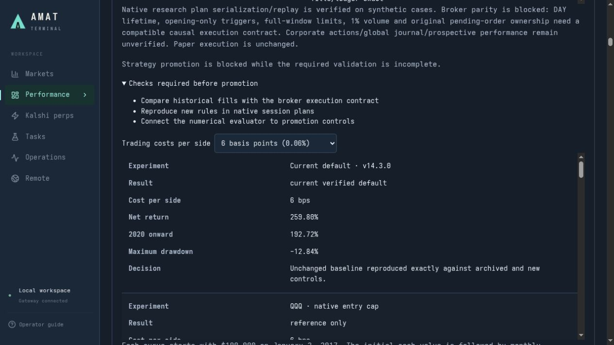
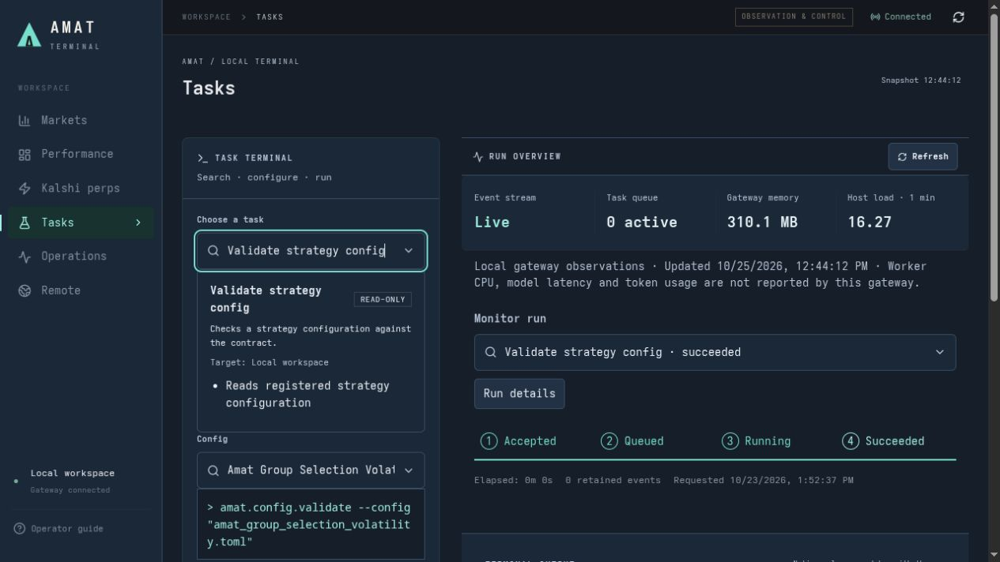
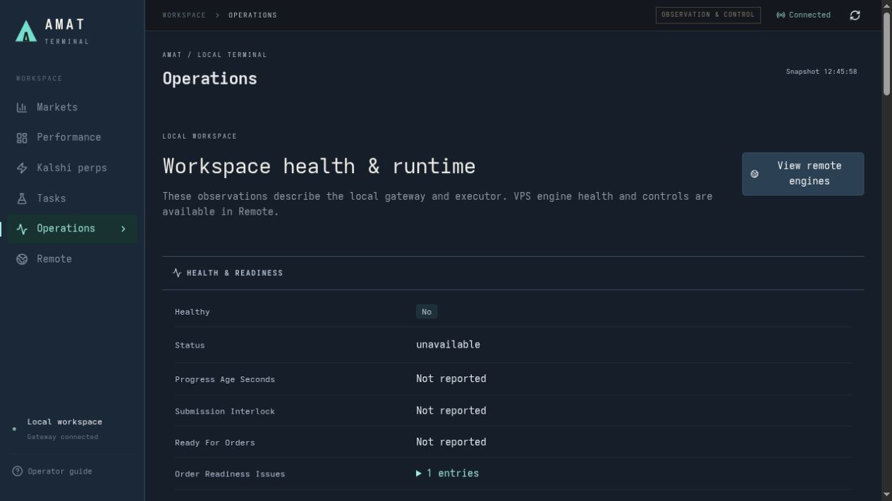

# AMAT — Adaptive Multi-Asset Trend


AMAT is a research and paper-trading workspace for developing systematic strategies, replaying them against recorded data, and observing separate execution engines from a local terminal. It combines reproducible multi-asset research, bounded model-assisted experiments, an Alpaca executor, a Kalshi perpetual paper engine, and a React/FastAPI workstation.

Research produces signals, plans and evidence. Execution components own accounts, order admission, reconciliation and durable receipts. Historical research results and forward paper experiments are evidence to inspect; they do not establish live qualification or expected returns.

## Table of contents

- [UI screenshots](#ui-screenshots)
- [Current retained strategy and measured statistics](#current-retained-strategy-and-measured-statistics)
- [How the strategy works](#how-the-strategy-works)
- [Project sources and chat-history provenance](docs/project-sources.md)

- [System design and component boundaries](docs/architecture.md)
- [Installation and first local run](docs/installation.md)
- [Configuration and your own API keys](docs/configuration.md)
- [Private remote-server and SSH configuration](docs/remote-configuration.md)
- [Strategy API, execution plans and extensions](docs/strategy-api.md)
- [Local HTTP API and task contracts](docs/http-api.md)
- [Research engine and supporting packages](docs/components/research.md)
- [Alpaca executor](docs/components/executor.md)
- [Kalshi perpetual engine and trade alerts](docs/components/kalshi-perps.md)
- [Terminal, workers and remote helpers](docs/components/terminal.md)
- [Data, evidence and reproducibility](docs/data-and-evidence.md)
- [Operations, backup and release](docs/operations.md)
- [Testing and verification](docs/testing.md)
- [Contributing](CONTRIBUTING.md)
- [Security and credential handling](SECURITY.md)
- [Preparing a GitHub upload](docs/github-publication.md)
- [Troubleshooting](docs/troubleshooting.md)
- [Preparation verification and known baseline failures](docs/publication-verification-2026-10-25.md)
- [Documentation status and historical references](docs/README.md)
- [Change history](CHANGES.md)

## UI screenshots

Actual screenshots of the local terminal, captured October 25, 2026. These are the implemented UI, rather than generated mockups. Screens show dated observations and retained job/research results; they do not imply a fresh strategy validation, order or deployment.

**Performance — retained v14.3.0 baseline, explicit costs and promotion requirements.**



**Tasks — searchable registered capabilities, typed inputs, inline effects preview and run monitoring.** The selected configuration validation was previewed for this capture; the succeeded monitor entry is an older retained run.



**Operations — local health/readiness kept separate from remote engine observations.** The screenshot honestly shows local executor data as unavailable; it is not a remote-health certificate.



See [asset provenance](docs/assets/README.md) for capture details and the generated repository logo.

## Current retained strategy and measured statistics

The retained equity strategy is **v14.3.0: all groups with volatility-triggered, cost-aware switching**, configured in [the strategy TOML](amat/configs/strategy/amat_group_selection_volatility.toml). “Current best” means the retained incumbent under this project's acceptance rules. It does not mean the highest isolated backtest return, a global optimum, or live qualification. The latest completed campaign tested five hypotheses and ten candidate variants; all ten were rejected and no promotion occurred. [Sources S1–S2](docs/project-sources.md#s1--retained-equity-strategy-and-campaign-results).

**Historical simulation: January 3, 2017–October 12, 2026, with 2016 signal warm-up and $100,000 starting cash.** Returns are cumulative after the stated assumed cost **per side**. Drawdowns below are positive loss magnitudes. The 2020-onward slice continues the same account and uses previously inspected history; it is not a new untouched holdout.

| Assumed cost per side | AMAT full-period net return | AMAT 2020-onward return | AMAT maximum drawdown | Native QQQ full-period return | Native QQQ maximum drawdown |
| --- | ---: | ---: | ---: | ---: | ---: |
| 2 bps (0.02%) | **296.39%** | 211.89% | 12.59% | 555.07% | 34.75% |
| 6 bps (0.06%) | **259.80%** | 192.72% | 12.84% | 555.08% | 34.75% |
| 10 bps (0.10%) | **221.88%** | 177.60% | 12.98% | 555.04% | 34.75% |

At the middle 6 bps assumption, the recorded account has **1,929 fills**, **2,868 missed instructions**, **86.26% average exposure**, and **$24,604.44 modeled fees**. A missed instruction can reflect cash, rounding or historical liquidity rules; it is not automatically a broker incident. These figures come from the [October 23–24 final campaign report](amat/docs/research-2026-10-24-adaptive-campaign-final.md) and [publication summary](docs/strategy-performance.md).

AMAT's historical drawdown was substantially lower than QQQ's, while its cumulative growth was substantially lower too. QQQ is a concentrated reference with a different risk/exposure profile, not a matched-risk strategy or an admissible diversified candidate. The separate idealized fractional QQQ total-return reference returned 569.18% at 6 bps; it is not the native executable benchmark. Broker spread/slippage and actual execution costs were not measured by these modeled assumptions. Historical VWAP fills do not prove parity with staged broker limit orders. [Measurement and limitations](docs/strategy-performance.md).

## How the strategy works

1. **Observe completed data.** Use adjusted historical prices for causal signals, preserve explicit dividends/splits, and keep raw prices for valuation/fills. The daily strategy requires a full signal warm-up; it never substitutes a future or incomplete bar.
2. **Measure trend and risk.** Combine 63-, 126- and 252-session trend horizons; require positive eligibility and at least two agreeing horizons. Estimate volatility and covariance from trailing data.
3. **Rank groups and assets.** Cover eleven ETFs across US/international equities, rates, metals, commodities and the US dollar: SPY, QQQ, IWM, EFA, EEM, IEF, GLD, SLV, DBC, USO and UUP. The retained configuration enables group selection, at most three active groups and four selected positions.
4. **Avoid uneconomic discretionary switches.** The volatility gate activates when trailing 20-session annualized volatility exceeds 25%, or fast volatility exceeds 1.5 times trailing 60-session volatility. When active, a within-group replacement must clear the fixed projected-edge versus round-trip-cost hurdle. Invalid/excluded incumbents still exit; this gate does not force permanent holdings.
5. **Build bounded long-or-cash targets.** Apply the configured symbol/cluster caps, 100% gross ceiling and 20% volatility target without releveraging after clipping. Positive unused cash remains cash. Equity sells reduce backed long holdings; they do not create direct shorts.
6. **Plan before execution.** Form inert, dated intents from the completed signal session. Native historical research uses observed next-session 09:30–09:35 New York VWAP, whole-share purchases, explicit costs, a 1% opening-volume entry cap and recorded misses. The separate executor rechecks identity, timing, account safety, available cash, ownership and receipts before any broker action.

The switching edge is a fixed opportunity proxy, not a calibrated return forecast. An optional model may propose research candidates; it does not replace this deterministic incumbent or gain order authority. Kalshi's DOGE/SOL paper policy is a separate source-pinned perpetual experiment with its own history, fills, fees and funding. See [the full strategy explanation and evidence](docs/strategy-performance.md), [strategy API](docs/strategy-api.md), and [architecture](docs/architecture.md).

## Repository map

| Directory | Responsibility | Detailed documentation |
| --- | --- | --- |
| `amat/` | Strategy computation, historical simulation, validation, research and immutable evidence | [Research component](docs/components/research.md), [existing AMAT guide](amat/README.md) |
| `executor/` | Alpaca account checks, order safety, scheduling, reconciliation and receipts | [Executor component](docs/components/executor.md), [native guide](executor/README.md) |
| `kalshi-perps/` | Persistent perpetual paper accounts, source-pinned strategy adapter, native books/funding, alerts | [Kalshi component](docs/components/kalshi-perps.md), [native guide](kalshi-perps/README.md) |
| `frontend/` | Loopback UI/API, registered task adapters, independent workers, cached remote diagnostics | [Terminal component](docs/components/terminal.md), [native guide](frontend/README.md) |
| `docs/` | Current cross-system guides and dated design contracts | [Documentation index](docs/README.md) |
| `scripts/` | Repository publication checks | [Publication guide](docs/github-publication.md) |
| `operations/` | Private local deployment/repair evidence; excluded from upload | [Operations guide](docs/operations.md) |

## Quick start

Use Python 3.12 or newer, `uv`, and Node.js 22 LTS with npm. Run from the repository root:

```sh
uv sync --project amat --locked
uv sync --project executor --locked --extra remote
uv sync --project kalshi-perps --locked
uv sync --project frontend --locked
npm ci --prefix frontend/web
uv run --project amat amat --help
frontend/.venv/bin/python frontend/scripts/doctor.py
frontend/.venv/bin/python frontend/scripts/start.py
```

Open [the local terminal](http://127.0.0.1:5173). The API listens on `127.0.0.1:8765`. This installs dependencies and starts the workstation; it does not provision a VPS, restore research datasets, or start the trading daemons. Provider-backed actions require your own credentials and data. Review [installation](docs/installation.md) before running engines or research campaigns.

For the built UI:

```sh
npm run build --prefix frontend/web
frontend/.venv/bin/python frontend/scripts/start.py --production
```

Open [the built terminal](http://127.0.0.1:8765). Keep both UI and gateway on the local workstation. Remote observations use explicitly configured, pinned SSH access. All connection identity fields are required in an ignored private file; there is no embedded server/key fallback. See [private remote configuration](docs/remote-configuration.md).

## Current operating boundaries

The approved remote application inventory is `amat-executor`, `kalshi-perps`, and `kalshi-perps-trade-alerts`. The optional shadow experiment is retired; preserve its account volume, protocol and results. Alerts watch the main paper account. Optional demo/live code and historical comparison workflows exist, but are separate from this approved deployment.

Automatic remote health checks run during the local API lifecycle, independently of browser visibility. Monitoring is read-only. Native watchdogs, backups and paper-session evidence collection have their own lifecycles. Missing or stale observations remain labeled unknown or stale.

The checked-in daily strategy default is configured by `amat/configs/strategy/amat_group_selection_volatility.toml`. Kalshi's default paper profile is configured separately in `kalshi-perps/configs/paper.toml`. Defaults are explicit research or paper configurations, not claims of profitable performance. Read dated study reports for the exact costs, periods and failed candidates.

## Before uploading

```sh
python scripts/check_publication.py
python scripts/check_publication.py --history
```

Review [the publication procedure](docs/github-publication.md), including staged-content checks and the retained proprietary license status. Keep local credentials, runtime databases, backups, research datasets and generated evidence out of commits. Lockfiles, source, tests, blank templates and maintained documentation belong in Git. This repository has no root license granting redistribution; publishing to GitHub does not itself change that status.
