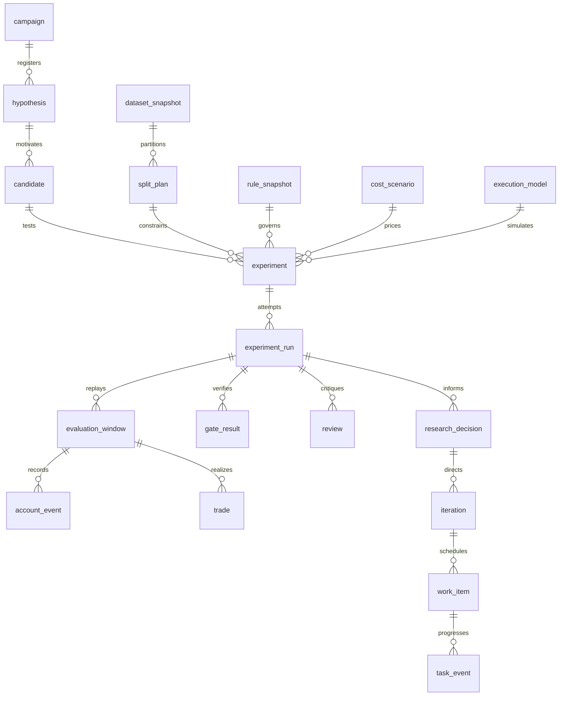

# Funded trading autoresearch data schema — 1.0.0

This specification defines the durable data contract for a funded-futures
research loop. Its objective is to learn efficiently whether a strategy can
reach a frozen account target under actual constraints, preserve every trial,
and direct the next experiment toward the most useful unresolved question.
Failure to support the target is a valid research outcome.

The executable control-plane schema is
[`funded_research_v1.sql`](../schemas/funded_research_v1.sql). The canonical
market/feature record contract is
[`funded_market_records_v1.schema.json`](../schemas/funded_market_records_v1.schema.json).
The SQL column declarations, checks and foreign keys are authoritative; this
document defines their semantics and application-level invariants.

The generated [column dictionary](../schemas/funded_research_v1.dictionary.json)
lists every table/column, SQLite type, required/default/primary-key status,
foreign key and CREATE statement, bound to the exact DDL hash.

**Scope:** research, forward shadow observation and alerts. Simulated orders
are evidence, not executable broker instructions. No account purchase, payment,
bank credentials or autonomous Apex execution belongs in this schema.

## 1. Physical layout and shared types

Use SQLite for research metadata, lineage, task events and bounded ledgers.
Use immutable Parquet/Arrow files for large market, feature, signal and account
paths. JSON is for small configurations, manifests, proposals and reviews.
The `artifact` catalog binds all external bytes to SHA-256 digests.

```text
campaigns/<campaign-id>/
  research.sqlite3                 # new schema; not the current legacy ledger
  artifacts/<sha256>/...            # immutable documents/configs/results
  data/<dataset-id>/<contract>/<session>/<kind>.parquet
  features/<dependency-hash>/...
  runs/<run-id>/manifest.json
  runs/<run-id>/windows.parquet
  runs/<run-id>/account-events.parquet
  runs/<run-id>/orders-fills-trades.parquet
  reports/<artifact-hash>.md
```

| Type/convention | Definition |
|---|---|
| `id` | Stable opaque text, preferably a prefixed UUID. Never a mutable label. |
| `*_sha256` | Lowercase SHA-256 of exact artifact bytes or canonical dependency manifest. SQL enforces length; application validates hex and recomputes it. |
| `*_at_ns`, `*_ns` timestamps | Signed 64-bit Unix nanoseconds in UTC. IANA timezone stored separately for local-session rules. Never host-local naive time. |
| Durations | Integer nanoseconds except fields explicitly named `seconds` or calendar days. |
| `*_usd_micros` | Signed integer millionths of USD. $50,000 = 50,000,000,000. Use Decimal at input boundaries; never binary-float money. |
| Price ticks | Signed integer multiples of the instrument's rational tick size. For MNQ, 80,000 ticks = 20,000 index points. |
| Contract counts | Integer contracts; mini equivalence belongs to the account rule snapshot. No fractional futures. |
| Dates | ISO `YYYY-MM-DD`, trading date determined by the frozen calendar, not the timestamp's UTC date. |
| JSON | UTF-8, finite numeric values only, explicit schema/version where stored as an artifact. JSON columns hold documented extension payloads, not hidden core fields. |
| Unknown value | SQL/JSON null plus an explicit status. Zero is a measured zero, never a placeholder for unknown cost or usage. |
| Time intervals | Half-open `[start,end)` unless explicitly described as an inclusive local trading date. |

All referenced artifacts must resolve, match hashes and be readable under the
run's access policy. Credentials never enter tables, manifests, prompts or
reports. Environment-variable names may be recorded; secret values may not.

## 2. Entity relationships



Every experiment resolves a complete dependency graph before execution. A
parent candidate is lineage, not evidence that its costs, splits or fills are
comparable to the child.

## 3. Research intent and account rules

| Entity | Purpose and required semantics |
|---|---|
| `schema_version` | Installed contract version, installation time and DDL digest. Application inserts the actual digest; the DDL does not invent one. |
| `campaign` | Frozen objective artifact, initial equity, target profit, calendar-day horizon, execution scope, maximum trials and stopping policy. `created_by` records human or authorized system identity. |
| `source_document` | Snapshot of an authoritative page or paper: URL, publisher, retrieval/effective times, archived artifact and authority class. A URL alone is not frozen evidence. |
| `rule_snapshot` | Exact firm/product/platform/stage rules effective during a run. Includes drawdown amount/mode/cap, daily limit, contract equivalence, flatten deadline/timezone, automation policy, payout, inactivity, scaling and exceptions. |

Do not use one generic “Apex $50K” rule object for all products. EOD versus
intraday, Evaluation versus Performance, and platform-specific trail caps
require distinct snapshots. `daily_loss_usd_micros=null` means no firm daily
limit when the authoritative rules establish that; an unknown limit must be
identified as an unresolved blocker in the snapshot's artifact and quality
gate. Internal daily controls belong in the execution/risk policy, not in firm
rules. Unknown automation policy blocks any operational progression.

The objective artifact contains:

```json
{
  "schema_version": "1.0.0",
  "objective": "net_evaluation_profit_within_calendar_horizon",
  "currency": "USD",
  "initial_balance_usd_micros": 50000000000,
  "target_profit_usd_micros": 3000000000,
  "horizon_calendar_days": 30,
  "secondary_objectives": ["survival", "net_rewards_after_program_costs", "research_information_per_compute_second"],
  "never_relax_to_pass": ["profit_target", "drawdown_rules", "execution_costs", "holdout_boundaries"],
  "execution_scope": "research"
}
```

These numbers describe the existing campaign intent, not a reusable assumption
about all firms. Review and freeze current primary sources when starting a new
campaign. No live rule lookup occurs inside a frozen historical simulation.

## 4. Instruments, calendars and data provenance

| Entity | Purpose and semantics |
|---|---|
| `instrument` | Root symbol/exchange, rational tick size and tick cash value, sourced specification and hash. Example MNQ: numerator 1, denominator 4, tick value 500,000 USD micros. |
| `contract` | Specific expiry and exchange/vendor identity, first/last trade timestamps, expiry date and definition evidence. Never substitute root symbol for expiry identity. |
| `calendar_snapshot` | Frozen session calendar, timezone, date coverage and provenance quality. A cash-equity reference is explicitly `proxy`. |
| `session` | Trading date, open/close, full/early/holiday/halt classification and session segments. `segments_json` specifies RTH/ETH/break intervals with UTC timestamps. |
| `dataset_snapshot` | Provider, acquisition time, coverage, timestamp semantics, raw/adjusted/proxy classification, contract-identity quality, license reference and promotion eligibility. |
| `dataset_partition` | External data artifact by dataset, contract/session where known, kind/resolution, row count and coverage. Verified futures bars require contract IDs. |
| `roll_assignment` | Contract selected for a session, frozen selection policy, selection time and latest input availability. Historical same-day volume cannot choose a contract before that volume exists. |
| `data_quality_check` | Named check, observed/expected payloads, pass/fail/unknown, severity, checker code hash and evidence. Preserve failed checks. |

Required quality checks: identity, tick compatibility, duplicate events,
chronological ordering, OHLC consistency, nonnegative volume, expected-session
coverage, daylight-saving boundaries, expiration/roll continuity, timestamp
availability semantics, quote spread/staleness and source reconciliation.
Unknown provenance does not become verified because checksums match.

### Canonical high-volume records

The JSON Schema defines the complete field sets for these rows; equivalent
Parquet types are integer `int64`, string/dictionary enums and nullable `float64`
where appropriate.

| Record | Grain/key | Content and cross-field invariants |
|---|---|---|
| `bar` | Partition + contract + start time | Contract/session IDs; start/end/available timestamps; OHLC in integer ticks; volume in contracts; nullable trade count; quality. Require `start < end <= available`, `low <= open,close <= high`; unique key. Null identity only for unverified exploration. |
| `bbo` | Partition + contract + event time + sequence | Exchange/received timestamps; bid/ask ticks and sizes; quality. Require `bid <= ask`; received time, if measured, cannot precede event time. No invented receipt time on historical exports. |
| `feature` | Definition + input partition + contract + decision time | Latest input availability, feature availability, scalar value/unit/status. Require `max_input_available <= available <= decision`. Measured values must be finite/non-null; warmup/missing/invalid values are null. |

For bars, changing the assumed availability from bar start to bar end changes
the dataset identity. Partial bars are never available at the beginning of the
bar unless a distinct streaming feature explicitly models that information.

## 5. Splits, contamination and reusable computation

| Entity | Purpose and semantics |
|---|---|
| `split_plan` | Frozen dataset partitioning, purge/embargo durations, exposure status and maximum final-holdout queries. |
| `split_segment` | Fold number, train/validation/holdout/forward/exploratory role, half-open UTC interval. |
| `data_exposure` | Append-only record of who viewed a segment, when and why, with the viewed output artifact. Model review of holdout metrics counts as exposure. |
| `feature_definition` | Feature code, parameters, lookback, availability lag and causal-test evidence. |
| `feature_partition` | Feature result linked to exact definition/input partition/dependency digest. |
| `cache_entry` | Exact dependency manifest, result artifact, producer, creation and optional expiry. A cache hit never counts as a new independent statistical sample. |

The application must reject same-fold overlapping train/validation/holdout
intervals, apply purge/embargo across label horizons, and log holdout access
before materializing its results. Previously inspected dates cannot be
relabeled unseen in a new campaign. Exposure history should be checked across
campaigns by dataset/content hashes, not just IDs.

Simulation cache key:

```text
SHA256(canonical_json({
  schema_version, candidate_spec_hash, candidate_code_hash,
  data_partition_hashes, contract_definition_hashes, roll_policy_hash,
  calendar_hash, split_hash, rule_snapshot_hash, cost_scenario_hash,
  execution_model_hash, engine_hash, environment_hash, seed
}))
```

Feature keys omit candidate/rule dependencies only when the feature genuinely
does not depend on them. Signal keys add feature/strategy inputs. Statistical
keys include all source results, resampling procedure, dependence definition,
trial-family size and seed. Model-advice keys additionally include model/prompt/
output-schema versions and evidence hashes; cached advice cannot pass a gate.

## 6. Hypotheses, candidates and experiments

| Entity | Purpose and semantics |
|---|---|
| `hypothesis` | Mechanism, expected effect, explicit falsification, supporting evidence, parent and registration time. Optional information gain/compute estimates drive prioritization, not acceptance. |
| `candidate` | Immutable implementation/specification, hypothesis and parent, parameter count and complexity. Hash includes parameters and code identity. |
| `candidate_change` | Ordered field-level before/after JSON patch and rationale. Every child must reconcile its patches to its parent. |
| `cost_scenario` | Per-contract-side commission, spread/impact ticks, gap policy, measured/assumed provenance, calibration/effective time and whether exchange fees are included. |
| `execution_model` | Decision/fill clocks, latency, fill basis, intrabar ambiguity policy, missing-data policy and internal risk controls. |
| `experiment` | Candidate + split + rules + costs + execution + baseline + seed, purpose, registered trial number and complete dependency hash. |
| `experiment_run` | Operational attempt with worker, timestamps, environment/engine identity, status, resource usage, result and sanitized error. Retries are attempts of the same trial, not new hypotheses. |

Candidate specification artifacts must contain: instrument universe, causal
features and lookbacks, signal expression/version, entry/exit rules, stop
initialization/update rules, sizing formula, max entries/positions, cooldown,
time restrictions, parameters and allowed bounds. Keep executable arbitrary
model-generated code outside the contract until explicitly reviewed and tested.

`risk_policy_json` requires planned risk per trade, internal daily loss control,
remaining-floor reserve, max contracts, max entries, one-way exposure policy,
position aggregation, gap assumptions and kill/abstention conditions. Explicitly
distinguish money at risk from notional account balance.

Costs must state whether bid/ask displacement is already incorporated in fill
prices. Do not subtract spread/slippage twice. `spread_ticks` defines the full
spread; fill displacement is half-spread plus modeled impact, unless the
execution artifact explicitly specifies a measured alternative. Scenario
numbers are frozen independently of strategy tuning.

## 7. Evaluation windows and execution evidence

| Entity | Grain and semantics |
|---|---|
| `evaluation_window` | Fresh account for one start/deadline/run/fold, outcome, end equity/net P&L, eligible/observed/missing sessions, trade count, dependence group and path evidence. |
| `account_event` | Ordered reset/mark/floor/daily-pause/risk-exhaustion/breach/target/expiry/fee/reward event, cash/unrealized/equity/peak/floor/capacity and daily P&L. |
| `simulated_order` | Contract, causal signal/decision/submission times, side, integer quantity, type, reference/stop ticks, risk budget and idempotency key. |
| `simulated_fill` | Order, execution time, quantity/tick price, commission, reference slippage and fill-model evidence. Supports partial fills. |
| `trade` | Entry/exit orders, contract, direction/size, times, gross/fee/net cash P&L, positive-magnitude MAE/MFE and exit reason. |

Window semantics:

- Independent starting account state for every window. No profit/capacity
  inherited from earlier windows; no free reset inside a window.
- Deadline uses calendar days and the explicit account opening convention.
- `passed` requires target evidence and no earlier breach; `failed` requires
  breach evidence; `expired` requires observed full horizon without passing;
  `incomplete` is truncated coverage; `invalid` is unusable evidence.
- Missing sessions follow the registered policy. Abstention does not certify
  what would have happened on missing data.
- Overlapping windows share a `dependence_group`; counts are not independent
  pass probability observations.
- EOD floor changes on its registered clock; intraday peak includes unrealized
  equity. Both can enforce liquidation intraday. Stage/platform cap differs.
- Touch-versus-cross thresholds, fee treatment, first-session handling and
  target recognition are explicit in rule/execution artifacts.
- `risk_exhausted` differs from breach, expiry, no signal, warmup and missing
  data. A stalled account must not appear successful merely because it avoided
  crossing the floor.

Use `account_event.payload_json` for abstention reason counts if no order is
created: `no_signal`, `unaffordable_contract`, `risk_buffer`, `daily_pause`,
`missing_data`, `warmup`, `policy_filter`, `outside_session`. Detailed signal
traces belong in external artifacts. Actual and simulated fills must never
share an unlabeled table.

Required accounting reconciliations: fills sum to order quantities; inventory
conserves signed fills; closed trades reconcile to the cash ledger; net trade
P&L equals gross minus fees; account equity equals cash plus unrealized P&L;
capacity equals equity minus floor. Slippage embedded in execution prices is
already in gross P&L. Validate rounding at each currency/tick boundary.

## 8. Metrics, uncertainty and decisions

| Entity | Purpose |
|---|---|
| `metric` | Explicit name, unit, definition, scope, measured/undefined/missing status and optional numerator/denominator. May apply to run or individual window. |
| `statistical_test` | Source metric, method/protocol, dependence unit, raw/effective observations, trial-family count, p-values/interval/confidence, seed and validity status. |
| `paired_comparison` | Candidate/control runs, matching-session manifest, difference, unit and matched/confounded/incomparable classification. |
| `gate_result` | Versioned policy, measured values, frozen threshold, outcome/explanation and evidence. Model prose is not a deterministic gate. |
| `review` | Deterministic/model/human critique with support/reject/inconclusive/unavailable verdict. A model review links to its actual attempt. |
| `research_decision` | Reject/retain/replicate/refine/ablate/request-data/shadow/stop, evidence, identity/time and optional next hypothesis. No live-trade action exists. |
| `iteration` | Parent, prior decision, incumbent, registered plan and ordinal. Preserves why the next experiment was chosen. |

Minimum metric catalog:

| Metric family | Required examples |
|---|---|
| Objective | passed/failed/expired/invalid/incomplete counts, full-window denominator, dependence-adjusted interval or explicit diagnostic label, time to target |
| Economics | net P&L, evaluation/activation/reset/data/platform cost, gross rewards, expected net rewards, minimum reward-eligible balance |
| Risk | worst intraday equity drawdown, EOD drawdown, floor capacity, risk-exhaustion days, loss streak, adverse gap loss |
| Trading | trades, contract exposure, gross/net expectancy, win rate, profit factor, turnover, commission, spread/impact attribution, MAE/MFE |
| Feasibility | affordable-signal fraction, zero-contract count, missed signals, latency, fill rate, data exclusions |
| Stability | fold/year/regime results, worst-fold expectancy, cost/latency sensitivity, parameter-neighbor stability |
| Research efficiency | wall/CPU seconds, peak bytes, tokens, known/unknown USD cost, cache hits, useful information gain, rejected-trial count |

For expected net rewards, specify the population, horizon, reward rules and
all costs. A zero observed reward from an expired simulation differs from a
missing funded-stage model. Drawdown distinguishes intraday path marks from
daily-close estimates. Sharpe specifies sample clock, risk-free assumption,
annualization and inactive-day treatment. Undefined profit factor or Sharpe is
null, not zero or infinity.

Required gates: `data_provenance`, `causality`, `execution`, `out_of_sample`,
`statistics`, `economics`, `manual_policy`. Thresholds are registered policy
artifacts, not invented by a reviewer after seeing results. `blocked` is not
`pass`. Verified data and passing gates permit only a shadow research decision,
never autonomous execution.

## 9. GPT-6 tasks, budgets and iterative learning

| Entity | Purpose |
|---|---|
| `model_task` | One hypothesis/design/code/failure/selection review, requested GPT-6 model, reasoning, input/schema artifacts, output/time limits and request digest. |
| `model_attempt` | Actual requested/served model, terminal result, tokens, billed amount/pricing source, retry time and sanitized error/output. One attempt cannot masquerade as successful review after HTTP 429. |
| `resource_budget` | Campaign/category/time interval limit for tokens, compute seconds, USD micros, trials or holdout queries. |
| `budget_reservation` | Atomic capacity reservation before a task with idempotent task reference. |
| `budget_settlement` | Measured usage, explicit release, or unknown usage. Unknown keeps the reservation charged. Overshoot is recorded honestly and blocks later work; never truncate measured usage to the limit. |
| `failure` | Categorized fingerprint, safe code/diagnosis, retryability/time and evidence. Strategy failure is different from data/provider/operational failure. |

GPT-6 reviews receive compact evidence manifests and registered objectives,
not credentials or unrestricted filesystem contents. Required review artifact
fields: verdict, blockers, cited evidence IDs, proposed hypotheses, expected
mechanisms, falsification tests, alternative explanations, and suggested next
experiments. Record prompt/output-schema hashes and requested versus actually
served model. No fallback to a weaker model without explicit recorded policy.

Each iteration's plan artifact contains:

```json
{
  "schema_version": "1.0.0",
  "question": "Does a pullback entry improve affordable net expectancy?",
  "parent_decision_id": "decision_example",
  "allowed_changes": ["entry_rule"],
  "frozen_controls": ["account_rules", "costs", "split_plan", "risk_budget"],
  "control_candidate_id": "candidate_control",
  "planned_ablation": true,
  "ranking": {
    "expected_information_gain": 0.6,
    "estimated_compute_seconds": 120,
    "estimated_usd_micros": null,
    "priority_reason": "Contract affordability is the largest unresolved blocker"
  },
  "stop_conditions": ["budget_exhausted", "data_invalid", "registered_trial_limit"]
}
```

The numbers are estimates, not observed benefits. When cost is unknown,
prioritization must not treat it as free. Prefer eliminating an uncertain data
assumption or testing a single mechanism to a wide parameter sweep.

## 10. Scheduling, efficiency and recovery

`work_item` records one ingestion/validation/feature/simulation/statistics/model/
report task with dependency manifest, global idempotency key, priority and
resource estimates. `task_event` is its append-only state/lease history.
`latest_task_state` is the materialized logical state; `budget_usage` exposes
conservative charges. Claim tasks using a single write transaction and compare
the latest sequence/lease before appending a new lease.

Recovery rules:

1. Validate dependencies/hashes, then reserve all relevant budgets atomically.
2. Look up the exact cache key before computing. Confirm result bytes and
   evidence quality; a file's existence is not a verified cache hit.
3. Persist running attempt and lease before work. Heartbeat long tasks.
4. Write artifacts to temporary paths, hash, atomically rename, then commit
   result references and terminal state. A terminal run cannot be edited.
5. On interruption, preserve the attempt/reservation. Resume as a new attempt
   under the same experiment, not by erasing the failure or resetting its seed.
6. Retry provider/transport failures only according to recorded backoff and
   budgets. Do not retry deterministic invalid data or failed strategy criteria.
7. Reuse feature partitions across candidates and rules when dependencies
   permit; account paths must be replayed when floor/risk rules change.

Useful indexes in the DDL cover campaign trials, running attempts, window
outcomes, account paths, contamination checks, repeated failures and model
costs. High-volume paths should normally live in partitioned Parquet, with the
SQL tables serving as queryable detailed evidence when desired.

## 11. Enforcement boundaries

**Enforced by SQL:** foreign-key existence, core enums/ranges, integer account
arithmetic, canonical trial numbering/bounds, experiment campaign consistency,
one running attempt, exact experiment deduplication, budget reservation limits,
fill-after-decision causality, immutable definitions/evidence, terminal-run
sealing, and the named prerequisites for a shadow decision.

**Enforced by the ingestion/transaction service:** artifact hashes/hex/URI
resolution; finite IEEE values in REAL columns; real dates and timezones;
full cross-campaign lineage integrity; contract/instrument matching; interval
overlap/purge/embargo; actual holdout-query budget; nondecreasing event time and
floor; complete fill/inventory/P&L reconciliation; sealed-run/result alignment;
all gate-policy requirements; source authenticity and license; atomic task
leases and budget settlements. JSON Schema enforces row shapes/types, not
cross-field inequalities or external references.

Appending a newer passing gate must not erase an earlier failure. Create a new
run or revised experiment with new evidence. Administrative artifact retention
or legally required deletion needs an explicit audited maintenance procedure;
normal worker code cannot delete records. Research storage is not an access
control boundary against a database administrator.

## 12. Mapping the current MNQ workflow

| Current artifact | Destination |
|---|---|
| `protocol.json` | campaign/objective, rule/cost/execution definitions, registered candidate experiments |
| `protocol.sha256` | objective/config artifact verification |
| `data-manifest.json` | dataset snapshot/partitions, source document and provenance checks |
| `mnq-sample.csv` | immutable source artifact plus normalized market partitions; missing contract ID remains explicit |
| `data-audit.json` | named quality checks and calendar/session evidence |
| `run-provenance.json` | experiment run + environment/code/input artifacts |
| `results.json` | run artifact, evaluation windows, metric records; keep individual outcomes and dependence groups |
| `gpt6-review.json` | task/attempt/review or unavailable-provider failure |
| Existing `research.sqlite3` | import legacy call metadata with a migration manifest; never apply this DDL directly to it |
| `REPORT.md` | generated report artifact referencing evidence IDs |

Legacy results do not contain complete fills, account paths or expiry IDs.
Import those fields as missing evidence, not reconstructed facts. The public
MNQ sample remains unverified/promotion-ineligible even when its basic OHLCV
checks pass. This schema defines the next storage contract; it does not claim
the current runner already writes all these entities.

## 13. Acceptance checklist for an implementation

- New database installs the DDL with foreign keys enabled on every connection.
- Hash and row-schema tests reject altered inputs, duplicates and unknown enums.
- $50K and $3K round-trip exactly through integer-micro representations.
- Failed/unknown checks and rate limits are preserved and cannot promote a run.
- Changed candidate/code/cost/rules/data/splits invalidate cache dependencies.
- Holdout views are logged and query budgets enforced across retries/campaigns.
- Independent account resets and overlapping dependence groups are retained.
- Cancellation/restart never duplicates fills, trials, settlements or task leases.
- Reports reconcile trade/account economics and label all missing measurements.
- Next-iteration choices reference recorded failure/decision evidence rather than
  silently optimizing whichever historical metric looks best.
