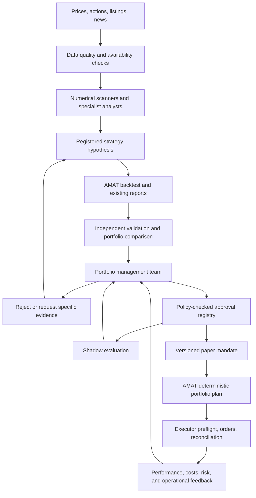

# Continuous discovery with a portfolio management team

Date: 2026-09-10. Scope: AMAT and its executor (`executor` in this workspace).
Status: proposed architecture and reusable role instructions; no new runtime,
model integration, strategy promotion, or broker configuration is implemented
by this document.

The first implementation slice is specified in
[Portfolio team v1](portfolio-team-v1-implementation.md), with four reviewers,
artifact adapters, decision contracts, persistence, and acceptance criteria.

## Decision

Build this within the existing project, with a separately supervised research
and portfolio-review service. Reuse AMAT's data validation, strategy core,
backtests, reports, and provenance. Keep the order-capable executor in its own
container. A separate repository is unnecessary until this service needs to
manage other independent strategy engines or broker systems.

The portfolio management team receives strategy candidates, commissions missing
tests, rejects weak candidates, approves eligible candidates for shadow or paper
operation, and selects a permitted risk-budget tier. Deterministic code computes
the actual portfolio weights and orders within that mandate. No Telegram account,
Grok subscription, or particular LLM vendor is required by this design.

This is more than swapping an alert destination: notification reports an event;
approval changes which strategies are authorized to consume portfolio risk.
The approval must identify exactly what was reviewed and its limits.

## Source and modifications

The inspiration is Roan's [September 8 post](https://x.com/RohOnChain/status/2097303933081489605)
and its linked article, *How to Use GPT-6 Astra to Find Profitable Trading
Strategies 24/7*. Direct X access failed; the article text and embedded code
were recovered through the [FxTwitter mirror](https://api.fxtwitter.com/RohOnChain/status/2097303933081489605).
The useful idea is a recurring discovery, testing, and monitoring loop. Its
claims about model capabilities, institutional equivalence, monthly operating
cost, and profitability were not independently established and are not premises
of this proposal.

The analyst/researcher/risk/portfolio-manager division also draws on
[TradingAgents](https://github.com/TauricResearch/TradingAgents) and its
[paper](https://arxiv.org/abs/2412.20138). AMAT would apply that division to
strategy admission and portfolio oversight, supported by its own reproducible
research engine. Agent agreement is not independent statistical evidence.

| Article mechanism | AMAT adaptation |
|---|---|
| Large swarm watches instruments | Numerical scanners compute features in batches; agents investigate shortlisted anomalies and news |
| Hypotheses carry executable Python strings | Versioned strategy configurations using supported components; new code receives isolated implementation and tests |
| One backtest plus fixed thresholds | Registered trials, walk-forward results, untouched evaluation periods, cost stress, and portfolio comparisons |
| Generated confidence percentage | Measured effect, uncertainty, effective sample size, evidence status, and explicit missing information |
| Telegram alert | Durable review request to the portfolio management team |
| Deployment after validation | Approval for a named stage, artifact version, capability set, and risk tier |
| Kelly-derived suggested size | Deterministic capped sizing using portfolio covariance, liquidity, exposure, and uncertainty |

## Full workflow



1. **Observe:** Ingest prices and news at the cadence the data and strategy can
   use. Preserve both event time and availability time. A recent article cannot
   be inserted into a historical decision merely because it describes old news.
2. **Screen:** Scan the approved data universe for trend/range structure,
   residual dislocations, event clusters, and changing risk. Exclude quarantined
   corporate actions and unsupported instruments before considering execution.
3. **Register:** Record a falsifiable mechanism, allowed assets, direction,
   horizon, parameter search budget, benchmarks, costs, and evaluation rules
   before running the experiment. Deduplicate near-identical trials.
4. **Test:** Use AMAT's strategy core and reporting functionality. Save all
   failures as well as winners. Reserve evaluation data from the strategy author;
   every revision prompted by an evaluation result consumes that evaluation.
5. **Challenge:** An independent reviewer inspects accounting, timestamp alignment,
   sensitivity, concentrations, missing fills, and simpler competing explanations.
6. **Review:** The portfolio team receives the frozen evidence package and current
   portfolio snapshot. It chooses reject, request evidence, approve shadow, or
   approve a bounded paper mandate. Approval for shadow grants no broker orders.
7. **Activate:** A deterministic policy service verifies the decision, records the
   mandate atomically, and activates it at the next permitted rebalance boundary.
8. **Operate:** AMAT produces plans for the approved release; the executor checks
   the mandate and normal account/data/order constraints before submission.
9. **Evaluate:** Feed reconciled returns, execution costs, exposure, and regime
   behavior back into review. Predeclared limits can suspend new entries;
   changing the strategy creates a new candidate version and review.

New strategies enter review as soon as their evidence package is ready. Existing
approved strategies produce signals at their own supported cadence. An hourly
market event does not require an hourly reinvention of the strategy.

## Roles and decision authority

The research workers propose and test ideas. The head portfolio management team
is a separate set of reviewers with a different objective: decide whether an
idea deserves scarce portfolio risk.

| Role | Concrete responsibility | Output |
|---|---|---|
| Research coordinator | Schedule work, enforce trial/compute budgets, track failed ideas | Experiment queue and ledger |
| Market and sector analysts | Investigate structure and catalysts in equities, defense, energy, and ETF families | Sourced, timestamped hypotheses |
| Quant implementation worker | Express candidates using AMAT components; prepare isolated code changes where needed | Immutable candidate and reproducible run |
| Independent validation reviewer | Challenge leakage, accounting, cost assumptions, sample selection, and robustness | Evidence findings and reproducible objections |
| Head of research, on PM team | Judge mechanism, novelty, and adequacy of validation | Scientific recommendation |
| Portfolio construction reviewer, on PM team | Assess marginal return/risk, overlapping positions, factor exposure, and turnover | Portfolio addition/replacement comparison |
| Risk and operations reviewer, on PM team | Check liquidity, capabilities, stale data, drawdowns, and execution/reconciliation readiness | Risk recommendation and hard-gate results |
| Chief portfolio manager | Resolve reviews within the fixed policy and choose a stage and allowed risk tier | Structured decision with reasons and references |

Keep initial reviewer assessments separate before a single rebuttal round. The
chief PM cannot vote away a failed accounting or capability gate. Missing
evidence, malformed output, unavailable reviewers, or a timeout produces a
pending/request-evidence result, never automatic approval. Models may differ
between roles, but different models can still share errors and training data.

Use ordinary code for scans, arithmetic, test execution, durable scheduling,
policy checks, and risk enforcement. Use LLMs for hypotheses, source synthesis,
adversarial review, and reasoned choices among policy-permitted outcomes.

## Evidence and approval policy

The current [promotion guidance](../.claude/references/promotion-gates.md) is a
starting specification, not an already implemented automated approval service.
It suggests net out-of-sample Sharpe of at least 0.50, positive locked-holdout
return, at least 60% positive annual folds, drawdown no worse than 20%, and
positive performance at triple baseline costs, plus concentration, parameter
stability, accounting, and benchmark checks. Promotion there means eligibility
for shadow/paper testing, not live-capital authorization.

Translate the relevant rules into versioned, executable policy. Strategy-family
exceptions must be declared before testing: a single-asset specialist cannot
meet a literal less-than-25%-P&L-per-symbol criterion. Its concentration must
instead be evaluated in the combined portfolio and across episodes. An LLM
cannot invent that exception after seeing a profitable result.

Every review package should include:

- Candidate/config/code/data hashes, model artifact when applicable, run IDs,
  trial lineage, reports, and availability-aware data coverage.
- Matched-period incumbent, cash, simple allocator, and relevant family controls;
  explicit differences in target volatility, caps, warm-up, and costs.
- Net returns, volatility, drawdown depth/duration, tail losses, turnover,
  fill/miss rates, and capacity/cost stress. Show uncertainty and fold dispersion.
- Trade win rate, average win/loss, profit factor, holding periods, and net
  expectancy; distinguish completed-trade P&L from dividend-inclusive equity return.
- Results by market regime, year, asset family, and symbol; nearby-parameter
  stability and a ledger of all attempted variants.
- Portfolio results with and without the candidate at comparable risk. A sleeve
  may add value through diversification without beating the incumbent alone.
- A capability manifest: asset types, signed positions, bar frequency, execution
  windows, margin/borrow assumptions, and event-data requirements.

For gross average win W, gross average loss L, win probability p, and expected
round-trip cost c, trade expectancy is `p*W - (1-p)*L - c`. If the trade outcomes
already include costs, do not subtract costs again. A universal 55% win-rate
gate ignores payoff asymmetry. Estimate uncertainty with methods suited to
serial dependence and overlapping positions; the raw order count is not an
independent sample count.

A raw t-statistic above two or high Sharpe after thousands of searches is not
enough. Account for selection across the experiment family, and separate
development, validation, and untouched evaluation. Confidence should describe
the uncertainty of a measured estimate, not an LLM's enthusiasm. Historical
tests already inspected in this project cannot become fresh holdouts for this
new team. Historical LLM replay also risks knowledge in the model's training
data; forward shadow operation is needed to evaluate the actual agent policy.

## How the team should treat the existing experiments

These are expected review outcomes based on the existing
[September 7 study](strategy-adjustments-2026-09-07.md), not executed agent votes
or new backtests.

| Evidence | Appropriate decision |
|---|---|
| v10: Sharpe 0.710 versus v6 1.137 on the same reported dates, with 18,268 versus 3,110 fills | Reject incumbent replacement; retain breadth for discovery |
| Matched v11 versus v10: annualized return 3.71% versus 3.29%, but Sharpe 0.665 versus 0.696, drawdown -9.92% versus -8.11%, and costs $6,257 versus $2,514 | Request controlled risk/turnover comparisons; no promotion from the higher return alone |
| Soft v12: Sharpe 1.012 versus matched v6 1.114 | No demonstrated replacement advantage; investigate any diversification benefit separately |
| Expanded session-pattern scan: zero hypotheses survived the specified train and validation filters | Reject the proposed general overnight trading rule on this evidence |
| Defense: 17/18 standalone sleeves positive in the inspected sample | Commission a registered family study; do not turn retrospective winners into an approved whitelist |

The earlier study's attribution table is too strong if read causally: these
configurations also change risk targets, caps, selection counts, and other
settings. Matching dates does not isolate breadth or learned regimes. The team
must request single-component ablations or matched-risk portfolio comparisons
before crediting a particular component with an improvement.

The proposed oil/gas clock rule also needs a precise clock: 4:55 PM Eastern is
after the usual 4 PM US regular-session close. If the intended rule is five
minutes before close, use the exchange calendar's actual close minus five
minutes, including early-close sessions. Existing close-to-next-opening-VWAP
diagnostics do not establish either intraday execution hypothesis.

## Durable contracts and lifecycle

Use a transactional queue and append-only decision events, rather than multiple
agents overwriting one shared candidates JSON file. SQLite with a single writer
is adequate for an initial single-host service; multiple hosts can justify a
server database later. A reviewer receives an immutable evidence snapshot.

Proposed records:

| Record | Required content |
|---|---|
| StrategyCandidate | Identity/version, parent trial, hypothesis, config/code/data hashes, capabilities, evaluation plan |
| EvidenceBundle | Run and report references/hashes, test results, sample boundaries, contamination status, metrics and uncertainty |
| ReviewerAssessment | Role, model/prompt version, evidence hash, recommendation, objections and source references |
| PMDecision | Candidate/evidence/policy hashes, stage decision, reason codes, reviewer records, timestamp, expiry |
| PortfolioMandate | Release ID, allowed strategy hash, stage, allowed risk tier, limits, activation/expiry, suspension policy |

State transitions:

```text
proposed -> registered -> testing -> review_pending
review_pending -> rejected | evidence_requested | shadow_approved
evidence_requested -> testing
shadow_approved -> shadow_running -> review_pending -> paper_approved
paper_approved -> paper_active -> suspended | retired
suspended -> review_pending
```

Every transition checks the previous state/version and has an idempotency key.
Changed evidence invalidates prior reviewer outputs. Retries must not duplicate
activation. Hashes establish identity; they do not authenticate authorization.
The policy service needs exclusive write access to the mandate registry, with
authenticated messages or signed releases if crossing trust boundaries.

Expiry or suspension prevents new risk. The executor must still reconcile orders
and follow a predeclared reduce-only/unwind policy for existing exposure.
Strategy replacement needs an explicit ownership-transfer and position-transition
plan; changing a configuration path must not abandon the previous holdings.

When multiple sleeves become executable, combine their target exposures before
submission, net conflicting orders, enforce portfolio limits, and retain sleeve
attribution in a virtual ledger. The current single-strategy plan is not already
a multi-sleeve deployment interface.

## Integration with this repository

Proposed additions, all within the current two-project scope:

```text
amat/src/strategy_lab/       discovery orchestration and experiment registry
amat/src/portfolio_team/     review roles, evidence contracts, policy, mandates
amat/configs/governance/     versioned admission/risk policies and role prompts
amat/outputs/governance/     review reports and exportable decision artifacts
executor/src/executor/      mandate validation at the existing preflight boundary
```

Keep `deskreview` observational: its existing package contract explicitly says it
forms no decisions and sizes nothing. Feed its reports into the PM service;
do not quietly give narration a new trading authority.

AMAT's validation/reporting modules and experiment records are reusable, but
the candidate queue, PM service, transactional machine-readable registry,
mandate validation, and release activation adapter still need implementation.
The executor currently consumes `amat plan --json` as a subprocess result and
has config provenance; provenance alone does not establish PM approval.

Deployment should initially use three process roles: research workers with
bounded CPU/memory and read-only snapshots; the PM/registry service with durable
state; and the existing executor with the broker credentials. Mount only approved
release artifacts into the execution path. Give research code neither those
credentials nor permission to edit the executor's active release. The existing
workspace mount is not by itself a release boundary if another process can edit
the host files.

Start with supported daily long/cash equities and ETFs. Real short books, hourly
orders, options/Heston trading, direct futures, and spot FX need their own data,
ledger, cost, and execution contracts. An approval team cannot supply those
capabilities through a prompt. Research records can describe these candidates,
but a capability gate must prevent their paper activation until implemented.

## Reusable PM role instructions

Chief portfolio manager:

> Review the identified strategy version against the supplied policy and frozen
> evidence. Read the independent research, portfolio, and risk assessments.
> Choose reject, request_evidence, approve_shadow, or approve_paper only when
> the lifecycle and deterministic gates permit it. Cite evidence fields and run
> IDs for every quantitative claim. Missing or contaminated evidence is not a
> pass. For approval select an allowed mandate tier; never invent signal values,
> quantities, returns, probabilities, or exemptions. State the expiry, conditions
> for suspension, and exact evidence needed for any requested revision. Output
> the structured decision contract. Do not call a broker or edit strategy code.

Independent validation reviewer:

> Seek the strongest reproducible reason this candidate may fail. Check event
> availability, execution timing, corporate actions, cost treatment, selection
> bias, and evaluation reuse. Compare identical dates and risk assumptions.
> Distinguish an absent result from a failed result. Return evidence references,
> reproduction instructions, and required tests before reading the author's
> response. Do not tune the strategy using the evaluation period.

Portfolio construction reviewer:

> Evaluate the candidate's marginal contribution to the supplied portfolio under
> the permitted budgets. Use calculated exposures, covariance, stress losses,
> costs, and netted turnover. Investigate redundant factor bets and crowding.
> Compare addition and replacement scenarios at comparable risk. Recommend only
> a predeclared tier supported by those calculations; request missing analyses.

Risk and operations reviewer:

> Check the capability manifest against implemented execution and accounting.
> Verify data freshness, tradability, liquidity, ownership of positions, order
> reconciliation, and the tested unwind path. Report each hard gate as pass,
> fail, or missing with evidence. No narrative argument can convert fail or
> missing into pass. Propose suspension only through the supplied risk policy.

## Implementation sequence and acceptance

1. Build typed records, a durable registry, and deterministic policy evaluation.
   Import v6/v9/v10/v11/v12 evidence with explicit historical contamination flags.
   Verify hash mismatch, missing evidence, unsupported capability, expiry, and
   repeat delivery cannot result in approval or duplicate activation.
2. Add the PM reviewers against frozen evidence. Run in shadow, recording model,
   prompt, cost, latency, objections, and decisions. Compare with deterministic
   gates alone to establish whether the team detects useful additional defects.
3. Add bounded discovery using the existing universe and supported templates.
   Cap trial counts, concurrent backtests, model usage, and review rounds. A
   budget exhaustion event defers research; it must not interrupt execution.
4. Implement the mandate/release adapter and a controlled paper activation test,
   including restart recovery, rejected/expired releases, ownership transition,
   reconciliation, suspension, and unwind. Then allow autonomous paper admission
   only within the fixed policy.
5. Extend signed and intraday execution separately, with parity/accounting tests
   and real historical window data, before admitting those strategy families.

Measure reproducibility, substantive defects found, rejected-candidate reasons,
false approvals observed during forward operation, research cost per useful
candidate, approval latency, net portfolio contribution, and realized execution
deviation. More approved strategies is not a success metric. Compare the agent
team to a deterministic review baseline using the same candidate queue and
forward observations; historical narrative reviews alone cannot demonstrate
improved investment performance.
