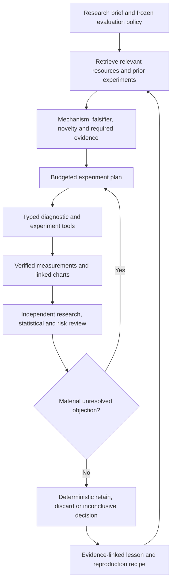

# Strategy research workflow: GitHub references and implementation proposal

Assessment date: 2026-09-12. This is a research and design deliverable, not an implemented workflow change. It combines current local source inspection, recorded AMAT experiments, official project documentation, selected upstream source files, and live GitHub repository metadata. Existing uncommitted work was preserved. No upstream framework was installed or executed.

Subsequent implementation: [research tools guide](research-tools.md) and
[verification results](research-tools-verification-2026-09-12.md). The assessment
below preserves the observed starting state; the verification notes distinguish
delivered behavior from the remaining live-provider acceptance check.

## Recommendation

Prioritize reliable model proposals, evidence retrieval across sessions, callable quantitative diagnostics, and the review-to-experiment bridge. Add resources as versioned research packages with executable examples and fixed evidence contracts. Evaluate whether each addition improves research decisions under equal budgets.

More resources can help when they answer a specific question or enable a missing experiment. A larger prompt, more agents, or more historical trials alone does not establish improvement. Keep AMAT's deterministic accounting, scoring and retention gates authoritative.

## What AMAT already has, and what remains

| Area | Observed state | Recommended change |
|---|---|---|
| Experimental integrity | Frozen programs, snapshots, recipes, dependencies, paired controls and artifact hashes | Extend these contracts to each new tool and resource package |
| Objective | Version 6 uses exposure-matched incremental Sharpe less added complexity | Keep this fix; evaluate fresh search trajectories under it |
| Failure memory | Full failure reports across sessions; proposer gets current-session aggregates, the last four failures and up to eight recent experiments within 24 KB | Retrieve relevant earlier experiments before proposing, with compatibility and temporal filters |
| Quantitative diagnostics | Feature availability, forward-return association, redundancy, delays, ablations, nearby parameters, stress scenarios and bootstrap checks | Expose verified cached results through a small typed tool registry |
| Review | Independent specialists and chief synthesis already exist | Require evidence references and testable objections; dispatch targeted checks to resolve disagreements |
| Follow-up execution | `research_queue.py` still returns `adapter_not_registered` | Implement one matched experiment adapter that publishes both runs and registers the comparison |
| Visual access | Analysis tables and reports exist; reviewed proposer/summary paths send structured text | Generate standard charts from those tables; offer chart artifacts plus their numeric evidence |
| Causality testing | Prefix-invariance tests already cover registered formulas, fitted signals, patterns and routing | Add candidate-level reports and startup-history sensitivity checks, rather than duplicating existing unit coverage |

Local evidence: [proposer](../src/autoresearch/proposer.py), [failure memory](../src/autoresearch/failures.py), [review evidence](../src/autoresearch/summaries.py), [follow-up queue](../src/portfolio_team/research_queue.py), [metrics](research-metrics.md), [scoring contract](exposure-matched-search-score.md), [signal tests](../tests/unit/test_signal_development.py), and [router tests](../tests/unit/test_regime_routing.py).

The [recorded 100-strategy batch](flexible-100-results-2026-09-11.md) completed 100 candidates with zero escalation. All 100 proposals used built-in fallback after the model chain returned no usable proposal; 97 candidates failed the incremental exposure-matched information gate. There were 57 completed reviews including baseline, 44 unavailable reviews, and 45 calls with unknown usage. Uncertainty testing was skipped for all candidates because earlier requirements were not satisfied.

These are historical batch observations, not a fresh provider-health test. The old objective mismatch has already been fixed in version 6. The [historical reranking](exposure-score-comparison-2026-09-12/report.md) found one positive new score and none above the initial 0.05 margin; this does not replay the search trajectory or demonstrate better future performance.

## GitHub shortlist

Stars below were returned by GitHub's public API on 2026-09-12. They measure attention, not strategy quality. The list is a selected comparison, not an exhaustive popularity ranking. None of the nine repositories was marked archived at inspection. Repository push dates are activity hints, not proof of maintained releases.

| Project | Stars | Last push, UTC | Best use for AMAT | Adoption choice |
|---|---:|---|---|---|
| [TradingAgents](https://github.com/TauricResearch/TradingAgents) | 104,760 | Sep 7 | Specialist debate and outcome memory | Borrow role boundaries and memory retrieval patterns |
| [AI Hedge Fund](https://github.com/virattt/ai-hedge-fund) | 63,345 | Sep 3 | Saved fund mandates and repeatable backtests | Borrow reusable strategy/benchmark configurations; distinguish its stated rebuild roadmap from delivered features |
| [RD-Agent](https://github.com/microsoft/RD-Agent) | 14,593 | Sep 4 | Hypothesis, implementation, experiment and feedback loop; factor/model research | Highest-priority architecture reference |
| [FinRobot](https://github.com/AI4Finance-Foundation/FinRobot) | 7,973 | Sep 11 | Registered financial tools and report/chart functions | Borrow callable-tool interfaces from available source; its README distinguishes open V0/V1 from non-open V2 |
| [FinRL](https://github.com/AI4Finance-Foundation/FinRL) | 16,271 | Jul 13 | Reinforcement-learning environments and baselines | Later, isolated policy-learning experiments if a concrete hypothesis needs them |
| [Qlib](https://github.com/microsoft/qlib) | 48,500 | Sep 2 | Model/data workflows, experiment recording and diagnostic plots | Reference for factor studies and reproducible analysis |
| [Freqtrade](https://github.com/freqtrade/freqtrade) | 54,292 | Sep 12 | Lookahead and recursive/startup-history analysis | Borrow validation methodology; it is a crypto trading framework, not an agent research coordinator |
| [vectorbt](https://github.com/polakowo/vectorbt) | 9,068 | Aug 2 | Fast exploratory sweeps and interactive analysis | Optional diagnostic adapter; retain AMAT accounting for promotion |
| [QuantStats](https://github.com/ranaroussi/quantstats) | 7,627 | Jul 20 | Portfolio tear sheets and risk charts | Optional presentation adapter over verified AMAT returns |

The final four are supporting quantitative infrastructure rather than agentic trading teams. RD-Agent's quant workflow is documented [here](https://rdagent.readthedocs.io/en/latest/scens/quant_agent_fin.html); Qlib's experiment recorder is documented [here](https://qlib.readthedocs.io/en/latest/component/recorder.html). Freqtrade explains its [lookahead](https://www.freqtrade.io/en/stable/lookahead-analysis/) and [recursive](https://www.freqtrade.io/en/stable/recursive-analysis/) analyses separately.

Selected upstream code anchors, pinned to inspected revisions:

- [RD-Agent quant loop](https://github.com/microsoft/RD-Agent/blob/32b3d395e73d9db5eee3fe9063d69aec0fdc83bd/rdagent/app/qlib_rd_loop/quant.py) and [experiment/feedback trace](https://github.com/microsoft/RD-Agent/blob/32b3d395e73d9db5eee3fe9063d69aec0fdc83bd/rdagent/core/proposal.py).
- [TradingAgents memory](https://github.com/TauricResearch/TradingAgents/blob/be952b8eccb49720509af544c6675233bc1f10d0/tradingagents/agents/utils/memory.py): its historical context filter checks when an outcome became known.
- [FinRobot tool registration](https://github.com/AI4Finance-Foundation/FinRobot/blob/6d6ccd32c1b8b1904dc656cf06897438aba3daec/finrobot/toolkits.py): explicit caller/executor tool registration.

For code reuse, the inspected repositories report MIT for RD-Agent, Qlib, AI Hedge Fund and FinRL, Apache-2.0 for TradingAgents, FinRobot and QuantStats, and GPL-3.0 for Freqtrade. vectorbt's [license](https://github.com/polakowo/vectorbt/blob/master/LICENSE.md) is Apache 2.0 **with Commons Clause**, not plain Apache. Record the exact file license and attribution when adopting code; a methodology reference does not require importing the framework. Metadata is preserved in the adjacent `research-github-metadata-2026-09-12.json`.

## Proposed workflow

Use logical responsibilities, not a requirement to run a separate expensive model for every box. Preserve the independent first-pass reviewers. Add a retrieval/planning stage, a deterministic experiment runner and a lesson-writing stage around them. Escalate disagreements into a concrete test with a completion criterion. Model consensus cannot override a failed gate.

A hypothesis should name its economic mechanism, expected horizon, eligible universe, required data, benchmark, falsifying result, relevant prior experiment IDs and the substantive change from those experiments. AMAT already supports mechanism and falsification fields; extend the contract with lineage and prior-evidence references.

## Preconfigured research resources

Start with four packages. Each contains a short method note, source URLs and revisions, data requirements, compatible feature recipes, known failure cases, runnable examples, diagnostic presets and expected output schemas.

1. **Trend and timing:** momentum, pullback, breakout and participation hypotheses; compare against the core trend and exposure-matched control; inspect delayed execution and incremental returns.
2. **Regime and routing:** explicit state definitions, sleeve controls and static blends; inspect state coverage, transition turnover, state-conditioned effects and sensitivity. Retrospective regime labels remain diagnostic only unless available causally.
3. **Validation and execution:** leakage checks, startup sensitivity, purged walk-forward fitting, costs, missed fills, delays, uncertainty and sample sufficiency. Reuse the existing AMAT implementations where available.
4. **Failure and replication:** reproducible counterexamples, implementation defects, invalid evidence, uninformative studies and rejected economic hypotheses, each with a relevant next test.

Add point-in-time fundamentals, timestamped events, alternative markets or intraday data only when an approved hypothesis requires information absent from the current dataset. Each dataset needs event time, availability time, revision policy, coverage, corporate-action handling and compatible execution assumptions. More indicators computed from the same prices may add little independent information; measure redundancy first.

Proposed callable interface — these names do not exist yet:

| Function | Inputs | Evidence returned |
|---|---|---|
| `find_related_experiments` | Hypothesis/recipe, program contract, research cutoff | Compatible matches, failure findings, differences and source hashes |
| `inspect_feature` | Candidate, horizon, permitted sample | Coverage, association, buckets, redundancy, tables and chart IDs |
| `compare_candidates` | Candidate, control, fixed sample and cost policy | Paired returns, matched exposure, incremental metrics and residual mismatch |
| `request_diagnostic` | Candidate, allowlisted check and bounded parameters | Cached result or a typed job with a resource estimate |
| `render_diagnostic` | Verified artifact and chart preset | Human-viewable chart, numeric table, sample labels and provenance |
| `record_lesson` | Experiment, supported observation, proposed explanation | Versioned lesson with evidence references and re-test conditions |

Wrap existing Python functionality first. A CLI, Python API or MCP facade can expose the same contracts later. Every call must declare operation/version, input hashes, permitted data period, output schema, resource bound, cache identity and errors. Keep raw credentials, arbitrary shell commands and the executor outside this research interface.

## Make failure memory change behavior

Keep immutable outcomes separate from interpretations. For each lesson record: candidate/recipe hash; family and mechanism; horizon; universe; data snapshot and availability boundary; evaluator/objective/cost versions; ancestry; observed failed checks; counterevidence; reproduction command; proposed explanation; and conditions that would justify another test.

Retrieve by structured compatibility first, then recipe similarity and text relevance. Start with SQLite metadata/full-text retrieval; add embeddings only if a measured retrieval evaluation shows a benefit. At the recorded library size, infrastructure scale is not the demonstrated bottleneck.

An exact repeat under identical code, data and evaluator should reuse its verified result. A similar proposal must explain what changed: information, execution assumption, mechanism, horizon, or a valid interaction. A single failed standalone signal must not permanently ban its family; it may still provide diversification or value in combination.

Use two time controls: the market information cutoff and the research knowledge cutoff. Cross-session memory containing later outcomes or checkpoint findings can contaminate a historical evaluation. Keep holdout-derived lessons out of proposal context, record which evaluation periods have been inspected, and aggregate search attempts across related sessions. Renaming a program must not reset the effective research history. Previously inspected AMAT periods cannot be made pristine by relabeling them.

## Quantitative and visual depth

Generate a standard diagnostic panel from verified exports:

- Candidate, baseline and exposure-matched control equity and underwater curves on common dates.
- Incremental performance and sample counts by year, asset and causally defined state.
- Forward-return association by horizon, decay, bucket returns and uncertainty.
- Parameter-neighborhood heatmap, ablation deltas and delay/cost sensitivity.
- Exposure, turnover, missed fills and binding risk constraints.
- Experiment ancestry and failure frequencies, with separate failed/skipped/unavailable states.

Return the numerical table with every chart. Chart annotations may suggest a hypothesis but do not establish causality. For example, a drawdown cluster should trigger a state-conditioned or execution test; it should not automatically become a narrative about a market regime. Interactive filtering is useful for diagnosis, but all inspected slices remain development evidence and must be recorded if they influence selection.

The current report has enough exports to build much of this without acquiring new market data. Optional QuantStats/vectorbt adapters must reconcile return conventions, annualization, costs, missing values and measured anchors with AMAT before their metrics appear beside canonical results.

## Delivery order and acceptance

| Priority | Deliverable | Acceptance evidence |
|---|---|---|
| P0 | Proposal-provider reliability and visible fallback provenance | One bounded real structured proposal survives schema/novelty validation and produces a recorded experiment; scripted unavailable/invalid/budget cases remain distinguishable; resume preserves successful work |
| P1 | Retrieval from verified cross-session evidence | Known related failures are recalled; incompatible scores are not pooled; future/checkpoint evidence cannot reach proposals; corrupt inputs are rejected |
| P1 | Typed wrappers and first matched-experiment adapter | One review request runs candidate and control over matched measured dates, preserves warm-up, records both artifacts, registers a comparison and resumes without duplication |
| P2 | Standard charts and four research packages | Every chart reconciles to its source table; each package has a runnable example and a reproduced known failure |
| P3 | Targeted committee and search-budget evaluation | Compare deterministic search, current model workflow, retrieval/tools, and retrieval/tools plus committee under equal candidate/compute/model budgets |

The first implementation slice should cover provider reliability, related-experiment retrieval and one matched experiment operation. Then add feature inspection, cost/delay checks and chart rendering. Expanding to many frameworks before validating this path would multiply interfaces without demonstrating research value.

Measure valid unique model proposals per attempt, repeat-failure rate, explanation accuracy against recorded evidence, useful falsifications per compute hour, completed follow-up requests, known and unknown model usage, and per-role marginal contribution. Preserve a fixed exploration allocation so memory does not collapse search onto familiar families.

Use historical replay with knowledge cutoffs to test mechanics, not to claim independent investment performance. Freeze budgets, selection rules and stopping conditions before comparing fresh workflow variants. Assess investment value on prospectively reserved evidence or forward observation. Zero promotions can be the correct outcome; increasing the promotion rate is not the optimization target.

## Scope of this assessment

Inspected local source and existing records; fetched official upstream references, repository metadata and selected source files. No strategy batch, paid model call, upstream runtime benchmark, new test suite, service deployment or broker action was performed. Historical test counts and results linked above belong to their original verification records. The proposed benefit to research quality remains a hypothesis to evaluate with the acceptance plan.
