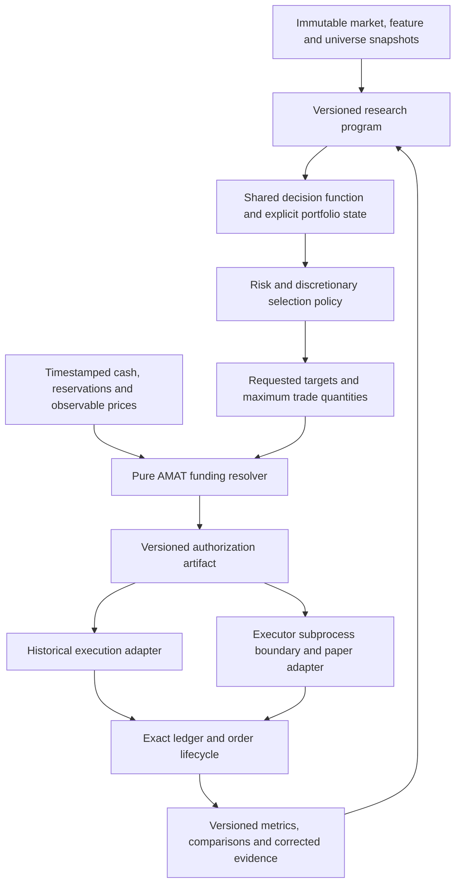

# Consolidated alpha-review implementation plan

**Status: implementation plan, October 8, 2026. No production changes or strategy promotion.**

This is the integration plan for the [September alpha review](../alpha-review-2026-09-30/review.md). It combines three delegated source reviews and the primary agent's data/research-loop review. The plan defines what to change, where, in what order, and how to establish correctness and economic usefulness. It is not a promise of higher returns.

## 1. Decisions and scope

Preserve v13 and historical artifacts as references. Build opt-in, versioned capabilities, compare each mechanism separately, and combine only mechanisms that earn further investigation. The ordinary extension-only research loop must retain its current restrictions; changes to funding, objective, universe, portfolio state, or model family use a separately registered structural research program.

The recommended first release is **evaluation identity + corrected evidence + decision-close funding experiments + risk diagnostics**. It does not require a new market-data vendor, generated-code execution, a new model family, or activation of a trading service. Funding, risk controls, and selection require paper-plan parity before operational use.

Detailed implementation memos:

- [Metrics, objectives and evidence](metrics-and-evidence.md).
- [Funding, execution costs and cash](execution.md).
- [Portfolio risk, selection, sleeves and entry models](portfolio-and-models.md).
- [Point-in-time data and research-loop completion](data-and-research-loop.md).

The plan below resolves shared interfaces and implementation order. The memos provide additional file/function references and test cases. Proposed filenames and schema names are clearly proposals; they are not existing functionality.

## 2. Updated understanding of the current codebase

| Concern from alpha review | What exists now | Actual remaining work |
|---|---|---|
| Sharpe and alpha measurement | Legacy CAGR/volatility score; additional conventional metrics in some reports; separate nested-campaign log-growth objective | Versioned conventional metrics and comparable factor/benchmark diagnostics across consumers, without rewriting legacy scores |
| Statistical controls | Session trial-adjusted bootstrap, finite-family `StatisticalProtocol`, genetic whole-search nulls, frozen development/validation boundaries | Cross-session trial accounting, coverage of distinct search families, correction/supersession links and consistent consumers |
| Funding | Causal close-based quantities, pending-order netting, buy participation clipping, simulator sells-first | Explicit spendable-cash/reservations, batch funding authorization, disjoint residual quantities, executable timing and paper parity |
| Paper order sequencing | Plans sorted across symbols, executor follows their order, durable order IDs and reconciliation | Explicit schema-authorized stages and completed-sale funding facts; merely submitting sales first is insufficient |
| Risk constraints | Ledoit-Wolf covariance, target-volatility scaling, nominal caps, no releveraging | Implement optional risk-contribution/stress constraints, report settled risk and identify inactive legacy fields |
| Cost-aware selection | Five-session top-four baseline schedule; research retention bonus, liquidity and cluster limits | Benefit/cost comparison in consistent units, realized/pending holding state and persistence |
| Entry-quality model | Four-head histogram gradient boosting with pooled event fits; separate ridge mechanisms elsewhere | Hierarchical calibration/regime policy evidence, opportunity-cost alignment and bounded sizing; do not rebuild it as if it were ridge |
| Strategy combinations | Stance/route mechanisms and diagnostic independent-account sleeves | One-account multi-sleeve state, netted transactions and marginal portfolio contribution |
| P13 replay | Separate isolated runtime with continuous accounts, 76 historical sensitivity paths and 544 synthetic replays | Audit/integrate reusable runtime changes and prove parity; preserve completed evidence |
| Event-timing follow-up | October 7 design specifies 416 paths after policy activation | Confirm completed receipts when available; a registered design is not a completed result |
| Agent research | New bounded controller, read-only development context, extension validator, frozen worker | Correction-aware context, useful-experiment evaluation, isolated generated-code validator |
| External information | Append-only point-in-time news store, discovery, immutable market snapshots, citation admission | Numerical vintage/availability feature contract and one justified new data family |
| Cash returns | Constant-rate sensitivity accrual exists; primary research requires zero yield; Treasury source fails closed | Attainable rate series, posting/spendability rules, excess-return metrics and a new research contract |

The main checkout and isolated P13 runtime are different source lineages. Main scripts `nested_strategy_campaign.py` and `strategy_robustness_diagnostics.py` explicitly require isolated runtime capabilities (`ScheduledDecisionContext`, `continuous_study`) absent from the main source tree. Do not treat presence of those scripts as completed integration. Existing working-tree modifications are extensive; HEAD alone is not a reproducible source identity.

Relevant newer evidence: [P13 sensitivity verification](/home/supasuge/Documents/amat-p13-workspace/amat/outputs/genetic-patterns/2026-09-30-p13-sensitivity/p13-sensitivity-verification.md), [544-run synthetic verification](/home/supasuge/Documents/amat-p13-workspace/amat/outputs/genetic-patterns/2026-10-02-p13-synthetic-replay/p13-synthetic-replay-verification.md), and [event-timing design](/home/supasuge/Documents/amat-p13-workspace/amat/outputs/genetic-patterns/2026-10-07-p13-event-timing/p13-event-timing.md).

## 3. Architecture and shared contracts



**Keep these ownership boundaries:**

1. AMAT owns signals, target weights, risk policy, and the deterministic funding policy. Executor owns account observations, broker communication, durable submissions, reconciliation, and measured execution facts.
2. The funding resolver is a broker-free AMAT module. Simulation calls it directly; executor invokes an isolated AMAT CLI with timestamped facts and receives a frozen authorization artifact. Executor does not import AMAT or gain a strategy optimizer. This preserves its standard-library runtime boundary and avoids two copies of the funding algorithm.
3. Schema 1 plans retain legacy semantics. A proposed major-2 plan carries the funding permission envelope and stable intent/authorization identities. Unknown versions fail closed. Upgrading software does not silently authorize new economic behavior.
4. Metric identities are independent of strategy identities. An evaluation contract includes source/data/cost/benchmark/cash/metric/calendar/scope/trial-family identities. Changed contracts invalidate comparable-result caches and leaderboard groupings.
5. A shared decision context must identify actual holdings, pending orders, reservations, previous policy state, account snapshot/event watermark, and the last fully processed session. A single writer publishes state transitions; pure decision functions return next state and reason traces. Planning and simulation use the same state semantics.

### Proposed interfaces to freeze before parallel implementation

| Interface | Required semantics | Owner |
|---|---|---|
| `MetricContract` / metrics v2 | Annualization, cash-return alignment, conventional Sharpe, legacy ratio, benchmark, warm-up/anchor scope, null/error behavior | Metrics |
| `EvaluationIdentity` | Candidate + runtime + data + feature/universe + execution/cost + metric + search family/cutoff | Integration/metrics |
| `EvidenceCorrection` | Original and replacement receipt hashes, scope, reason, recorded-at, source protocol, affected fields; immutable acyclic chain | Evidence |
| `DecisionContext` / policy state | Realized and pending holdings, reservations, risk-exit flags, selection state, as-of session, policy version, transition identity | Portfolio/integration |
| `FundingPolicy`, `FundingFacts`, `FundingAuthorization` | Stable intent ID; immutable authorization version binding quantities, facts, account event watermark and proposed policy state; downward-only authorization; conservative reserves; no side/symbol substitution | Execution |
| `ExecutionOutcome` | Requested/authorized/submitted/filled quantities, nonoverlapping residual reasons, cumulative/incremental fill distinction | Execution/evidence |
| `FeatureSnapshot` | Known-at basis, publication/vintage/ingestion evidence, transforms, missing masks, units, universe mapping and hashes | Data |

Finalize shared dataclasses/JSON fixtures in one contract change before assigning implementation workers to overlapping call sites. Avoid adding a generic framework where an explicit versioned artifact suffices.

## 4. Ordered implementation backlog

Each row is a bounded reviewable change. Its acceptance is engineering acceptance unless explicitly marked economic. The long-term research work does not block delivering the first release.

| ID | Deliverable and principal files | Depends on | Required acceptance |
|---|---|---|---|
| A00 | Capture source/data/config baselines; legacy replay fixtures; main/P13 diff map; capability inventory | None | Dirty and untracked source represented by hashes; no historical artifacts altered |
| A01 | Add metrics-v2 alongside legacy in `amat/metrics`, `autoresearch/objective.py`, `diagnostics.py`, `periods.py`, worker/report/export adapters and executor reporting | A00 | Hand-calculated excess-return examples; legacy values/digests unchanged; comparable contracts explicit |
| A02 | Add correction index/resolver and global trial registry; integrate `ledger.py`, `memory.py`, `failures.py`, `best_strategies.py`, `controller_context.py`, proposer/summary readers | A00–A01 | Idempotent registrations, crashes/retries/concurrent registration, no budget reset across sessions, heldout corrections excluded from development |
| A03 | Structural research-program capability contract in `contracts.py`, `specs.py`, `workspace.py`, worker/CLI | A01–A02 | Ordinary extension programs still reject protected changes; new contracts freeze complete controls and partitions |
| A04 | Conventional alpha/benchmark diagnostics in new `amat/metrics/alpha.py` and reporting | A01, causal factor inputs | Past-only factor fits, collinearity/missing-data reporting, cost-comparable benchmark runs, dependence-aware uncertainty |
| A04S | Explicit decision/account context and immutable policy transitions in new `amat/portfolio/context.py`, runner/planning adapters, checkpoint/state transport and executor event projection | A03/A11 | Event watermark, reconciled bootstrap, pending/reservation state, plan identity and restart invariance; no intent-as-fill assumption; legacy stateless path unchanged |
| A05 | Pure proportional funding resolver, disjoint order quantities, decision-close policy in `amat/execution/funding.py`, execution/runner/intent integration | A03, agreed state/envelope fixtures | Decimal conservation, order-permutation invariance, causal prior authorization, reservations and adverse gap cases; legacy exact parity |
| A06 | Plan-major-2 producer/parser and resolver CLI; executor plan source, submission, daemon, order registry and reporting integration | A04S/A05 | Fake-broker end-to-end parity, uncertain acknowledgment/restart idempotence, stale facts rejected, no spend of unfilled sales |
| A07 | Risk diagnostics and explicit capability labeling in config, allocator, plans and reports | A01/A03 | Dormant legacy values not advertised as enforcement; existing config canonicalization unchanged |
| A08 | Optional risk-contribution/stress constraints in new `amat/portfolio/risk_constraints.py` plus shared allocator/decision path | A04S/A07 | All active constraints checked after final weights; infeasibility explicit; tail-risk/static-lower-risk controls registered |
| A09 | Order-arrival and fill observations, shortfall decomposition; conditional cost protocol in execution/reporting | A01/A06 | Missing observations remain unavailable; attribution reconciles; flat-bps behavior exact; cost never double counted |
| A10 | Stateful cost-aware selection in cross-section/shared decision path and research adapters | A05/A08/A09, explicit state | Comparable benefit/cost units; forced exits bypass discretionary bands; delayed/partial/restart parity; daily/weekly/retention controls |
| A11 | Controlled P13 runtime integration into main runner/exits/replay modules, script entry points and tests | A00/A01, agreed state contract fixtures | Default main runner exact parity; selected P13 receipts reproduce; no reliance on arbitrary PYTHONPATH overrides |
| A12 | One-account sleeve blend and bounded hierarchical entry-policy calibration | A10/A11; separate registered programs | Netted executable positions, continuous capital, no sleeve double counting; baseline/static/equal mix and existing-model controls |
| A13 | Point-in-time numerical observation/export and universe history contracts | A00/A03; can run beside funding/risk | Publication/ingestion/revision/decision causality, missingness, dated membership; old snapshots unchanged |
| A14 | One new information-family experiment using A13 | A04/A13; actual entitled data | Mechanism, label horizon and universe suitability preregistered; clean ablation and independent evaluation |
| A15 | Dated attainable cash-return model, accountant/runner/input changes | A01/A05/A13 | Posting/spendability chronology, no duplicate yield, separate cash/strategy attribution; new cash contract |
| A16 | Isolated engineering validator and correction-aware research-quality evaluations | A02/A03; independent of A05–A15 | Staged code never executes in host controller; trusted harness, bounded resources/repairs and verified receipts |
| A17 | Integrated candidate evidence, shadow/paper observation and explicit promotion record | Only capabilities candidate actually uses | Matched controls, exact code/data contract, no erased suspension, real prospective chronology and authorized deployment step |

### First-release slice

Deliver A00–A03, the narrow A11 state/context integration, A04S, A05–A07 and the reporting-only parts of A09 first. A05 pure resolver development can run alongside A11/A04S; its plan/executor integration waits for A04S. A04 can begin with available factor proxies under a disclosed contract. A08 follows a stable risk interface; it should not wait for external-data acquisition. A13/A16 can proceed in parallel without touching trading defaults. A11 integrates already-tested P13 infrastructure before A12; it is not a requirement to rerun all large searches first.

No need to deploy all planned capabilities together. Mechanically valid features remain disabled by default until their specific experiment passes its predeclared economic criteria. Compare individual changes before testing combinations so gains/losses can be attributed.

## 5. Mechanism-specific implementation choices

### Funding and execution

First implement proportional funding with a fixed predeclared reserve, not learned priority ranking. Use decision-close facts and already spendable funds for the initial experiment. An arrival-time resolver requires separately timestamped observable prices and an explicit event stage; a completed future five-minute VWAP cannot be used to authorize an opening order.

Cash from a submitted sale is not available proceeds. Schema-2 staging may wait for confirmed fills and refresh the authorization facts, subject to a fixed deadline. On existing bar-only data, retain and label the legacy instantaneous same-window proceeds assumption as a different execution contract; do not claim equivalence to a broker event sequence. Market share orders cannot guarantee a hard debit ceiling through gaps, so model reserve breach/rejection rather than asserting impossible overspend.

Keep the logical intent ID stable. Each immutable authorization version binds its exact quantities, facts, account event watermark and proposed policy state by digest. Refreshed facts before submission may produce a new authorization version; they never mutate an existing artifact. A submitted order retains its original identity. Retry under uncertain broker acknowledgment reconciles that order before any new authorization can submit; it never generates a second purchase with a new identity. The initial residual policy is next decision, not same-session top-ups.

The current participation-then-rejection path may record both a clipped residual and the original full quantity as missed. Correct outcome accounting through nonoverlapping lifecycle buckets; don't reinterpret historical record counts as order rejection rates.

### Risk, forced exits and state

Report covariance-based risk contributions, gross/cluster stress loss, settled weights, target weights and forecast uncertainty before enabling a new constraint. A normalized risk-contribution limit cannot be enforced merely by scaling every position down: the fractions remain unchanged. Relative-risk enforcement must change weight shape or declare infeasibility and use the registered cash fallback. A baseline fallback is permissible only if independently verified against every active constraint; it cannot bypass the cap that caused infeasibility. Absolute stress-loss limits can use uniform scaling. Negative contributions from hedges and near-zero portfolio variance need an explicit definition; don't label clipped positive contributions as raw Euler contributions.

For the first opt-in risk policy, use deterministic bounded optimization/iteration with no increase above permitted exposure, no post-clipping releveraging and an explicit failure reason. Verify the final portfolio against all constraints. An infeasible minimum-diversification demand cannot authorize new assets or borrowing.

Risk exits bypass the discretionary switch/no-trade threshold, but execution liquidity still constrains fills. Report unfilled risk reduction rather than inventing a fill. Persist selection/risk state, available cash reservations, pending orders and corporate-action adjustments in simulation and plan formation. Do not use last session's desired membership as a substitute for realized holdings after a partial fill.

### Selection and model adaptation

Keep score-space hysteresis and expected-return utility distinct. A raw [0,1] trend preference is not basis points. If the first policy is rank-buffer persistence, label it that way. A cost hurdle measured in expected return needs a training-only calibrated mapping to the same holding horizon and economic units as round-trip costs. Unknown utility suppresses discretionary replacement and retains currently eligible holdings, while mandatory eligibility/risk reductions proceed. Empty/new-account baseline bootstrapping is a separately declared policy; switching back to baseline is not free or automatically justified.

Entry-quality work first targets calibration and regime policy evidence around the existing pooled gradient-boosting heads. Use matured out-of-fold labels, temporal blocks, shrinkage toward global/baseline behavior, and bounded sizing changes. The ordinary extension validator currently preserves the entry model; a separate experiment contract is required. Four fitted heads do not constitute four independent observations. Existing `entry_outcomes` calls `forward_returns` with its default 2 bps per side. Conditional-cost/cost-level experiments therefore require versioned label and cache identities, head-specific maturation and explicit differential deferral-cost assumptions. Audit whether each label is already net before subtracting costs; do not double charge training outcomes.

For sleeves, combine target demands in one account, net cross-sleeve trades, enforce portfolio risk once, and attribute costs without double charging. Independent diagnostic sleeve accounts are unsuitable for claiming executable combined returns. Compare a fixed mix/equal mix and baseline before introducing adaptive weights.

### Metrics, evidence and data

Preserve legacy metric functions and historical score versions. New reporting explicitly identifies conventional excess-return Sharpe, CAGR/volatility, log-growth or other objective, calendar/session annualization and warm-up scope. A newly calculated diagnostic over an old receipt is labeled recomputed analysis, never a replacement historical decision. Actual account cash yield and the risk-free benchmark are distinct inputs: portfolio net returns include attained yield once, and excess-return Sharpe subtracts the independently declared risk-free return once. The benchmark need not be attainable by this account.

The global trial register records candidate generation family, parentage, evaluated/effective numerical identity, invalid/duplicate/retry state, dataset and periods. Exact replay and numerical duplicates must not be treated as fresh independent discoveries. Do not claim a known effective number of independent tests merely from raw trial count. Enforce finite registered research budgets; report statistical diagnostics with their actual scope and resolution.

Corrections are append-only and field-scoped. A current view can use an admissible corrected measurement; a historical as-of view retains what was known then. No correction may smuggle a validation/holdout result into development context. Forks, conflicting corrections and cycles fail resolution explicitly.

Point-in-time numerical data use explicit availability basis and actual decision timestamps. Locally observed news uses ingestion time. A historical vendor-vintage contract requires release/vintage evidence; today's download of revised data is insufficient. New external data don't enter old snapshots or old training folds retroactively.

## 6. Verification and economic experiment protocol

**Contract/baseline tests:** retain exact old serialized configurations, candidate digests, plan-major-1 fixtures, run receipts and default decisions. Add opt-in versions and side-by-side outputs. Bind environment/data/source identity to every rerun. Label and isolate pre-existing failures rather than repairing unrelated code inside the feature change.

**Behavior tests:** use hand-calculated finance fixtures; Decimal conservation; correlated and infeasible risk cases; missing/corrupt input; causal prefix invariance; delayed/partial fills; splits/dividends; state resume; timeout/retry; no duplicate orders; plan/backtest decision parity. Test requirements are detailed in each memo. No test may be weakened merely to admit the new behavior.

**Statistical tests:** conventional Sharpe and excess-return checks, aligned calendars, dependence-aware uncertainty, factor-fit cutoffs and conditioning, correction cutoff tests, trial-family accounting and bootstrap resolution. Existing whole-search nulls and finite-family logic are reused, not replaced by a claim of generic statistical significance.

**Experiment matrix:** freeze a finite candidate/control list, dates, capital scales, cost assumptions, risk bounds and family budget before running. Begin with funding-only and risk-only variants; test their combination after individual attribution. Selection compares daily, weekly and existing retention controls. Sleeves compare fixed/equal combinations. Data/model changes require feature ablation and existing-model controls. P13 event worlds remain stress mechanisms, not independent market draws or future probabilities.

**Acceptance:** a feature may be mechanically correct and economically rejected. Economic selection uses net return and drawdown/tail/turnover limits appropriate to the declared objective, existing static risk/exposure controls, paired uncertainty and weak-period performance. Exact numerical thresholds are part of each preregistration—not tuned after inspecting winners. Preserve baseline fallback and the prior failed evidence.

**Quality gates for implementation changes:** run targeted existing/new tests first, then applicable integration tests, Ruff/type checking and both affected module suites before release. Current planning work does not claim those suites were run. Example repository-local commands (during implementation):

```bash
cd /home/supasuge/Documents/amat-workspace/amat
.venv/bin/python -m pytest tests/unit/test_execution_and_accounting.py tests/unit/test_execution_plan.py
.venv/bin/python -m pytest tests/integration
.venv/bin/ruff check src tests
.venv/bin/mypy src

cd /home/supasuge/Documents/amat-workspace/executor
.venv/bin/python -m pytest tests/test_submit.py tests/test_daemon.py tests/test_report.py
```

Use the project's supported environment if a listed executable is absent; no dependency upgrades are implied. Broad suites and formatting gates follow the actual changed surface. There is no broker requirement for the unit/integration gate.

## 7. Coordination, integration and release

Four implementation streams can run once A00–A03 interfaces stabilize: metrics/evidence, execution, portfolio, and data/research infrastructure. Assign one owner per shared file. `config/models.py`, `contracts.py`, `specs.py`, `workspace.py`, `worker.py`, `backtest/runner.py`, `planning/__init__.py` and CLI integration are serialized changes; workers first build separate modules and fixture-backed adapters.

Preferred change sequence: baseline manifest → metric contract → evidence/trial contract → new-program adapter → narrow P13 state integration → explicit decision-state implementation → plan/parser/CLI and funding integration → executor reconciliation → risk diagnostics/constraints → cost observations → stateful selection → sleeves. The pure funding resolver can be built in parallel after its contract fixtures are frozen; P13 integration must precede modifications that depend on its state semantics. Data/export and engineering isolation proceed independently and join only at frozen contracts.

For P13 integration, inventory actual changed modules and dependencies, import only needed state/context/accounting functionality, and reproduce both main legacy fixtures and P13 receipts. Existing artifacts keep original source identities. New synthetic/event work must not be falsely attributed to the older foundation runtime. Avoid copying an entire changed checkout over the working tree.

Deployment is a separate action from this plan. A future implementation can finish offline, produce an inert plan and publish a reviewable comparison without touching the paper service. A selected candidate requires frozen identity, migration/parity checks, genuine prospective observations, and an explicit activation record. Rollback restores the previous strategy contract and state using reconciled current positions; do not reuse a stale order plan. Suspended shadow campaigns retain their suspension and predecessor chain across migrations.

## 8. Completion definition and remaining decisions

Planning is complete when each alpha-review recommendation is assigned an existing/reused capability or a backlog item, shared interfaces have a consistent owner, and tests/experiment dependencies are explicit. Implementation is complete per slice only when code, tests, matching artifacts and documentation exist; improved historical return alone does not complete deployment qualification.

The default implementation decisions are fixed here: proportional funding, conservative observable facts, CLI separation, versioned metrics/plans, unchanged baseline defaults and bounded structural experiments. Later decisions requiring additional evidence are provider/entitlement selection, live attainable cash product, event-granularity data, acceptable operational risk budget, and economic qualification thresholds. They do not prevent starting the first offline slice and should not be guessed from a target return percentage.

## 9. Collective review resolutions

All three delegated agents reviewed the master after cross-reviewing each other. The final plan incorporates their requested corrections: explicit A04S state ownership and A11 ordering; feasible risk fallback; retain-valid-holdings behavior for unknown switch utility; immutable authorization versions distinct from stable intent IDs; separate account-yield/risk-free definitions; and versioned fixed-cost entry labels. These resolutions supersede any more general wording in an individual memo. Link/source checks and source identity are recorded in `validation.json` and `source-manifest.json`. Production tests were inspected, not executed, because this delivery changes planning documents only.
