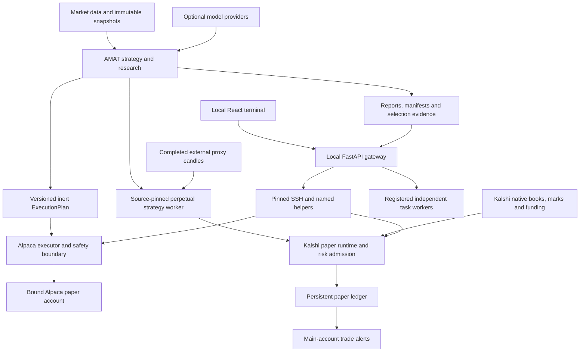

# System architecture

The system separates research decisions, execution authority and observation. Each component owns its durable state; the terminal adapts native interfaces without becoming a second broker or account ledger.

Arrows show data/control dependencies, not blanket authority. A strategy result never directly places an order. Registered worker actions can have effects declared by their capability; health observations do not initiate engine lifecycle or order actions.

## Ownership

| Owner | Inputs | Outputs and durable state | Authority |
| --- | --- | --- | --- |
| `amat/src/amat` | Configured universe, snapshots, account inputs for plan sizing | Signals, simulation, `ExecutionPlan`, manifests | Research computation and simulated execution |
| `autoresearch` | Frozen campaign limits, training data, optional proposals | Candidate records, validation, selection and rejection evidence | Bounded experiments; promotion requires explicit gates |
| `llmrouter` | Typed requests, provider policy, budget | Responses, usage/cost/failure accounting | Model requests; no broker authority |
| `newsdesk` / `deskreview` / `portfolio_team` | News, research evidence and workflow configuration | Discovery, reviews, coordinated research records | Research support |
| `executor` | Plan artifact, broker observations, independent risk policy | Order registry, submission receipts, interlocks, equity/report history | Sole Alpaca order owner |
| `kalshi_perps` | Validated strategy decision, actual native market observations | Account-bound SQLite events, fills, funding and reports | Sole writer for each native paper account |
| `frontend/server` | Native registered interfaces and evidence | Sessions, previews, jobs, event stream, cached observations | Local authenticated orchestration |
| Trade alerts | Main paper account events and durable cursors/outbox | Delivery receipts and notification state | Notifications; no order authority |

## Workstation and remote engines

The workstation runs the UI and API on loopback. Research commonly runs locally; an explicitly registered remote research helper is a separate capability, not an implied relocation of the UI. Remote engines are accessed with the existing permission-checked SSH transport, pinned host keys, time limits and output limits.

The approved remote application inventory contains three applications: `amat-executor`, `kalshi-perps`, and `kalshi-perps-trade-alerts`. Ordinary SSH, Docker and OS services remain infrastructure. The retired shadow experiment retains its stopped state and evidence. Optional live profiles and comparison campaigns are not part of this deployment.

## Failure and trust boundaries

A live API process, reachable SSH host, responsive container, fresh data and reconciled account are different facts. The UI retains source observation times and labels stale/unknown data. A successful subprocess exit does not prove an order filled. An ambiguous broker submission remains an uncertain outcome until native receipt/reconciliation handling resolves it.

Plans bind strategy/configuration identity and an execution window. Previews bind exact input, resource revision, session and expiry. Idempotency binds accepted dispatch. Source-pinned perpetual profiles bind research functions and selection evidence. These protections apply again at the execution boundary; the browser cannot authorize itself by changing a field.

## Source layout

Each Python package has its own `pyproject.toml`, lockfile and environment. `frontend` resolves the sibling executor with a local editable dependency; Kalshi invokes the AMAT research interpreter out of process. Keep the repository layout intact when installing. JavaScript dependencies live in `frontend/web`; `frontend/desktop` is an optional Electron shell. `frontend/vendor/fincept` is reference material with its own provenance, not the terminal runtime.

See [strategy contracts](strategy-api.md), [HTTP contracts](http-api.md), and [operations](operations.md) for the concrete interfaces.
