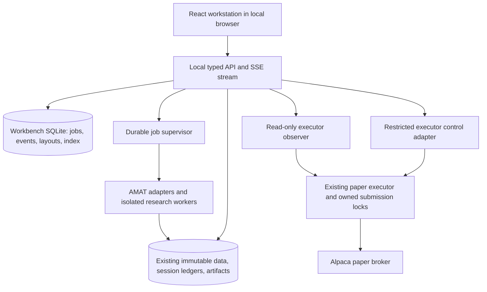

# AMAT Hedge Fund Workbench — complete local implementation plan

> October 8 update: [AMAT Terminal plan](../frontend/PLAN.md) adds the financial-terminal layout, metric definitions, current executor health and correlated action events. It establishes a top-level `frontend/` application boundary and supersedes the `workbench/` folder proposal and operations delivery priority below. Research/configuration coverage remains applicable. The initial terminal was implemented October 9; see [implementation status](../frontend/IMPLEMENTATION.md) for actual delivered scope. The broader full workbench remains a roadmap.

Planning baseline: September 30, 2026, America/Detroit. This document specifies a build; it does not claim the application has been implemented. The source inventory reflects the current working tree, including existing uncommitted work, rather than only the committed revision.

## 1. Product outcome and scope

Build one locally hosted, interactive application for the complete AMAT research-to-paper-operations workflow. An operator must be able to discover data, form hypotheses, configure research agents, run studies and backtests, inspect evidence, compare strategies, conduct portfolio reviews, select research baselines, inspect execution plans, and monitor the paper executor without returning to a terminal for supported routine work.

The application is a working research and operations desk: persistent layouts, linked analytical views, durable jobs, truthful live state, reproducible evidence, complete configuration, and an auditable command surface. Static reports remain accessible, but do not define the interaction model.

Initial operating assumptions:

- One local operator on the existing Linux workstation; multiple browser tabs and monitors supported. LAN/multi-user access is a later deployment mode with its own authentication and permission work.
- Local API, UI, event store, indexes, and job supervision. Existing model, news, market-data, and paper-broker integrations still require internet access and their existing credentials.
- Offline mode supports saved evidence, local datasets, eligible backtests, built-in proposals, report viewing, and replay. Connectivity-dependent actions explain their missing dependency.
- Preserve AMAT, newsdesk, deskreview, portfolio_team, llmrouter, and executor ownership boundaries. Reuse their computations and validators.
- “Live execution” means current **paper-account** operations. The existing executor pins the paper hostname. Real-money execution is a distinct future program, never a settings toggle.
- “Fully configurable” means every supported operator option is represented, including versioned advanced forms. Invariants and frozen evidence are visible but not editable in place.
- No external telemetry service is required. Model prompts and raw evidence are not automatically sent to a tracing vendor.

## 2. Evidence and current capability baseline

Read these sources as the implementation baseline, in order of authority: current code and parser contracts; tests and current artifact schemas; recent operational documentation; older design plans.

| Area | Evidence in the workspace | Consequence for the UI |
|---|---|---|
| Strategy, data, simulation, validation | `amat/src/amat/cli/main.py`, `amat/src/amat/config/`, `amat/src/amat/backtest/`, `amat/src/amat/validation/` | Wrap existing engines, configurations, reports, and provenance; do not calculate replacement strategy metrics in JavaScript. |
| Research sessions | `amat/src/autoresearch/cli.py`, `workspace.py`, `loop.py`, `ledger.py`, `contracts.py` | Treat frozen programs and session runtimes as versioned evidence. |
| Research telemetry | `amat/src/autoresearch/telemetry.py`, `observability.py` | Reuse read-only SQLite observations, phase state, model call timeline, usage, and writer-lock status. |
| Agent orchestration | `amat/src/autoresearch/graph.py` | Current outer graph is prepare → research → verify. Show this real topology first; additional nodes require actual instrumentation. |
| Portfolio review team | `amat/src/portfolio_team/cli.py`, `contracts.py`, `research_queue.py` | Present research, portfolio, risk_operations, and chief_pm roles, evidence, assessments, and gated follow-ups. |
| Genetic and multitimeframe research | `amat/src/autoresearch/genetic/cli.py` and sibling modules | Include nested validation, symbolic discovery, replay, parameter studies, shadow campaigns, and data diagnostics. |
| News and market review | `amat/src/newsdesk/cli.py`, `amat/src/deskreview/cli.py` | Include provider ingestion, coverage, knowability, asset discovery, and morning/midday/evening observation passes. |
| Execution and monitoring | `executor/src/executor/cli.py`, `daemon.py`, `operations.py`, `portfolio_monitor.py`, `order_registry.py` | Keep account observations, submission authority, operational incidents, and research readiness distinct. |
| Operator shortcuts | `research`, `amat/research`, `amat/scripts/research_cli.py`, `COMMANDS_CHEATSHEET.md` | Map aliases and special data/return-study tools as first-class workflows. |
| Existing views | `amat/src/autoresearch/presentation.py`, reporting modules, two notebooks | Reuse artifact formats; add interactive views and preserve original export access. |

The generated [inventory](capability-inventory.json) contains **88 leaf command endpoints, 537 argument occurrences, 60 candidate configuration/policy/specification classes, and hashes for 234 Python source files**. Argument occurrences include inherited/repeated options; configuration candidates are static discoveries, not 60 independently editable forms. The [coverage matrix](command-coverage.csv) assigns every command to a planned primary surface.

This is a strong starting inventory, not proof that every library function or artifact has already been classified. Phase 0 must additionally inventory wrapper aliases, standalone scripts, notebooks, environment settings, configuration files, persisted schemas, and library-only operator capabilities. Parser defaults are observations, not recommendations: some defaults and help text differ across wrappers and policies. Show the effective resolved policy for each actual session.

Observed gaps requiring explicit delivery:

1. A unified application server, typed API, and rich frontend are not established by the current CLI/report surfaces. `amat/package.json` is empty; do not assume it is a usable frontend foundation.
2. Durable jobs, lifecycle commands, and a normalized local event stream need a dedicated application layer.
3. Pause/resume/cancel support varies by workflow. A UI cannot infer safe resumption from an existing process ID.
4. Agent-generated code is currently saved as a proposal awaiting isolated validation. The September 27 autonomy document explicitly says it is not automatically executed, backtested, or promoted.
5. Broader statistical strategy lifecycle, some monitoring feedback, corporate-action coverage, and real observation windows remain backend work. Older “remaining work” lists may already be partially superseded by current code.
6. The latest-session pointer may live outside this repository under the sibling `amat-research` location. Discovery must support explicitly registered external session roots.
7. Docker's executor state volume can be authoritative while `executor/state/` is not. The UI must identify which deployment it observes.

## 3. What 100% coverage means

Create a versioned `capabilities.json` registry, generated partly from code and supplemented by reviewed declarations. Each capability has a stable ID, source owner, source revision/hash, category, route, input schema, defaults, constraints, output schemas, side effects, network/credential needs, lifecycle support, evidence requirements, adapter, tests, and implementation state.

Use separate coverage measures:

| Measure | Required release result |
|---|---|
| Command coverage | All supported CLI endpoints and aliases mapped to a working structured UI action or an explicitly justified read-only representation. |
| Configuration coverage | Every supported field classified as editable, secret-reference-only, frozen, derived, or invariant; every editable field can round-trip without loss. |
| Artifact coverage | Every supported operational/research schema can be discovered, inspected, downloaded, and related to its producer. |
| Workflow coverage | Every complete user journey has a passing integration/browser acceptance scenario. |
| State coverage | Queued, running, partial, failed, interrupted, unavailable, stale, canceled, and successful states are accurately represented where applicable. |

For each measure: coverage = accepted entries / applicable entries. Report numerator and denominator. Unclassified entries block the completeness claim. Engineering-only internals may be excluded only with a documented reason, not because a screen is inconvenient. Unsupported backend functionality stays marked unsupported and is separately tracked; a disabled button does not satisfy an implemented capability.

A searchable **All capabilities** drawer supplies typed advanced forms for rare commands. It is a completeness mechanism, not a raw shell box. Common workflows receive purpose-built screens. New parser/config/schema changes must fail a coverage-drift check until the registry and UI mapping are updated.

## 4. Application shell and interaction design

Visual thesis: a calm, precise trading and research workstation with dense tables, large analytical canvases, restrained color, and clear evidence provenance.

Content plan: persistent navigation, a primary working canvas, an optional right inspector, and a collapsible job/event tray. Start directly in the workspace; no marketing hero or decorative dashboard-card grid.

Interaction thesis: linked chart brushing reveals corresponding rows and evidence; selecting a strategy follows it across desks; restrained highlighting shows newly arrived events without moving the operator's selection.

```text
┌ Workspace / layout ─ Search & commands ─ Data as of ─ Connection ─ PAPER ┐
│ Navigation │ Tabs: Research session / Compare / Market SPY              │
│            │ Context: strategy · snapshot · dates · benchmark           │
│ Overview   ├──────────────────────────────┬─────────────────────────────┤
│ Research   │ Primary chart, experiment   │ Inspector                   │
│ Analysis   │ table, or workflow graph    │ Parameters / evidence /     │
│ Strategies │                              │ selected trade / run diff  │
│ Patterns   ├──────────────────────────────┴─────────────────────────────┤
│ Markets    │ Linked table, timeline, or secondary visualization         │
│ Agents     ├────────────────────────────────────────────────────────────┤
│ Reviews    │ Jobs & events: state · phase · elapsed · resources · alerts │
│ Execution  │                                                            │
│ Data       │                                                            │
│ Evidence   │                                                            │
│ Settings   │                                                            │
└────────────┴────────────────────────────────────────────────────────────┘
```

- Resizable panes, persisted layouts, pinned tabs, keyboard command palette, saved filters, column selection, and shareable local URLs with stable entity IDs.
- Named layouts: Research, Quant Analysis, Market Desk, Agent Operations, Paper Operations. These are arrangements of shared components, not separate applications.
- Context linking is explicit: link symbol/time range/strategy between panels; show a linked indicator and allow unlinking. Comparison never silently changes a run's frozen evaluation period.
- Global context can narrow browsing, but cannot mutate an active research contract.
- Use one primary action accent; reserve semantic colors for gains/losses, warnings, and failures. Labels and icons convey the same meaning without color.
- Dark and light themes, tabular numerals, legible small text, accessible focus, keyboard alternatives to drag/resize, reduced-motion support, and table alternatives for charts.
- Target desktop use at 1440×900 and wide monitors; 1024-pixel layouts collapse the inspector. Narrow screens prioritize monitoring and inspection.
- All views distinguish loading, truly empty, unavailable, partial, stale, unauthorized, and failed. Zero is a value, never the placeholder for unavailable data.

## 5. Desks and required functionality

### 5.1 Overview — `/overview`

Show active research, latest completed comparisons, selected research baseline, paper deployment, data freshness, unresolved incidents, provider budgets, queued work, and local resource pressure. Keep research performance, simulated performance, and measured paper performance in separate labeled sections. Drill into every reported quantity.

Primary actions: start research, reopen a session, compare selected candidates, inspect an incident, open the paper account, or resume an eligible interrupted job. A single all-green health badge is insufficient: display process health, observation freshness, reconciliation, deployment authorization, and submission enablement separately.

Acceptance: a running research session and executor can both be observed without confusing their strategy identity or performance history.

### 5.2 Research workbench — `/research`

Session browser with daily/intraday modes, active/completed/interrupted status, candidate count, date range, dataset, parent baseline, objectives, and reproducibility status.

New-session editor exposes brief, baseline, snapshot/minute data, train/validation/holdout boundaries, program, iteration and stall limits, robustness mode, scenario settings, timeouts, provider policy, token budget, seed, and applicable engineering policy. Validate conflicts such as latest daily data versus explicit snapshot overrides using the existing backend rules.

Session detail combines hypotheses, proposal diffs, experiment queue, candidate lineage, best-so-far curve, eligible-score leaderboard, raw-return leaderboard, quality gates, uncertainty, cost, failure library, and linked evidence. Never imply that raw return is the selection criterion when eligibility checks failed.

Actions: initialize, launch batch, run one proposal, continue supported work, request a checkpoint, inspect diagnostics, generate summaries, inspect related evidence/charts, export analysis, view failures, create a matched follow-up, and select a candidate for future research through the existing promotion contract. Selection for research does not authorize execution.

For frozen sessions, use the recorded runtime/schema adapter and original contracts. Changing dates, objectives, baseline, or model policy creates a new version/session unless the engine explicitly supports a logged change.

Acceptance: launch a bounded built-in research batch, close/reopen the browser, see real progress, and trace a candidate's displayed metric to the exact saved artifact and configuration.

### 5.3 Data analysis and backtesting bench — `/analysis`

Typed experiment builder covering synthetic verification, historical backtests, studies, simulation, walk-forward, holdout declaration, Monte Carlo, heavy-tail stress, standard stress, forward projection, regime experiments, target-volatility sweeps, exit-rule sweeps, and return-target studies. Include script-backed horizon, parameter-neighborhood, trade-quality, and asset audits after Phase 0 classification.

Expose universe, strategy version/config, initial equity, loading and measured windows, benchmark, allocation/execution assumptions, cost/slippage settings available to the selected engine, seeds, repetitions, folds, scenarios, and output options. Unsupported assumptions are not invented merely to populate a familiar backtesting form.

Results workspace:

| View | Required interactions |
|---|---|
| Equity, benchmark, and drawdown | Synchronized crosshair, brush, log/linear view, date drilldown, exact-value table, explicit baseline normalization. |
| Return distribution and tails | Histogram/ECDF, quantiles, expected shortfall, sample counts, confidence intervals when supplied, comparison by evaluation partition. |
| Rolling risk and exposure | Select windows, view volatility/Sharpe/exposure/turnover where supported, inspect missing periods and warmup. |
| Monthly/yearly and regime performance | Heatmaps and tables with linked trades, units, sample sizes, and net/gross distinction. |
| Positions and trades | Filters by asset, side, time, reason, missed trade, fill/cost; chart annotations linked to source records. |
| Walk-forward and scenarios | Fold chronology, locked/development partitions, fan charts, stress drawdowns, all failed scenarios retained. |
| Parameter sensitivity | Heatmap/scatter, trial count, search budget, neighborhood robustness, selected versus rejected configurations. |
| Matched comparisons | Validate identical data/window/execution assumptions; show differences before allowing causal interpretations. |

Add a query workbench for registered analytical tables: read-only SQL against an isolated analytical process, bounded memory/time/rows, no arbitrary filesystem/network extensions, saved queries, and reproducible export metadata. File access comes only through approved dataset handles. SQL over results is analysis, not authority to rewrite source metrics.

Include notebook discovery, preview, and execution of approved existing notebook templates through the job supervisor. Full arbitrary notebook/code execution needs the isolated compute mode; do not execute uploaded Python in the API process.

Acceptance: a UI-driven study matches the canonical CLI result for the same seed and inputs; brushing a drawdown identifies the underlying sessions and trades; raw exports preserve full resolution.

### 5.4 Strategy registry and portfolio construction — `/strategies`

Browse strategy configurations and versions, features/signals, candidate lineage, active research selection, paper deployment digests, and validation evidence. Provide version-aware schema forms, raw TOML/JSON editor, validation, semantic diff, and save-as-version.

Inspect supported feature formulas, causal availability, regime routing, entry/exit rules, asset selection, allocator weights, exposure, volatility targets, and implementation constraints. Preview proposed weights and an inert execution plan using the existing planner and explicit equity/positions inputs.

Where existing analytical outputs support it, show concentration, asset contribution, portfolio correlation, and exposure. New risk calculations are separately specified, tested backend features with methodology labels.

Keep lifecycle facets separate: discovered; retained for development; independently validated; risk-reviewed; selected for research; paper digest authorized; fill observed; incident watch. The current execution registry's `paper_approved`, `active`, and `watch` states do not prove statistical validation. A richer unified lifecycle requires new backend records and gates.

Acceptance: compare configurations, create a validated copy, build an inert plan, and inspect why it is withheld without making any broker call that submits an order.

### 5.5 Pattern and genetic research — `/patterns`

Cover all 18 nested `autoresearch patterns` endpoints from the inventory, including validation, discovery, symbolic discovery, nested search validation, replay, shadow freeze/observe/refresh, intraday coverage audit, minute/native fetch, native comparison, parameter search, walk-forward parameter search, component comparison, shadow registration, and campaign polling.

Provide protocol editor, genome/expression inspector, population/frontier views when recorded, generation/trial progress, fold and whole-search null evidence, calibration provenance, native-versus-aggregated candle comparisons, and frozen shadow signal timelines. Label raw shadow signals as observations; they are not orders or validated discoveries.

Controls must preserve search budgets, seed, costs, calibration dates, native/minute dataset identity, registry bindings, and explicit diagnostic-rebind semantics. Missing telemetry produces “not recorded,” not a fabricated generation animation.

Acceptance: execute an eligible small study and replay its retained artifact; every shadow observation references the original frozen artifact and actual input coverage.

### 5.6 Market analysis and news desk — `/markets`

Asset browser, universe filters, watchlists, candlestick/volume charts, available feature/regime overlays, cross-asset comparisons, breadth and correlation views where backed by data. Watchlists are workspace preferences; modifying one does not silently change the frozen strategy universe.

Separate historical snapshots, latest completed bars, delayed observations, and any future streaming feed. Show provider, entitlement/feed, interval, timestamp, market session, and freshness. A fast chart redraw does not make a daily snapshot live.

News views cover provider ingestion for existing Marketaux/Alpaca/Adanos adapters, ingestion progress, coverage gaps, deduplication/source evidence, knowable-as-of inspection, scalar exports, asset discovery, and theme configuration. Connect deskreview morning/midday/evening reports to their underlying strategy and data.

Current news cannot be inserted into historical simulations without a point-in-time availability contract. Show published, received, and effective/knowable timestamps when available. Broader live scanners, adaptive news trading, options, futures, and crypto execution are extensions with explicit data and engine prerequisites; existing crypto research inputs still belong in the workbench.

Acceptance: move the as-of timestamp and verify the knowable news set changes causally; disconnected data stays visibly stale.

### 5.7 Agent operations — `/agents`

Two linked views: a fleet table of actual research/review jobs and a run-specific execution graph. A role is not automatically a running process; distinguish logical role, model invocation, worker process, and scheduler task.

Display observed phase, start/end/elapsed time, parent/run/experiment IDs, queue and dependencies, heartbeat, worker resources, provider/model requested versus served, attempt/fallback chain, response status, token usage, charged budget, estimated/measured cost if available, validation outcome, evidence outputs, and blocked reason.

Use graph + chronological timeline + structured event table + sanitized logs + artifact inspector. Graph nodes derive from actual instrumented state. Expand the current three-node graph with worker/reviewer steps only when those events exist. Show evidence-linked summaries and tool/action records, not invented private reasoning traces.

Agent-policy editor:

- Supported roles/templates; proposal, review, summary, coding, and complex-task routing.
- Provider/model chain, requested reasoning options when supported, timeouts, allowed retries, fallback conditions, request concurrency, budgets, and stopping conditions.
- Brief/prompt templates, permitted registered tools, admitted evidence sources, memory scope, and engineering allowlist to the extent these controls exist; gaps require new validated backend fields.
- Experimental policies are immutable per run. Save/version/diff/validate, then apply to the next run or fork a session. Do not overwrite frozen policy to make a live UI edit appear effective.
- Resource scheduler limits across sessions; one writer per research session; a global quota prevents independent sessions from each spending the same shared budget.

Lifecycle controls are capability-aware: cancel queued work, request safe pause at a checkpoint, resume supported checkpoints, stop an owned research process, retry a proven-safe unit, or clone from failed inputs. Show “pause requested” until the worker acknowledges. Killing a process does not imply its remote provider request or side effect was canceled.

Engineering proposals have a dedicated queue: patch, hashes, allowed files, advisory tests, isolated validation status, repair count, evaluation evidence. Build the isolated worker before offering Run generated code. Isolation includes no model/broker credentials, network or Docker socket; read-only inputs; constrained writable outputs; CPU/memory/time limits; trusted tests outside edited code; and signed/hashed provenance. Passing tests allows the next research evaluation stage, not execution deployment.

Acceptance: induce a provider fallback and interrupted worker; the UI shows actual attempts, unknown usage, interruption, and legal next actions accurately after restart.

### 5.8 Portfolio committee and follow-ups — `/reviews`

Import catalogs, inspect evidence validation/quarantine, preflight a review, run single/bounded-cycle reviews, evaluate review cases, compare role findings, inspect chief resolution, replay saved reviews offline, build follow-up plans, record task approvals, inspect dispatch specifications, and execute registered eligible follow-ups.

Every finding links to facts/artifacts. Unresolved evidence requests remain visible. Unsupported follow-up adapters stay blocked with the backend reason. Explicitly distinguish committee dispositions from deployment permission.

Acceptance: conduct a review, inspect contradictory role findings, approve a specific evidence-bound task, execute it only through its registered worker, and retain its audit record.

### 5.9 Paper execution and operations — `/execution`

Authoritative deployment selector: local process/state root or existing Docker deployment/volume. Expose deployment identity, config digest, source/image identity when available, clock/calendar, plan schedule, dry-run/submission-disabled settings, and effective caps. An attached executor remains independent of browser lifetime and UI shutdown.

Account view: observed cash/equity/positions, orders, partial fills, remaining quantities, measured paper equity/drawdown, trade metrics, and daily reports. Distinguish broker status from derived registry status such as `pending_market_closed` and `observation_unavailable`.

Plan inspector: exact archived JSON, schema, strategy/config/snapshot/code identity, as-of/earliest/expiry sessions, holdings supplied to sizing, targets, intents, reasons, caveats, withheld actions, preflight failures, approved digest, and deterministic client order IDs.

Operations view: portfolio baseline/checkpoint proof chain, cash/share activity reconciliation, last successful reconciliation, current observation freshness, persistent incidents, attribution confidence, and actual qualifying observation-window progress. A healthy container is not proof of healthy trading operations.

Map all existing executor actions: daemon/run attachment, status, check, account, calendar, explicit one-shot submit, daily report, local trade rebuild, and retention prune. Side effects are explicit: `check` may contact data services; `report` may email and prune; submit is an order action; prune deletes retained files. Provide read-only report viewing separately from running the report phase.

Add service control only through a narrow executor-owned command adapter. No general shell access or Docker socket in the browser/API. Proposed hot controls such as disable submissions need an acknowledged executor mechanism; environment-file changes alone do not update a running daemon. A stop-submissions action must state what happens to existing orders. Canceling orders or flattening positions are separate backend capabilities and cannot be implied by stopping a service.

Order actions require exact deployment/account/session/plan identification, the existing authorizations and preflight, one submission lock, idempotent request tracking, and a reviewable action confirmation. Ambiguous broker timeouts become “outcome unknown: reconcile,” never an automatic retry. Monitoring does not authorize resubmission.

Current recorded order refresh can be approximately four minutes apart plus processing; the status documentation uses a twelve-minute stale threshold for portfolio observations. Preserve source-specific cadence and thresholds. Faster observation is a separately measured executor change, not a claim made by the UI event stream.

Acceptance: paper fixtures cover closed-market partial fills, missing observations, unrecognized holdings, expired plans, duplicate submit attempts, ambiguous submission outcomes, stale data, and reconciliation discrepancies. Real paper-account checks are a separate explicit operational validation, never a default test.

### 5.10 Data, evidence, settings — `/data`, `/evidence`, `/settings`

Data: dataset catalog, manifests/hashes, snapshot hierarchy, available periods/symbols, corporate-action exceptions, daily/minute/native coverage, calendar completeness, quality results, ingestion/update jobs, storage use, and immutable snapshot lineage. Offer “create updated snapshot,” not overwrite historical evidence.

Evidence: sessions/runs/artifacts search; JSON/CSV/Markdown/HTML/PDF/notebook viewers; lineage graph; config/source/schema/seed identity; links between candidate, evaluation, review, plan, order, and incident; original download and reproducible export bundles. Preserve limitations and unknown provenance on legacy imports.

Settings: all supported configuration categories, effective precedence, value origin, defaults, validation, secret references, model/provider health, resource limits, storage roots, display units/timezones, local notifications, report recipients, retention, backups, and adapter compatibility. Advanced raw editing round-trips through the same authoritative validators as forms.

HTML reports use a sandboxed viewer without trusted same-origin script privileges. CSV exports retain formula-injection protections. Files resolve through registered roots and artifact IDs, with traversal/symlink checks.

## 6. Local architecture



Proposed new top-level project:

```text
workbench/
  frontend/             React + TypeScript application
  backend/              FastAPI API, schemas, read models, application services
  supervisor/           Durable queue, leases, process ownership, resource scheduler
  adapters/             Research, patterns, reviews, data, news, executor observation
  capabilities/         Registry, source mappings, schema snapshots
  tests/                Adapter contracts, integration, browser, replay, fault tests
  scripts/              Launch, doctor, inventory, migration, backup/restore
  pyproject.toml        Separate application dependencies and lockfile
  README.md             Local operation and recovery
.workbench/             Ignored local state, logs, caches, preferences
```

Keep the executor's standard-library dependency boundary intact. Put web dependencies in the new application. Research subprocesses use the correct project environment or recorded frozen runtime. API adapters may use stable public research functions for read-only operations, but must not conflate current package imports with historical runtime semantics.

Recommended stack, with versions pinned and compatibility-tested at Phase 0:

| Layer | Choice and reason |
|---|---|
| Frontend | React, TypeScript, Vite; a local SPA does not need server rendering. |
| Routing/server state | React Router and TanStack Query; URLs identify entities, queries handle caching/invalidation. |
| Tables | TanStack Table plus TanStack Virtual; sorting/filtering/paging on the server for large datasets. |
| Charts | Apache ECharts for time series, distributions, heatmaps, candles, and linked selections. Add another plotting engine only for a proven unmet requirement. |
| Workflow graph | React Flow with memoized node components and bounded subscriptions. |
| Editors | A structured schema form plus lazily loaded Monaco editor for advanced JSON/TOML/SQL and diffs. |
| API/contracts | FastAPI, Pydantic, OpenAPI-generated TypeScript types; explicit schema versions for persisted artifacts. |
| Jobs | Dedicated Python supervisor with durable SQLite queue, leases, subprocess groups, bounded concurrency, and per-session locks. |
| Storage | SQLite WAL for application-owned metadata/events; existing source databases stay owner-controlled. Read-only DuckDB over registered analytical exports where useful. |
| Live updates | Server-Sent Events for server-to-browser changes; normal HTTP for commands. Add WebSocket only if a real bidirectional high-frequency requirement emerges. |
| Validation | Existing Python gates plus focused adapter tests, frontend unit tests, Playwright journeys, accessibility checks, fault injection. |

The separate compute supervisor is an architectural choice consistent with [FastAPI's guidance on heavy background computation](https://fastapi.tiangolo.com/tutorial/background-tasks/). Virtualization must be supplied alongside the table layer, as documented by [TanStack](https://tanstack.com/table/v8/docs/guide/virtualization). Graph rendering should follow [React Flow's performance guidance](https://reactflow.dev/learn/advanced-use/performance). Shared chart datasets support the proposed linked analytical views; see [Apache ECharts datasets](https://echarts.apache.org/handbook/en/concepts/dataset/).

Do not use in-request backtests, FastAPI background tasks as the durable queue, a shell textarea as an API, or client-side recomputation as the official metric source. Redis/Kubernetes/distributed workers are unnecessary for the initial single-host system.

## 7. Contracts, job control, and live state

### 7.1 Entities and ownership

Workbench entities: Workspace, RegisteredRoot, Capability, ConfigVersion, DatasetRef, RunRef, CandidateRef, Job, JobAttempt, Event, ArtifactRef, ReviewRef, DeploymentRef, IncidentRef, SavedLayout, SavedQuery, and NotificationRule.

Source systems own research decisions, measurements, broker states, and evidence. Workbench stores references and rebuildable read indexes, not competing authoritative copies. Keys include source namespace and deployment/session identity to avoid collisions. Monetary order fields retain decimal strings; units and fractional-versus-percentage representations are explicit.

Artifact references include source schema/version, producer identity, canonical path/root handle, content hash, availability status, and lineage. Historical schema adapters are versioned; unsupported artifacts remain downloadable and honestly labeled.

### 7.2 Representative API

| Endpoint family | Purpose |
|---|---|
| `GET /api/v1/capabilities` | Coverage, schemas, availability, side effects, lifecycle support. |
| `GET /api/v1/config-schemas`, `POST /config-drafts/validate` | Typed forms and authoritative validation without activating a change. |
| `POST /config-versions` | Save a new validated version with provenance. |
| `POST /jobs`, `GET /jobs/{id}` | Submit typed capability inputs and inspect durable status. |
| `POST /jobs/{id}/actions` | Supported pause/resume/cancel/retry request with expected state/version. |
| `GET /events?after={cursor}` | Filtered replayable SSE with snapshot/reconnect semantics. |
| `GET /sessions`, `/runs/{id}`, `/candidates/{id}` | Normalized research read models. |
| `GET /datasets`, `/artifacts/{id}`, `/artifacts/{id}/download` | Registered, bounded evidence access. |
| `POST /analysis/queries`, `GET /series` | Bounded query jobs and resolution-aware chart data. |
| `GET /deployments/{id}/observations` | Executor state with per-source freshness and authority. |
| `POST /deployments/{id}/actions/preview` | Exact action consequences, required evidence, and current preflight. |
| `POST /deployments/{id}/actions` | Explicit executor action through restricted adapter; preview never guarantees later preflight. |

Commands carry an idempotency key, expected resource revision, input/config hashes, and operator context. Return `202` with job/action ID for asynchronous work. Validation errors identify the exact field and authoritative reason. Availability failures distinguish missing dependency, unsupported capability, source unavailable, stale input, conflicting writer, and invalid state.

### 7.3 Job state machine

`queued → validating → running → succeeded | failed | interrupted | outcome_unknown`

Additional legal paths: queued cancellation; running → pause_requested → paused at a supported checkpoint; paused → queued/resuming; running → cancel_requested → canceled only after acknowledgment. An application-owned job record must preserve the engine's native status separately.

Persist request before spawning. Use a single supervisor owner/lease per job, process identity beyond a recycled PID, process-group ownership, bounded stdout/stderr, environment allowlists, and correct cwd. A crashed supervisor reconciles surviving workers and durable results before retrying. Read-only/idempotent work may retry by policy; unknown side-effect outcomes require reconciliation.

Scheduling: independent limits for CPU backtests, data ingestion, provider requests, and notebook/isolated compute. Start with one heavy research job by default, configurable after benchmarking. Bound BLAS/thread counts as well as worker count. Reserve resources for monitoring and UI responsiveness. Do not run duplicate schedulers alongside an attached executor.

### 7.4 Event contract

```json
{
  "schema_version": "workbench-event/1",
  "event_id": "stable-source-or-adapter-id",
  "cursor": 1842,
  "occurred_at": "2026-09-30T19:42:11Z",
  "observed_at": "2026-09-30T19:42:12Z",
  "source": "autoresearch",
  "source_instance": "registered-session-id",
  "source_sequence": 132,
  "run_id": "run-id",
  "job_id": "job-id",
  "kind": "model_call_finished",
  "severity": "info",
  "payload": {"call_id": 41, "status": "ok", "artifact_ids": []}
}
```

Events describe observed facts. Distinguish source event time, observation time, and ingestion order. Source sequence may be absent; global cursor orders local delivery, not historical causality. Dedupe by source identity/event key, detect sequence gaps, and reconcile snapshots after reconnect. For file tails, track rotation identity and offsets; buffer incomplete final NDJSON lines.

Poll existing SQLite/JSON evidence initially; add native events incrementally. Avoid long read transactions or invoking write-locking export code merely to refresh a screen. Build checkpoint/replay fixtures from sanitized recorded metadata.

SSE uses a persisted cursor/Last-Event-ID, bounded per-client queues, heartbeats, and a resnapshot path after retention gaps. Slow clients receive a gap/resync notice rather than causing unbounded memory. The UI can batch rendering while retaining every durable event. Critical operational incidents must not disappear due to chart sampling.

Freshness is per source, with last attempt, last successful observation, expected cadence, and stale reason. Proposed UI transport goal: p95 under two seconds from adapter observation to visible update on the reference host. This does not improve or conceal source sampling cadence.

## 8. Configuration and local controls

Maintain a field registry with source path, schema version, type, unit, default, bounds, enum, dependency rules, value origin, secret classification, authority, and activation semantics.

| Configuration group | UI treatment |
|---|---|
| Strategy/universe/features/allocator | Versioned forms + raw editor + backend validation + semantic diff. |
| Research program/evaluation | Draft before launch; frozen during the session; fork/version for changes. |
| Model routing/budgets/timeouts | Show effective chain and source; new-run policy versions; record overrides. |
| Committee catalogs/policy | Structured evidence selectors, readiness checks, immutable review references. |
| Genetic/nested/shadow protocols | Domain forms with calibration/search/trial constraints and protocol hash. |
| Data/news/providers | Registered datasets, ingestion windows, source options, point-in-time rules. |
| Executor env/risk/schedule | Executor-owned validation, exact digest authorization, next-restart versus hot-change labels. |
| Secrets | Write-only local secret references and configured/missing status; never echo values in forms/events/logs. |
| Workbench preferences/resources | User-local persisted settings, independent of research evidence. |

Display precedence explicitly: built-in defaults → selected version → environment → supported invocation overrides → frozen effective configuration. The actual order is adapter-specific and must come from the implementation, not a universal guess. Lock constants such as the paper hostname and “research execution authority: none.”

Local-only is not authentication. Bind to loopback by default; use a generated local session credential/HttpOnly session, origin/Host checks, CSRF protection for writes, no wildcard credentialed CORS, and path allowlists. The browser never receives broker secrets. The API cannot arbitrarily rewrite credentials or run supplied shell commands.

Import existing session evidence read-only and create rebuildable indexes. Back up application state through a consistent SQLite backup operation; keep schema migrations versioned and test restore. Backing up an index is not backing up the source research/executor state: enumerate all authoritative roots and use their appropriate consistent backup procedures.

Retention policies differ: display cache can expire, but retained research evidence and executor proof chains cannot be purged by a generic “clear history” action. Preview paths and effects for destructive retention operations.

## 9. Delivery sequence, work packages, and dependencies

Estimates are engineering effort ranges for planning, not guarantees. They assume the current source can be made reproducibly installable and existing engines do not require major algorithm changes. The full UI and the backend gaps are separate effort lines.

| Phase | Deliverables | Exit gate | Estimated engineer-weeks |
|---|---|---|---|
| P0 — Inventory and contracts | Complete registry; script/notebook/env/artifact inventory; source freeze; fixture selection; schema and UI context design; dependency pins; existing test baseline. | Every supported surface classified, gaps explicit, baseline tests recorded; no unresolved coverage category. | 1–2 |
| P1 — Local foundation | New project, shell/navigation, launcher/doctor, roots discovery, typed API, event store, artifact index, auth boundary, health/freshness components. | Launch locally, inspect an existing daily/intraday session and correct executor state source; restart and restore layout. | 2–3 |
| P2 — Durable research jobs and agent visibility | Supervisor, adapter allowlist, real telemetry, sessions/queue/graph/call timeline, policy editor, supported lifecycle controls. | A real bounded run survives browser closure; interrupted worker/fallback/duplicate-click scenarios pass. | 2–4 |
| P3 — Analysis bench and strategy registry | Backtest/study/validation forms, comparison workspaces, linked charts/tables, versioned configs, inert plan inspection, exports. | Canonical CLI parity, large-result interactions, causal partitions and config diff verified. | 3–5 |
| P4 — Market, news, data, pattern, review coverage | Data catalog/updates, news knowability, desk reviews, all genetic commands, committee and task queue, query/notebook templates. | Every command family reachable; end-to-end matched review/follow-up and pattern replay pass. | 3–5 |
| P5 — Paper operations | Authoritative observer, orders/positions/plans/reconciliation/incidents, deployment settings, restricted explicit controls. | Adversarial paper fixtures pass; no bypass of existing submit protections; restart cannot repeat orders. | 2–4 |
| P6 — Completion and release | Rare-command forms, remaining field/artifact coverage, legacy adapters, fault recovery, performance/accessibility, backups, docs, packaging. | All five coverage measures reach 100% for the agreed implemented scope; full release checklist passes. | 2–3 |

Total initial planning envelope: **15–26 engineer-weeks**. With two or three experienced engineers and careful parallel work after contracts stabilize, budget roughly **10–16 calendar weeks**, then revise after P0. A useful integrated local release should arrive at P2/P3; it is not the complete workbench.

Dependencies: P0 → P1 → P2; P3 builds on P1/P2 contracts; P4 and executor observation can proceed alongside P3; executor mutations wait for hardened job/idempotency/control contracts; P6 follows all feature families. Each phase ships a working vertical slice using real or explicitly labeled recorded data.

Backend expansion track, estimated separately after a focused design:

- Isolated generated-code evaluation, bounded repair, code-aware candidates, and independent lifecycle gates: provisional 4–8 additional engineer-weeks, with security/isolation validation.
- Global budget metering, broader agent tool/policy configurability, additional checkpoint support, and monitoring-to-research feedback: 2–4 additional engineer-weeks depending on existing coverage.
- Provider streaming feeds, unsupported corporate-action adapters, and statistical signal-decay baselines require independent data/protocol work and cannot be completed merely by finishing screens.
- Real observation windows depend on actual qualifying market sessions; tests cannot manufacture elapsed operating history.

Suggested implementation ownership: application/API and supervision; frontend/interaction/visualization; research/executor adapters and verification. Roles can be one person sequentially or a small team; no autonomous agent implementation is required by this plan.

## 10. First implementation backlog

Each ticket should reference capability IDs, schema changes, dependencies, and a concrete acceptance artifact.

| Ticket | Work | Acceptance evidence |
|---|---|---|
| WB-001 | Finish generated/supplemental capability registry | Parser options, config fields, scripts, notebooks, env and schemas classified; drift report. |
| WB-002 | Define normalized IDs, freshness, event and action schemas | Schema fixtures for daily, intraday, review, pattern, and executor observations. |
| WB-003 | Launcher, dependency doctor, root/deployment selection | Clean start/stop; no unintended executor shutdown; correct external sessions and Docker volume. |
| WB-004 | Application shell and saved layouts | Keyboard and browser navigation; cross-tab state behavior; restored panes. |
| WB-005 | Read-only artifact/session adapters | No file mutation during browsing; unknown schemas handled. |
| WB-006 | Event ingestion and replay | Restart/reconnect/rotation/partial-write tests with no false event loss claims. |
| WB-007 | Durable queue and subprocess supervisor | Browser/API/supervisor/worker crash matrix; idempotent job submission. |
| WB-008 | Research launch and policy forms | Valid and invalid configs match engine acceptance; frozen settings immutable. |
| WB-009 | Agent graph, timeline and budgets | Real call IDs, routing attempts, usage gaps, and actual phase durations. |
| WB-010 | Analysis series/table query API | Bounded reads and server-derived aggregates; exact export matches canonical artifact. |
| WB-011 | Backtest comparison workspace | Linked selections, metrics provenance, sample mismatch explanation. |
| WB-012 | Executor read models and freshness | Existing paper state correctly rendered without order authority. |
| WB-013 | Restricted executor action adapter | Preview/commit/recheck/acknowledgment and ambiguous outcome handling. |
| WB-014 | Rare-capability forms and coverage dashboard | All 88 current endpoints mapped; supplemental entries complete. |
| WB-015 | Release faults, recovery, performance and docs | Signed-off release checklist and reproducible verification commands. |

## 11. Testing and release acceptance

### 11.1 Test layers

1. Adapter contracts: CLI/API parity, schema versions, monetary units, timestamp handling, config validation, errors, artifact lineage, and no unintended writes.
2. Worker integration: locks, quotas, subprocess limits, retries, checkpoint claims, interrupted output, process recovery, and idempotency under repeated requests.
3. Analytical fixtures: exact reference metrics or explicit numeric tolerance; all rows retained; sampled charts never feed official metrics; golden artifact hashes where existing tests require them.
4. Browser journeys: launch research, inspect agent fallback, compare candidates, run a study, inspect point-in-time news, replay a review, observe partial orders, and restore layout after restart.
5. Boundary tests: research cannot submit, secrets cannot reach UI payloads, generated code cannot reach credentials/network, invalid paths/configs fail closed, source HTML remains sandboxed.
6. Fault injection: lost SSE, delayed source observations, locked SQLite, rotated/partial NDJSON, provider limit, worker crash, backend restart, stale deployment, low disk, incompatible schema, and ambiguous broker response.

Existing AMAT and executor quality gates remain required for changes touching their modules or shared plan behavior. New application tests complement them. Run live-provider and real paper-account checks only as explicitly selected operational tests, never hidden inside the default suite.

### 11.2 Performance targets to measure

Declare a reference host in P0; provisional minimum target is a modern four-core CPU, 16 GB RAM, SSD, with heavy jobs serialized. These are targets, not observed current performance.

- Warm metadata navigation p95 under 500 ms; initial local shell usable within two seconds after server readiness.
- Adapter observation to visible UI p95 under two seconds; source latency reported separately.
- Smooth virtualization over 100,000 trade rows without sending the entire dataset to the browser.
- Multi-million-bar histories queried by time range/resolution; preserve extrema and OHLC semantics when reducing chart data. Full-resolution downloads remain available.
- Ten open analytical panels remain usable while one bounded research job runs; benchmark latency and memory rather than asserting a fixed FPS without evidence.
- Slow or disconnected clients cannot stall source ingestion or executor observation.
- Historical replay and live mode are unmistakable; replay never invokes trading actions.

### 11.3 Release checklist

- [ ] Clean installation and one-command launch documented and tested.
- [ ] All command/config/artifact/workflow/state coverage measures at 100% of classified supported scope.
- [ ] Real source adapters power production screens; demo fixtures visibly labeled and isolated.
- [ ] Normal research-to-review-to-inert-plan journey completes entirely through the UI.
- [ ] Every live value has source identity, as-of time, freshness, and missing-data semantics.
- [ ] Safe lifecycle controls match actual engine support; no fake pause/resume or optimistic broker outcomes.
- [ ] No browser/model/research path bypasses executor authority or paper-only enforcement.
- [ ] Existing jobs survive UI closure; app restarts reconcile work correctly.
- [ ] Config edits are validated, versioned, auditable, and applied only at supported boundaries.
- [ ] Frozen evidence is never silently rewritten; legacy schema readers pass fixture tests.
- [ ] Export, backup, restore, migration rollback/recovery, retention, and low-disk behavior verified.
- [ ] Accessibility, keyboard operation, large tables/charts, and source disconnection tested.
- [ ] Runtime documentation explains remaining backend gaps and source freshness limits.
- [ ] Source revision plus dirty-source hashes and verification results saved for release review.

## 12. Recommended first delivery

Build the integrated read-only desk and durable research launch path first: discover existing sessions and the authoritative executor deployment, inspect real evidence, run a small bounded research session, show actual model/worker events, and compare its results interactively. This validates the architecture against the hardest shared contracts before building every advanced form.

Then finish the analysis bench, pattern/market/review surfaces, and paper controls against the coverage registry. Completeness is established by accepted mappings and end-to-end behavior, not by the number of screens.
