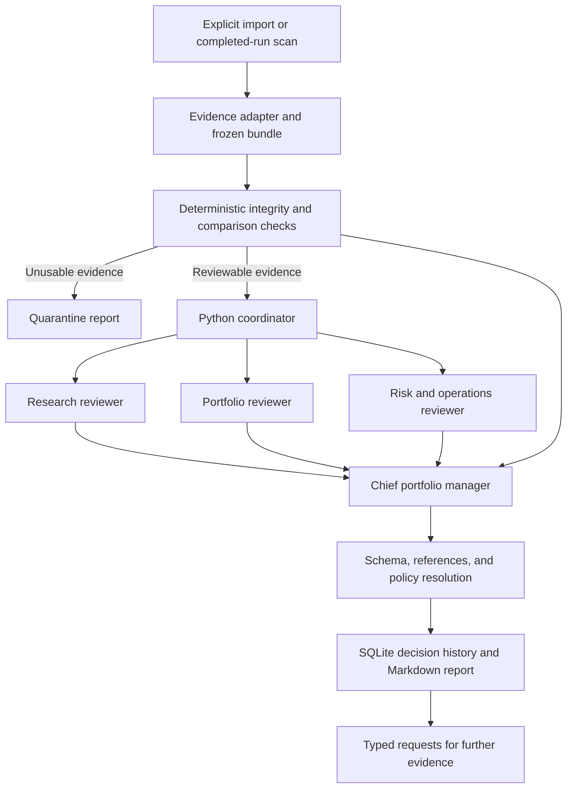

# Portfolio team v1: implementation design

Status: design for implementation, 2026-09-10. No runtime is deployed by this
document. Scope: `amat` and `executor`. This specifies the first useful slice of
the [overall architecture](portfolio-management-team-2026-09-10.md).

Implementation update: the offline import/registry/check/report workflow and
four-role fake-provider coordinator are now available as `pmteam`. See the
[operating instructions and precise implemented scope](portfolio-team-operations.md).
An explicit Gemini adapter, durable usage reservations/deadlines, a single-reviewer
baseline and reference-coverage evaluation are now implemented. Admission, the
watcher, and the broader hidden evaluation corpus remain planned.
The offline adapter validates historical config identity
and TOML syntax; it does not require compatibility with today's strategy loader.

## 1. Product contract

Given a completed AMAT strategy run and a declared comparison, produce a durable
investment-committee review containing verified metrics, independent objections,
a research disposition, and a prioritized list of missing experiments.

V1 is **reviewing strategies in shadow**. It does not mean the candidate strategy
has been admitted to forward shadow trading. The service can shortlist a
candidate for that next stage, but it cannot start a strategy, select live
weights, write a mandate, or change the executor configuration.

The first demonstration imports the existing v6/v9/v10/v11/v12 run artifacts.
It should recognize weak comparisons and provenance limitations, then explain
which evidence would change the conclusion. It need not find a winner.

Outputs per review:

- Machine-readable evidence, deterministic checks, three reviewer assessments,
  the chief PM recommendation, and the final policy resolution.
- A concise Markdown committee report with measured comparison tables,
  dissent, limitations, and specific next experiments.
- A durable history of model calls, retries, usage, artifact hashes, and events.

## 2. Team architecture

Use four logical agents and a Python coordinator. Agents are bounded inference
jobs with versioned instructions; they are not four continuously running bots.
The coordinator, evidence builder, and policy engine are ordinary code.



| Agent | Inputs beyond the common evidence | Responsibility | Required output |
|---|---|---|---|
| Research reviewer | Hypothesis, trial lineage, evaluation-use record | Challenge mechanism, leakage, tuning, robustness, and alternative explanations | Supported findings, research disposition, requested experiments |
| Portfolio reviewer | Declared incumbent/control comparisons and available portfolio evidence | Assess opportunity cost, return/risk trade-offs, redundant exposures, and turnover | Comparison findings, missing joint-portfolio evidence, research disposition |
| Risk/operations reviewer | Provenance and capability checks; optional dated executor export | Assess reproducibility, data/accounting concerns, and execution compatibility | Readiness findings and research disposition |
| Chief PM | All three completed assessments, original evidence, deterministic checks | Resolve substantive disagreement and prioritize the next decision or experiment | Structured recommendation, treatment of dissent, reasons and evidence references |

The three reviewers cannot read one another's first pass. The design supports
concurrent dispatch; the implemented model adapter defaults to one request at a
time for quota safety, with an explicit option for up to three concurrent calls.
The chief runs afterward. V1 has no debate loop: unresolved factual disagreement
becomes `request_evidence`. A schema repair is permitted, but a strategy may not
be modified until reviewers produce a more favorable conclusion.

The risk reviewer interprets deterministic results; it does not manufacture
tests or change their status. The chief cannot override an integrity failure,
invent unavailable capabilities, or turn missing out-of-sample evidence into a
pass. An agent-generated objection is labeled as an allegation unless a check
or referenced artifact substantiates it.

Research generation, specialist sector agents, a coding agent, and an autonomous
backtest runner are later extensions. For v1 they are represented by the
`EvidenceRequest` output so the review loop has a concrete next step.

## 3. Responsibilities and code placement

Create one new sibling Python package inside the AMAT distribution:

```text
amat/src/portfolio_team/
    contracts.py           immutable Pydantic records and enums
    evidence.py            normalization, references, comparison facts
    adapters/amat_runs.py  versioned legacy run-file adapter
    checks.py              deterministic evidence and capability checks
    policy.py              permitted dispositions and final resolution
    store.py               SQLite transactions, jobs, leases, events
    schema.sql             registry schema and migrations
    coordinator.py         review lifecycle and call budgets
    providers/base.py      narrow model-request protocol
    providers/fake.py      deterministic development/test responses
    providers/gemini.py    initial adapter if existing provider is selected
    roles/                 four versioned instruction files
    reports.py             verified tables and committee Markdown
    cli.py                 pmteam commands
amat/configs/governance/    policy, model-role mapping, import catalog
amat/data/governance/       mutable SQLite state; separate from snapshots
amat/outputs/governance/    copied evidence and append-only review exports
```

Dependency direction is `portfolio_team -> amat` for manifest/config semantics;
`amat`, `newsdesk`, `deskreview`, and `executor` do not import `portfolio_team`.
Register the package and `pmteam` entry point in `amat/pyproject.toml`, and include
SQL/prompt resources in the wheel. Verify an installed-wheel smoke test, since
this repository has previously had a package omitted from its distribution.

Reuse `amat.provenance.RunManifest`, existing report field semantics, and AMAT's
config loader. Do not duplicate the trading metrics implementation. Keep the
current advisory narrator and `deskreview` contracts unchanged: they supply
optional narrative/observations, not PM authority.

No new orchestration framework is necessary for this four-call graph. A small
explicit coordinator makes job recovery, budgets, and policy behavior easier
to test. The provider protocol allows a future framework without changing the
evidence or decision contracts.

## 4. Evidence ingestion: use the files that actually exist

Current runs have `manifest.json` and `results.json`. The latter wraps the result
in `{run_id, manifest_sha256, results}`. A study has a `results.studies` array,
and each study's `combined` object holds performance, sample, annual returns,
attribution, concentration, and caveats. Study formats differ from ordinary
backtests and validation batteries; each needs an explicit adapter.

Initial adapter: the persisted study envelope. Inspection confirmed that the
selected v6 `backtest-...` artifact also uses this envelope, with one
`v1-frozen` primary study, as do the selected v9/v10/v11/v12 runs. Command names
alone do not identify result shape. Fixture these exact structures before
implementation. Other backtest/validation formats need separate adapters.
Unsupported shapes produce `unsupported_artifact_format` and remain visible in
the queue; do not guess through arbitrary JSON.

For each input:

1. Resolve paths inside configured roots, reject escaping symlinks and excessive
   file sizes, and read source bytes once into a staging snapshot.
2. Parse the manifest and validate the embedded run ID and manifest digest using
   the matching AMAT serialization contract. The manifest digest is **not** the
   raw file hash: AMAT hashes canonical JSON. Store both kinds of hash, separately.
   Pin adapter/manifest versions; future defaults must not silently change the
   interpretation of old hashes.
3. Require an explicit study/engine selector when several results could qualify.
   Check selected config hashes, duplicated metrics, dates, units, finiteness,
   and basic equity/return consistency within documented tolerances.
4. Verify historical configuration bytes when available. The current file is
   usable only if its digest matches the run. Missing historical configuration
   becomes `configuration_unavailable`; current contents cannot stand in for it.
5. Copy exact manifest/result/config inputs into an exclusively created evidence
   directory. Record raw content hashes, normalized schema/adapter versions,
   and referenced dataset identity. Detect sources changing during discovery;
   incomplete directories are retried, not reviewed as completed runs.
6. Record data verification depth: a manifest digest verifies the manifest link,
   not the underlying market data or the truth of results. Partition checksums
   and code/environment reproducibility require additional evidence.
7. Normalize facts and comparison metadata, resolve references, then freeze the
   bundle hash. Persist it transactionally before scheduling reviewers.

Do not extract numeric evidence from PDFs or previous assistant prose when the
structured artifact exists. PDFs and research notes remain linked context.
Do not assume `holdout_accessed=false` means history is untouched: it records
one boundary check, not every prior researcher's knowledge of that period.
The initial catalog explicitly labels the September experiments
`previously_inspected_history`.

### Existing evidence limitations

`PerformanceReport.as_dict()` does not export its daily equity curve, date array,
or drawdown series. The current saved aggregate study reports therefore cannot
support a new portfolio-return correlation, block-bootstrap interval, or
joint-sleeve allocation simulation. Agents must request those artifacts.
Adding a versioned series export to future AMAT runs is a separate small
implementation item; do not reconstruct daily paths from annual summaries.

`performance.hit_rate` is a return-interval hit rate, whereas
`assets[].win_rate` refers to completed trades. Normalize these as distinct
metrics. Fill count is not trade count or independent sample size. Per-asset
closed-trade P&L is not the same as dividend-inclusive portfolio equity return.

The v11 manifest inspected for this design records `code_revision.dirty=true`.
It is valid review material, with a release-readiness limitation. Importing it
today cannot retroactively recover the exact uncommitted source used in the run.

## 5. Contracts

Use frozen Pydantic models with forbidden extra fields, bounded strings/arrays,
finite numeric values, explicit metric units, and aware UTC timestamps. Add a
schema version to every top-level artifact. Unknown required versions fail
validation. Missing, not applicable, zero, and failed are different states.

| Record | Required fields and semantics |
|---|---|
| CandidateVersion | ID, strategy name/version, config hash, hypothesis or explicit `not_recorded`, capabilities or unknown, lineage |
| RunEvidence | Run ID, source-byte hashes, manifest digest, selected engine/study, adapter version, provenance, dataset references, evaluation-use status |
| MetricFact | Stable fact ID, metric name, value, unit, sample, source artifact hash and JSON pointer; derivation ID and input facts for calculated differences |
| ComparisonSpec | Purpose (`replacement`, `addition`, `mechanism_test`), candidate/control run IDs, settings differences, sample and cost compatibility |
| GateResult | Gate/policy version, scope, `pass/fail/missing/not_applicable`, fact references and reason code |
| ReviewerAssessment | Role, evidence/policy/prompt/model IDs, findings with severity/status/references, disposition, evidence requests |
| PMRecommendation | Proposed disposition, cited findings, response to each blocking objection, selected evidence requests |
| ReviewDecision | Effective disposition, model recommendation, deterministic checks, completeness, readiness, execution authority, supersedes/review IDs |
| EvidenceRequest | Typed experiment, missing requirement, acceptance criteria, required data, purpose and priority; no shell command |

Agent citations use IDs resolved by the evidence service. Example source pointer:
`/results/studies/0/combined/performance/sharpe` in a hashed `results.json`.
The report renderer supplies actual numbers from `MetricFact`; agents need not
copy them. Valid references establish where a claim comes from, not whether
the prose interpretation is correct. Narrative is explicitly labeled model
interpretation; it cannot modify facts or satisfy a quantitative gate.

Preserve all findings and dissent in exports. The chief can classify an objection
as resolved, unresolved, or unsupported, but cannot delete it from the record.
Memory consists of referenced past decisions with their original evidence-use
status. Do not automatically inject previous final verdicts into first-pass
reviews of the same experiment: that would anchor the supposed independent review.

## 6. Decision semantics

Keep separate fields for processing, research disposition, and readiness:

```text
processing_status:
  queued | preparing | reviewing | synthesizing | completed |
  retry_wait | deferred_budget | blocked_provider | quarantined | failed

research_disposition:
  reject_current_proposal | request_evidence | continue_research |
  shortlist_for_forward_shadow

readiness_status:
  not_assessed | blocked | eligible_for_next_review

execution_authority:
  none                           # the only value accepted in v1
```

These fields answer different questions. A completed critique may reject the
investment proposal while readiness is independently blocked by provenance.
A provider outage is a processing failure, not proof the strategy is bad.
An unsupported execution capability can coexist with a useful research idea.

Decision precedence:

1. Corrupt/mismatched evidence: quarantine; no model calls and no investment verdict.
2. Missing required reviewer after bounded retries: incomplete review; no chief
   synthesis, no positive disposition. Preserve available partial assessments.
3. Invalid chief output or unresolved evidence references: bounded repair, then
   processing failure; never default to an earlier successful verdict.
4. Valid complete committee: policy checks the proposal against stage requirements.
   Missing mandatory evidence prevents shortlisting and yields `request_evidence`.
5. A valid supported negative recommendation may reject the current proposal.
   `continue_research` means a plausible avenue with no demonstrated admission case.
6. Shortlisting requires the declared research gates to pass and all required
   reviewers to be present. It remains a recommendation for a later admission
   review, with `execution_authority=none`.

No majority vote or average confidence score. Mechanical checks determine
permitted outcomes; the chief makes a reasoned choice within that set. The
policy stores both proposed and effective dispositions and any override reason.
Keep admission rules separate from optional performance observations: the
project's numerical promotion guidance applies to its intended out-of-sample
evidence, not an aggregate full-history Sharpe substituted for that evidence.

V1 shortlisting uses the existing canonical-family promotion criteria, mapped to
explicit evidence requirements. Other strategy families can be reviewed but need
a separately versioned policy before shortlisting. An agent cannot create an
exception for its preferred candidate.

## 7. Runtime and persistence

SQLite on a local named volume, one coordinator/writer, foreign keys, explicit
transactions, WAL, busy timeout, and versioned schema migrations. Model requests
run outside database transactions. Keep large source/response blobs in hashed
files and store references in the database.

Tables: `candidates`, `evidence_bundles`, `artifact_refs`, `comparisons`,
`reviews`, `review_jobs`, `model_attempts`, `assessments`, `decisions`,
`evidence_requests`, and `events`. Artifact/evidence/assessment/decision records
are immutable after insertion; job status is mutable with an append-only event
for each transition. A new review supersedes rather than overwrites a decision.

Deduplicate reviews by a hash of candidate evidence, comparison evidence,
policy, role prompts/model settings, and review protocol version. Deliberate
repeatability experiments supply an explicit replicate ID. Changing any evidence
creates a new review, not a repair of old reviewer conclusions.

Lease jobs atomically with owner, deadline, and fencing generation. Ignore late
responses from expired attempts when updating current state, but retain them in
the attempt history. Exactly-once external model invocation is not guaranteed:
a crash after a provider response may cause another billed call. Guarantee a
single committed result for each job generation and record ambiguous attempts.

Persist a validated response before moving to the next state. Restart resumes
missing work. Export reports from committed decisions through an outbox/retry
step; a renderer crash must not cause another committee meeting. Back up SQLite
through its backup interface, with the referenced immutable blobs, rather than
copying only an active database file and ignoring its WAL.

Default workload: one review at a time, three concurrent reviewer requests,
one chief request afterward. Four calls on success; at most eight total attempts
with a per-role ceiling of two. One schema-repair or transient retry consumes
that role's remaining attempt. Authentication/configuration errors do not retry.
Use 120-second per-request timeout and a 10-minute review deadline as initial
engineering defaults. Cancellation stops new calls and records partial usage.

Use a per-review and daily token budget with reservations before requests.
Optional monetary limits require a configured provider price table and recorded
usage; missing prices cannot silently count as zero cost. No strategy search or
news polling is performed by these review calls.

## 8. Model adapter and context

Provider-independent protocol:

```text
review(request: ModelRequest) -> ModelResponse

request: role, system_prompt, evidence_view, output_schema, model_settings,
         deadline, request_id
response: structured_payload, provider_request_id, model_id, finish_reason,
          usage, timestamps, raw_response_reference
```

Start with a fake provider for deterministic end-to-end tests. The existing
Gemini dependency is the lowest-integration-cost first real adapter if no other
provider preference is selected. Model IDs are explicit deployment configuration;
do not inherit the report narrator's default or silently switch models on failure.
An OpenAI adapter can implement the same protocol without changing the graph.

Each reviewer receives common immutable facts plus its role-specific evidence.
No arbitrary shell, broker, database-write, or general web tool is exposed to the
agents in v1. The normalizer supplies all required per-asset rows where they fit;
oversized evidence is deterministically partitioned or deferred. Record every
truncation and missing section; do not silently discard losing assets to fit a
context limit. A later read-only paginated evidence tool can extend this contract.

Treat strategy descriptions, reports, and news excerpts as untrusted content,
separate from system instructions. Only bounded structured outputs enter policy.
Record exact model/prompt/input hashes so a stored meeting can be replayed
without another API call. A fresh model rerun is a new replicate and may disagree,
even with otherwise identical settings.

## 9. Operator workflow and deployment

Proposed commands, not currently implemented:

```text
pmteam import-catalog configs/governance/initial-reviews.toml
pmteam review <comparison-id> --provider fake
pmteam review <comparison-id> --provider configured
pmteam status
pmteam show <review-id>
pmteam replay <review-id> --offline
pmteam watch --catalog configs/governance/initial-reviews.toml
```

The initial catalog explicitly selects candidate/control runs and study indices,
comparison purpose, and history-use status. It includes the matched v10/v11 runs;
the differently warmed-up comparison attempts are not silently selected. Import
v12's original and soft revisions as distinct hashes. If the referenced matched
v6 result is available only in prose, request a persisted run instead of making
that comparison appear fully verified.

The [initial catalog example](../../amat/docs/portfolio-team-v1-catalog.example.toml) references
six verified existing run directories. Its v12/v6 comparison intentionally
requires a new matched control: the saved v6 run has a different measured
start date. This is a useful first acceptance case for `request_evidence`.
The [policy example](../../amat/docs/portfolio-team-v1-policy.example.toml) defines the draft
runtime limits and allowed outcomes; neither file is currently executable.

`watch` scans only configured completed-run roots, with a 60-second polling
interval and a stable-file check. Existing runs are ingested only through the
catalog for the first demonstration. For future runs, require a registered
comparison or leave the candidate `awaiting_comparison`; do not pick whichever
baseline makes it look strongest. Future AMAT writers can add an atomic completion
marker; v1 must tolerate legacy non-atomic two-file writes.

Use an optional `portfolio-team` Compose service in the existing deployment
configuration, with a separate image/process and governance volume. Mount run
and strategy evidence read-only, supply only the chosen model credential, and
expose no broker credential or executor-state write mount. An optional dated,
redacted executor report export can be input evidence. Its age and observation
gaps are shown; importing an old report is not a current health check.

No executor source changes are required for v1. Keep core report generation
independent of this service. Service health distinguishes a live worker from a
healthy provider and records last completed review, queue age, incomplete jobs,
and budget exhaustion. Provider failures can leave the review service degraded
while paper execution continues normally.

## 10. Concrete acceptance and evaluation

Implement in five reviewable increments:

| Increment | Deliverable | Exit criterion |
|---|---|---|
| 1. Evidence and comparisons | Contracts, legacy adapters, catalog and source references | Existing runs import; tampering is quarantined; missing history/config/series remains explicit |
| 2. Deterministic review | Gate evaluator, SQLite records, CLI and Markdown | Offline report has accurate units/values, comparison caveats and no fabricated capability results |
| 3. Team protocol | Four prompts, fake provider, coordinator and decision resolution | Full meeting runs; restarts, stale responses, malformed output and missing reviewers cannot yield a positive result |
| 4. Real model shadow | Selected provider adapter, usage budgets, replay, optional container | Existing strategy meetings produce traceable findings; executor settings and orders are untouched |
| 5. Reviewer evaluation | Hidden fault corpus, baseline comparison and disagreement report | Measured review usefulness is reported; candidate admission remains a later milestone |

Fault corpus: at least 30 fixtures spanning units/hit-rate confusion, mismatched
dates, risk-target confounding, inspected holdouts, dirty/unknown provenance,
missing series, unsupported short/intraday claims, concentration, misleading
trade counts, and contradictory artifact values. Include healthy and ambiguous
cases so rejecting everything does not score well. Altered cases intended to
test reasoning have valid content hashes; integrity corruption has separate tests.

Compare deterministic checks alone, checks plus one general reviewer, and checks
plus the four-agent team on the same hidden evidence. Tune prompts on a separate
development set, freeze them, and report held-out flaw recall, unsupported-finding
rate, useful evidence requests, repeatability, latency, and cost. A human audit
labels disputed semantic findings; LLM grading alone is not ground truth.

Engineering acceptance: every displayed metric traces to verified evidence;
invalid/missing mandatory evidence never yields shortlisting; no duplicate
committed decisions; replay needs no provider; all jobs are auditable; no broker
access or executor mutation is possible through the package interface. Use
targeted unit/integration tests, installed-wheel checks, and the repository's
lint/type gates for the new package and touched interfaces.

This evaluation can demonstrate better review quality, not increased returns.
The latter requires prospective candidate selection and forward strategy
outcomes after a separate admission/execution implementation. If four agents
do not improve useful fault detection over one reviewer at acceptable cost,
retain the simpler team.
