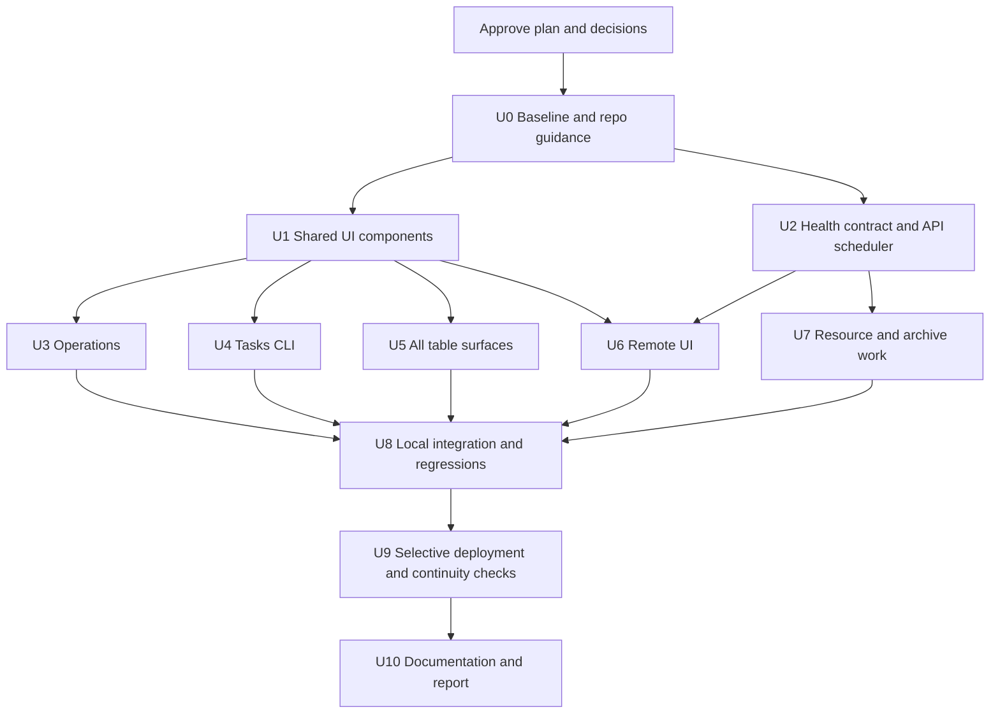

# AMAT UI and remote operations implementation plan

Prepared October 23, 2026, America/Detroit. **Status: implemented, tested and selectively deployed October 23, 2026.**

All U0–U10 units are complete. The [delivery report](../operations/ui-remote-2026-10-23/REPORT.md) records the actual implementation, 634 passing package tests, browser checks, deployed identities, state/restore evidence, measured resource trade-offs and remaining limits. Source changes were integrated in disjoint agent-owned units; remote deployment had one sequential owner. The retained October 22 missing-session-plan alert is documented separately from current process health.

This document records the approved implementation contract. The original planning pass used read-only repository/browser/VPS inspection and added only this document. Implementation, tests and selective deployment began after explicit approval; the dated implementation report records actual changes, verification and operating evidence.

## 1. User decisions incorporated

The user answered the interactive questions. These choices replace the initial recommendations; overall implementation was explicitly approved by the user on October 23, 2026.

| Decision | Selected choice | Consequence |
|---|---|---|
| Browser terminal | Guided, keyboard-driven CLI for registered tasks, with typed inputs, inline preview, Run action, and streamed transcript | Reuse existing capability/preview/job/SSE contracts. No full-shell transport is needed. |
| Automatic health-check lifecycle | Run the new automatic checks only while the local API is running | Own scheduling in the API lifecycle, independent of browser/tab visibility; stop new scheduled checks when the API shuts down. Do not introduce or expand a VPS health-check timer. |
| Generated-run archives | Compress completed, inactive generated detail after 7 days; retain summaries/manifests and verified compressed detail; no deletion of retained archives | Replace eligible collector detail deletion with lossless archival. Existing backup rotation remains separately documented. |
| Permitted remote application containers | Keep `amat-executor`, `kalshi-perps`, and `kalshi-perps-trade-alerts`; retire `kalshi-perps-shadow` because it is optional | Preserve shadow history/state, stop and disable its container during approved deployment, and update trade alerts to watch only the retained main account. |

Supporting SSH, Docker, OS services, existing backups, and existing paper-session evidence collection remain in place. The existing VPS paper-session timer is separate from the newly requested automatic health checks and is not disabled by this decision. No new unattended VPS health scheduler is added. The Web UI remains local.

### Why the shadow container can be retired

`kalshi-perps-shadow` is a separate prospective DOGE/SOL paper experiment, not a dependency of the principal engine. Its deployment records describe a separate $10,000 simulated account, 1x target exposure, 25/75 DOGE/SOL allocation, and extra short-entry filters (ADX14 >= 30; DOGE EMA25 and SOL EMA50). It compares its results with the default account and has no automatic promotion. The latest user instruction permits removing it if unnecessary for the retained services.

Dependency direction matters: the shadow container reads the default account report through a read-only volume; the default engine does not depend on shadow. Trade alerts currently mount and scan both account databases through a hardcoded account registry. Therefore retirement must also make the alert account selection explicit, stop scanning/reporting the retired account, remove the shadow mount, and preserve the durable outbox/cursors without replaying historical alerts. Keep the shadow database, frozen protocol/configuration and results for possible later review or resumption; do not delete its volume.

Evidence: `kalshi-perps/outputs/trend-shadow-2026-10-22/STATUS.md`, `kalshi-perps/deploy/shadow.toml`, `kalshi-perps/configs/strategies/doge-sol-trend-shadow.toml`, `kalshi-perps/deploy/shadow.compose.yml`, `kalshi-perps/deploy/trade-alerts.compose.yml`, and `kalshi-perps/src/kalshi_perps/trade_alerts.py:16`.

Routine design assumptions: snapshot summaries compare available metadata, not every market-data value; workspace-wide evidence is removed from Tasks, with proven run-specific reports available compactly; “+1” means one CSS pixel above the current computed text hierarchy, with the tiny monospace table override removed so ordinary table text can inherit the readable body scale. Strategy, risk, accounting and order behavior must retain their existing semantics.

**Approval gate satisfied:** the user explicitly approved implementation, multi-agent work, remote deployment/restarts as required, and shadow retirement with state preservation and main-account trade alerts.

## 2. Analysis scope and current architecture

The main agent and three read-only reviewers covered the workspace structure, all four application packages, deployment and operations records, the UI's table render sites, task/API/worker contracts, remote SSH/controller/collector paths, memory/retention code, and relevant test suites. The main agent also inspected the running local Tasks and Operations screens. This is a cross-repository architecture and affected-path review, not a claim that every research module or historical artifact was line-reviewed.

| Area | Current role | Implication |
|---|---|---|
| `frontend/web` | React 19, TypeScript and Vite; six current desks; production UI available locally on loopback | Build and test locally; keep UI and gateway off the VPS. |
| `frontend/server` | FastAPI, sessions/CSRF, capability catalog, exact-input previews, persistent jobs/events, independent workers and SSE output | Reuse these contracts for task interaction and cached remote observations. |
| `executor` | Separate execution daemon, CLI, durable safety/receipts, health/readiness, SSH transport and remote control helpers | Preserve executor ownership and existing order/recovery boundaries. |
| `kalshi-perps` | Persistent paper runtime, strategy history, account events, reporting and watchdog | Resource changes require deterministic signal/accounting regressions and remote deployment. |
| `amat` | Research/strategy code, immutable snapshots, evidence, replay and tests | Inspect shared dependencies; avoid unrelated research changes or modifying frozen evidence. |
| `operations`, deployment docs/scripts | Prior release and repair receipts | Use the current deployed baseline, not an older image name or runbook. |

The checkout has substantial pre-existing work: 77 modified tracked files at inspection, many untracked paths, and the entire `frontend/` and `kalshi-perps/` directories currently appear as untracked. No repository `AGENTS.md` was found. A fresh worktree from Git HEAD would omit the current application. Implementation must preserve this checkout and take a file/hash baseline that includes untracked source; a Git diff alone is insufficient.

Applied skill: [frontend-skill](../../../.codex/skills/frontend-skill/SKILL.md), read from `/home/supasuge/.codex/skills/frontend-skill/SKILL.md`. Its app guidance informs a restrained working surface, readable typography, utility copy and progressive disclosure. No new agent framework or UI platform is proposed.

## 3. Findings that determine the work

| Finding | Source | Planned response |
|---|---|---|
| Operations renders an unavailable reconciliation panel and raw event identifiers | `frontend/web/src/App.tsx:1268–1351` | Remove the panel and related introduction copy; use readable event summaries and snapshot disclosures. Keep underlying native reconciliation protections. |
| Generic tables infer columns from object key order; structured arrays render every key | `App.tsx:190`; `StructuredData.tsx:36` | Explicit presentation schemas for known records; compact labeled records for unknown objects. |
| There are 36 literal table render sites: 25 AnalysisCharts, 8 PaperSessionPanel, and 1 each App, StructuredData, PerpsWorkspace | `frontend/web/src/` | Track and migrate every render site and conditional study state; a generic-table edit alone is insufficient. |
| Global table rules force nowrap, 10px monospace cells, small headers and overflow; multiple appended theme generations compete | `styles.css:489`, `:2304`, `:2782`, `:3168` | Consolidate active tokens, wrapping, numeric alignment, responsive layouts and readable fonts. |
| Task review uses a separate preview button/modal, while workspace-wide evidence dominates the monitor | `App.tsx:674`, `:1074`, `:1475`; `ResearchWorkspace.tsx:292` | Inline automatic preview, one Run action control, terminal-style interaction, compact selected-run outputs. |
| Previews expire after 120 seconds and bind exact action, inputs, revision and session | `frontend/server/app.py:1205–1254` | Preserve backend guards; prevent obsolete preview responses and duplicate dispatch. |
| SSE and persistent jobs already provide status, output and reconnect support | `app.py:649`, `:1301`; `supervision.py:28` | Extend existing mechanisms rather than duplicate execution state. |
| Snapshot metadata already includes coverage dates, symbols, rows, provider/feed and manifest dates | `frontend/server/market.py:75–105` | Compute concise, truthful metadata summaries without rescanning OHLC or adding model calls. |
| Remote UI polling drives executor checks and a cached two-engine overview | `frontend/server/remote.py:274`; `vps_actions.py:113`; `RemoteWorkspace.tsx:25` | Scheduled collection plus shared cached reads; avoid per-tab SSH duplication. |
| An unattended minute paper-session collector already observes both engines | `frontend/deploy/paper-monitor/worker.py`; `amat-paper-monitor.timer` | Preserve its existing evidence role; place the new automatic diagnostic schedule in the local API lifecycle. Share bounded observation/parsing helpers where appropriate. |
| Fixed-origin perps history reloads all retained candles and makes copies | `kalshi-perps/src/kalshi_perps/history.py:143–204` | Profile growth, then bound working memory with equivalent incremental or streaming computation. No blind rolling-window change. |
| Perps reporting reloads and sorts historical order/funding/snapshot events | `kalshi-perps/src/kalshi_perps/adx_forward.py:242–262` | Use bounded traversal or correctly checkpointed aggregation; late funding and event ordering require parity tests. |
| Collector deletes generated observation details after seven days; finalization loads a day's evidence | `frontend/deploy/paper-monitor/worker.py:80`, `:112` | Implement archive-compatible readers first; stream finalization and replace eligible detail deletion with approved verified compression. |
| Two approximately 32 MiB executor journal generations can consume the entire 64 MiB backup allowance | `executor/src/executor/journal.py:39`; `executor/scripts/backup-state.py:18` | Coordinate source budgets, staged disk requirements, transfer bounds and restore tests. |
| Local backup downloads also have size bounds | `frontend/scripts/pull-remote-backup.py:24` | Version and test the backup/transfer contract together, without unbounded transfers. |

Current documentation includes obsolete Simple/Advanced views and desk counts. Relevant guides will be rewritten around actual behavior rather than accumulating contradictory appendices.

## 4. Live VPS baseline

Observed through the existing configured, pinned SSH transport on October 23, approximately **1:13 p.m. Detroit time**. No credentials or private environment values were printed.

| Observation | Result |
|---|---|
| Remote Web UI | No UI service or Uvicorn/Vite/Next process found; no HTTP listener found |
| TCP listeners | SSH 2222 and loopback DNS |
| Principal containers | `amat-executor`, image `amat-executor:native-whole-20261022`; `kalshi-perps`, image `kalshi-perps:data-fix-20261022` |
| Other app containers | `kalshi-perps-shadow`; `kalshi-perps-trade-alerts` |
| Container state | All four running and healthy; zero current Docker restarts; `OOMKilled=false` |
| RAM | Approximately 956 MiB physical; 473 MiB available at the sample |
| Swap | Approximately 1.48 GiB total; 188 MiB used |
| Container memory sample | Executor 16 MiB; principal perps 217 MiB; shadow 83 MiB; alerts 13 MiB |
| Container memory ceilings | 640 + 320 + 384 + 128 = 1,472 MiB, above physical RAM; these are limits, not simultaneous allocations |
| Storage | Approximately 24 GiB filesystem; 13 GiB free |
| Collector detail | 7,769 files, approximately 91 MiB |
| Backups | 35 files, approximately 40 MiB |
| Existing monitor | VPS minute timer active; short-lived collector service |

These are point-in-time observations. Healthy process state does not establish fresh data, reconciled accounts, order readiness, or permanent capacity. Current source/configuration identity must be recaptured before deployment. The October 22 native whole-share/staged executor release is newer than older Compose image defaults; a blanket rebuild from old local settings could regress deployed behavior.

## 5. Proposed user experience

**Visual thesis:** a brighter charcoal workspace with clear separators, readable neutral text and one restrained teal accent. Suggested starting tokens are background `#151e29`, raised surface `#1d2a38`, text `#edf3fa`, secondary text `#b8c5d6`, accent `#77ddcc`; final values must pass contrast checks in context.

**Content plan:** navigation and current status; the selected desk's working surface; optional row/run details. Operations contains local health/runtime, readable history and snapshot summaries. Tasks contains task selection/configuration, inline effects preview, Run action, then lifecycle/output. Remote contains timestamped engine/host observations and diagnostic detail.

**Interaction thesis:** fast keyboard selection, immediate preview updates, and restrained disclosure/focus transitions. Respect reduced-motion settings and do not animate routine monitoring updates.

### Tables and event history

- Use semantic HTML tables with the visual simplicity of rendered Markdown: clear headers, aligned columns, modest row padding, subtle horizontal rules and restrained alternating/hover states.
- Use a reliable sans-serif stack such as `system-ui, "Segoe UI", Arial, sans-serif`; reserve monospace for commands and terminal output. Use tabular numerals for financial values.
- Raise the existing computed hierarchy by 1px, including fixed-size rules; eliminate the small monospace override for ordinary table text. Record before/after computed values so appended rules do not defeat the change.
- Choose necessary columns deliberately. Wrap long labels; move supporting fields into accessible row details. At narrow widths, use labeled stacked records or smaller comparison groups while retaining essential information.
- Do not solve overflow with clipping, tiny text, or hidden essential metrics. Ordinary tables and their expanded records must fit without horizontal scrolling.
- Events show local date/time with timezone available, readable event/task name, outcome/severity and a short meaningful message. Source is secondary. IDs remain available only in optional technical details, not primary history, live console or task activity.
- Keep event rendering bounded with pagination or controlled batches; default history must not render hundreds of opaque technical rows.

### Snapshots and selection controls

- Give every snapshot an accessible disclosure containing a short summary: provider/feed where known, actual date coverage, symbol count, row count and provenance/freshness.
- Default comparison to the previous comparable snapshot; allow choosing a comparison where useful. Show dates extended/reduced, symbol additions/removals and row-count delta. If no comparable baseline or metadata exists, explain that directly.
- Metadata differences do not prove changed prices, row-level corrections or equivalent datasets. Do not label a row-count delta as new/changed price records.
- Long task/run/snapshot catalogs use searchable, keyboard-accessible pickers with plain-language labels and secondary dates/status. Small finite selectors may remain native; booleans use labeled checkbox/switch controls.

### Tasks and browser CLI

The selected implementation is a guided interactive command surface for the existing executable capability catalog: search/type a task name, use arrows/Enter to select, edit typed inputs, and see a command-like transcript and output. Unsupported catalog inventory must remain unavailable.

1. Before selection, display **No action selected** and disable Run action.
2. After selection, show description, target, inputs, effects and validation directly below the picker. No separate Action preview panel/modal or New action button is needed.
3. Debounce preview requests, bind responses to the current inputs, ignore stale responses, and refresh expiry. Display pending/error state in place.
4. **Run action** dispatches exactly the currently previewed task once through existing session/CSRF/revision/idempotency controls.
5. Show queued/running/succeeded/failed/cancelled/unknown states, elapsed time, exit/result information and escaped/redacted streamed output. Reconnect to the same accepted job after reload.
6. Remove workspace-wide Registered evidence. Offer compact reports/downloads for the selected run only when association is actually known; preserve access to registered artifacts in optional details where needed.

A full arbitrary-command PTY is not included in the recommended scope. Selecting that option requires revising this part of the plan before implementation.

## 6. Monitoring, resources and retention design

### Observation and scheduling

- Extend the existing remote helper and local SSH adapters. Define one versioned, bounded response contract before changing the Remote UI. Reuse existing collector/parsing code where appropriate without expanding its unattended diagnostic duties.
- Separate host/transport availability, process/container health, durable progress, trading-data freshness, executor readiness/reconciliation, resource pressure and backup freshness.
- Collect RAM available, swap usage/pressure, CPU/load, disk/inodes, per-container memory/current limit/CPU/PIDs, restart/OOM state, image identity, heartbeat age, monitor freshness, last successful backup and unexpected application listeners/services.
- Own the new scheduler in the local API startup/shutdown lifecycle. Collect lightweight observations about once per minute while the API is running, regardless of whether the browser is open or which tab is selected. Start with heavier diagnostics no more than every five minutes or on a meaningful change/manual request; calibrate against measured duration and host load. Stop scheduling when the API exits, and do not orphan a detached scheduler. Do not invoke expensive planning/broker checks on every UI refresh.
- Local cached reads must not launch duplicate remote checks. Use one in-flight collector, time/output limits, bounded cache/history, jitter and capped backoff. Preserve last success with stale/unavailable labels when collection fails.
- Monitoring remains read-only. Native watchdogs continue owning existing restart behavior; a health alarm does not add an automatic restart loop or override an intentional stop.
- Display issue transitions and recovery without flooding event history with every successful probe. Preserve existing notification configuration; this work adds no new outbound notification channel or unsolicited test messages.
- The local gateway can show transport failure while running. The new automatic diagnostics pause when the local API is closed, as selected by the user. Existing native container healthchecks/watchdogs, trade alerts, backups and the paper-session collector retain their separate existing lifecycles.

### Memory and work admission

- Measure representative growing history/event stores locally and measure the deployed container footprint before tuning limits.
- Define aggregate host headroom as well as per-container thresholds; avoid assuming the sum of container ceilings fits available physical RAM.
- Stream or process data in bounded batches, limit caches/output/history buffers, and prevent maintenance from overlapping itself or other optional heavy work.
- Optimize signal-history loading and account-metric reconstruction using equivalent computation. Preserve fixed-origin indicator seeding, chronological event ordering, late funding, partial fills/take profits, liquidation and restart determinism.
- A simple insertion-order aggregate is insufficient when late events carry earlier economic timestamps. Checkpoint invalidation/replay boundaries must handle this explicitly.
- Under pressure, defer optional compression/heavy diagnostics first and report the reason. Do not silently discard accounting evidence, kill trading processes or change strategy/risk settings.

### Compression and backup compatibility

- Create an eligibility manifest for completed, inactive, allowlisted generated runs/session details. Exclude active sessions, queued/running/unknown jobs, open handles/locks and symlink escapes.
- Keep summaries, provenance, checksums and archive indexes available. Write a temporary archive, verify it and recovery metadata, publish atomically, then remove only the redundant uncompressed generated copy. This is lossless archival, with no new automatic expiry/deletion of retained archives.
- Keep immutable research originals, current account databases/WALs, funding/order deduplication, receipts, uncertain-order state, interlocks, equity history, checkpoints and authorization/proof records outside generic cleanup.
- Add archive-aware reading before enabling compression. Preserve selected-session views and expose an understandable archived state.
- Use low CPU/IO priority, a single maintenance lock, bounded bytes/time per pass and temporary-space preflight. Stop safely on insufficient disk/RAM or interruption; do not create an archive alongside its source without accounting for that temporary space.
- Stream collector finalization and eligible diagnostic reads rather than loading all detail into memory.
- Coordinate backup source budgets, SQLite online snapshots, archive/transfer limits, existing backup rotation and restore behavior. Do not merely raise every size limit or treat live databases as ordinary files.
- Existing backups retain bounded generations. Any change to their deletion policy requires an explicit documented decision; the proposed seven-day compression policy applies to eligible generated run/session detail.

## 7. Controlled implementation units and delegation

Each unit ends with its own relevant tests and a reviewable change summary. Dependent units wait for the interface and regression gate they use.

| Unit | Work | Depends on | Owner / parallelization | Gate |
|---|---|---|---|---|
| U0 | Apply user decisions; preserve tracked/untracked baseline; record current UI, source hashes and live deployment identity; add factual reusable `AGENTS.md` guidance | Plan approval | Main agent; reviewers may independently prepare fixtures | No pre-existing work lost; exact runtime/account/config baseline recorded |
| U1 | Consolidate theme/type tokens; establish responsive table/record, event formatter, disclosure and searchable picker interfaces | U0 | One UI foundation owner | Build; computed font/contrast/focus checks; long/missing-value fixtures |
| U2 | Define structured health/resources contract; extend helper/SSH readers, API-lifetime scheduler and shared cache | U0 | Backend/remote agent can run alongside U1 | Fake-clock, fault, stale-data, read-only, shutdown and single-flight tests |
| U3 | Operations panel removal, event presentation/console and snapshot summaries | U1 | App integration owner | Correct summaries, no primary IDs, keyboard disclosure and responsive tests |
| U4 | Guided browser CLI, automatic inline previews, Run action, live lifecycle/output and compact artifacts | U1; existing backend contracts | Task agent works in extracted components; main owner integrates `App.tsx` | Preview race/expiry/session/idempotency and stream/reconnect regressions |
| U5 | Migrate all Performance/Perps/PaperSession and structured-data tables; improve selectors across all desks | U1 | UI table agent owns non-App surfaces; can run alongside U3/U4 | 36-site/state coverage and per-container overflow checks |
| U6 | Integrate scheduled health/resource results into Remote UI | U1 + U2 | Main integration owner | Clear scope/freshness; no repeated SSH work from render/polling |
| U7 | Resource-aware bounded history/metrics work, archive readers/writers, collector finalization, coordinated backup limits, and default-only trade-alert configuration for shadow retirement | U2 + measured baseline | Runtime agent; serialized ownership for shared remote files | Signal/accounting parity, bounded-memory measurements, interrupted archive/restore tests and alert cursor/account-selection regressions |
| U8 | Integrate locally and run complete applicable regression gates; repair only task-related failures | U3–U7 | Main agent with independent review/test subagent | All acceptance gates below pass; unrelated baseline failures labeled |
| U9 | Deploy tested remote artifacts selectively; retire shadow, adapt retained trade alerts, restart only affected services/containers; rebuild/restart local UI | U8 | Main deployment owner, sequential | Three intended containers, account/state continuity, fresh ordinary observations, correct images/helpers and no remote UI |
| U10 | Update operating docs and `AGENTS.md`; produce final report, screenshots and deployment/rollback evidence | U9 | Main agent; read-only review may run in parallel | Documentation matches actual behavior and measured results |

`App.tsx`, shared CSS, shared renderers and remote controller/collector contracts have one owner at a time. Parallel agents create isolated components/tests within assigned paths; they do not concurrently rewrite shared files or operate the VPS. Reuse the current checkout with explicit change ownership because the current application is not represented by HEAD.

## 8. Tests and acceptance criteria

### UI and action contracts

- Build: `npm run build --prefix frontend/web`.
- Run frontend Python tests through the existing environment: `uv run --project frontend pytest frontend/server/tests frontend/tests -q`.
- Rewrite old browser assertions that expect Preview action, review dialogs, Dispatch reviewed action and workspace-wide evidence. Extend existing task, UI, remote and performance browser journeys rather than retaining obsolete layout expectations.
- Exercise every conditional study/table state at 1440, 1024, 768 and 390px widths, plus increased text size. Verify `scrollWidth <= clientWidth` on each table/record wrapper and the document; the document check alone misses nested scroll areas.
- Include long strategy/task names, dates, paths, missing values, many columns and nested output. Essential labels/values remain visible through wrapping or disclosure.
- Verify sans-serif tables and actual +1 computed font changes, readable contrast, visible focus, keyboard picker/disclosure behavior and reduced motion.
- Confirm Operations panel removal; readable event messages with IDs only in optional details; snapshot metadata deltas for missing/identical/incompatible baselines and added/removed symbols.
- Test no-selection state, immediate task context, automatic preview, validation errors, rapid input/selection races, expiry/revision/session rejection, CSRF renewal, duplicate clicks/idempotency, capacity refusal and disabled unsupported tasks.
- Test queued/running/success/failure/cancel/unknown states, SSE reconnect/replay, reload of accepted jobs, and output escaping/redaction. Ordinary smoke tests mock dispatch and notifications; any real browser check uses an inert action such as configuration validation.

### Remote monitoring and resource regressions

- Extend `test_remote.py`, `test_vps_actions.py`, `test_remote_paper_monitor.py`, `test_streaming.py`, `test_api.py` and integration/action guards.
- Cover missing configuration, pinned-host/auth failures, timeout/output bounds, malformed data, missing container, OOM/restart flags, low RAM/swap pressure, disk/inode exhaustion, stale/future timestamps and partial engine failure.
- Fake-clock scheduler tests prove one collector, bounded backoff/recovery, API startup/shutdown cleanup, restart persistence, continued checks with the browser closed, and no new scheduled checks with the API stopped. Monitoring cannot invoke lifecycle, submission or arbitrary commands.
- Preserve distinctions among intentionally stopped, stalled, responsive-but-data-blocked, unreconciled, unavailable and healthy states. Missing evidence never resolves an existing incident.
- Test archive eligibility, active-run exclusion, symlink/path boundaries, interrupted compression, disk full, atomic manifests, checksum failure, idempotence and old-session reads/restoration.
- Exercise SQLite online backup with committed WAL data and restored integrity, source/transfer bounds and preserved order/account/checkpoint evidence. Use isolated temporary state roots.
- Run applicable executor suites including VPS control/safety, state snapshot, daemon, report, operations, order registry, submit and portfolio monitor; run package lint/type gates when affected.
- Run the complete Kalshi test suite and package lint/format checks when runtime code changes, with extra signal/history and account-metric parity cases. Cover late funding, partial fills/take profits, event collisions, liquidation, restart and corrupted/missing aggregate recovery.
- Extend trade-alert tests to prove default-only account selection after shadow retirement, healthy status without a shadow mount, preserved cursor/outbox state, and no historical notification replay. Mock notification delivery in tests.
- Measure peak RSS/time over increasing fixture history/event sizes before and after. Accept only equivalent economic outputs and measured improvement or bounded behavior; report the actual sizes/limits and remaining linear work.
- Run the full applicable package regression suite once integrated, rather than repeatedly broadening checks without a new reason. AMAT quality gates apply if shared research/strategy code changes; avoid touching that code unless required.

## 9. Environment, deployment and rollback

| Changed artifact | Runtime destination | Release action |
|---|---|---|
| React/CSS and local API/task adapters | Local workstation | Build, test, restart local terminal as necessary |
| Remote controller, collector, archive/backup helpers and their dependency copies | VPS helper installation | Deploy verified source manifest; reload/restart affected timer/service only |
| Executor runtime/deployment configuration | Existing executor image/service | Preserve current deployed source changes and configuration; rebuild/recreate only when affected |
| Kalshi runtime/deployment configuration | Existing perps image/service | Build verified image locally where practical for the small VPS, transfer, then recreate the single writer against its existing volume |

Deployment is sequential and begins only after local integration gates:

1. Capture fresh sanitized image/source/config/volume/account/position/order/receipt identity. Check current resource headroom and approved sidecar state.
2. Take current consistent backups and verify isolated restore/integrity before changing writers. Avoid copying the whole dirty workspace or replacing private environment/configuration files.
3. Prepare a selective release manifest that layers only approved changes onto the current deployed baseline, including remote-specific executor behavior and frozen strategy attestations.
4. Install compatible readers/contracts before producers/archive changes. Deploy helper changes and exercise bounded read-only collection through the local API scheduler. Update existing paper-collector archive behavior where needed without adding a new VPS diagnostic timer.
5. For changed engine images/configuration, stop the old writer before starting its replacement, retain the exact existing named volume/account identity, and restart only the affected component. Retire shadow by stopping/disabling its future autostart while preserving its state volume and experiment evidence. Update/restart retained trade alerts for the default account only, keeping its outbox/cursors intact and avoiding historical replay.
6. Verify both principal engines, current paper mode, durable progress, data freshness/readiness, account/position/receipt continuity, correct image/source identity, resource observations, fresh backups and local UI behavior. Observe multiple advancing ordinary cycles without manufacturing orders or sending test notifications.
7. Verify the three-container inventory (`amat-executor`, `kalshi-perps`, `kalshi-perps-trade-alerts`) and absence of remote web services/processes/listeners. Verify health checks continue with the browser closed while the API runs, then stop scheduling after API shutdown. Existing paper-session evidence collection retains its prior lifecycle.

Rollback restores previous code/images/helper configuration while preserving current authoritative account state and newer execution receipts. It must not restore an old volume over newer accepted orders. Stop and diagnose if native readiness, parity or state continuity fails; do not bypass the failed guard to complete the rollout.

## 10. Documentation and final delivery

Update `docs/frontend/README.md`, `docs/frontend/web/README.md`, relevant API/remote/deployment/verification docs, executor runbook and Kalshi operations documentation where changed. Retain older receipts as historical evidence with their dates.

Create root `AGENTS.md` with reusable, factual instructions for:

- package ownership and local UI versus remote engine deployment;
- preserving the dirty/untracked working baseline and using selective release manifests;
- single-owner shared files and safe parallel work boundaries;
- exact task-preview/idempotency and native execution ownership;
- SSH configuration/secret handling and bounded named diagnostics;
- distinction between health, data freshness and readiness;
- protected account/evidence state and verified archive/restore procedures;
- relevant test commands, inert browser checks and deployment continuity/rollback checks.

The final report must map every requested item to implemented files/behavior, explain rationale and trade-offs, record actual tests/results and screenshots, provide before/after resource measurements, list deployed image/source/helper identities, document retained archives and restore verification, and state any unresolved limitation. Passing local tests is insufficient to claim remote completion; deployed observations and state continuity must be recorded.

## 11. Scope and trade-offs

- Markdown-like visual tables still need semantic HTML and responsive layouts; literal Markdown rendering would not solve wide datasets or accessibility.
- Progressive disclosure keeps necessary facts visible without discarding technical evidence; unknown or unavailable values remain explicit.
- Reusing task previews/SSE and existing named remote diagnostics avoids duplicate execution/control systems. The guided CLI and API-lifetime scheduler are the selected design.
- Compression reduces disk usage. Bounded runtime processing controls RAM; neither can substitute for the other.
- Exact strategy/accounting semantics take priority over a quick history-window trim. If a proposed optimization cannot prove equivalence, redesign it and keep that runtime unit incomplete until it does.
- Resource ceilings and health checks do not guarantee permanent availability. Findings and measurements in the final report must retain their time scope and limits.
- The approved workflow includes deploying remote-relevant changes and restarting affected services. Local API changes remain local to satisfy the explicit requirement that the Web UI stay off the VPS.
