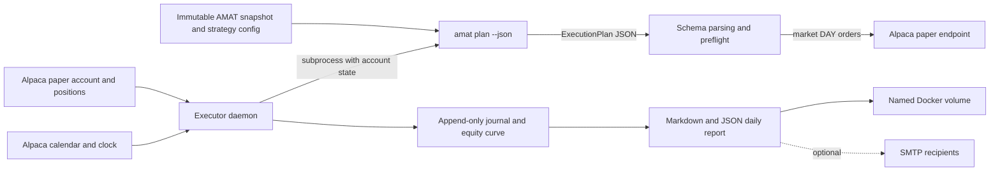

# AMAT Executor

Paper-trading execution, scheduling, reconciliation, and reporting for the
AMAT strategy on Alpaca.

> [!IMPORTANT]
> This service is **paper trading only**. The Alpaca paper hostname is a source
> constant, the live hostname is prohibited by tests, and every broker request
> reasserts the expected host. Paper results are optimistic and are not a
> forecast of live performance.

## Contents

- [Project overview](#project-overview)
- [Current measured performance](#current-measured-performance)
- [System architecture](#system-architecture)
- [Repository guide](#repository-guide)
- [Getting started](#getting-started)
- [Configuration](#configuration)
- [Using the CLI](#using-the-cli)
- [Running with Docker](#running-with-docker)
- [Development and testing](#development-and-testing)
- [Group contribution workflow](#group-contribution-workflow)
- [Operations, state, and recovery](#operations-state-and-recovery)
- [Safety guarantees](#safety-guarantees)
- [Known limitations](#known-limitations)

## Project overview

AMAT is deliberately split into two codebases with different responsibilities:

- `amat` owns research, market-data validation, backtesting, strategy decisions,
  and the provenance of those decisions. It cannot place orders.
- `executor` owns the exchange calendar, paper account state, order submission,
  durable execution records, end-of-day performance reports, and scheduling.

The only contract between them is the inert JSON artifact emitted by
`amat plan --json`. The executor invokes that command as a subprocess and
parses the result; it never imports the `amat` Python package. This keeps the
research system read-only while making the order-capable process small,
auditable, and dependency-light.

At runtime the daemon performs two scheduled phases using Alpaca's exchange
calendar rather than hardcoded weekdays or market hours:

| Phase | Default schedule | Responsibility |
|---|---|---|
| Submit | 10 minutes before the session opens | Read account and positions, build a fresh AMAT plan, run preflight checks, and submit DAY market orders |
| Report | 15 minutes after the session closes | Read final account state, append one equity observation, write Markdown/JSON reports, optionally email the report, and prune old artifacts |

A delayed morning phase may catch up until `SUBMIT_CUTOFF_MINUTES` before that
session's close. It records the delay so an intraday fill is not represented as
an opening fill. Alpaca's calendar naturally handles holidays and half-days.

## Current measured performance

These figures were read from the running Docker container and its named state
volume. They are a dated operational snapshot, not static project claims.

### Paper-account results

Snapshot source: `/var/lib/amat-executor/reports/2026-08-26.json`, generated
`2026-08-26T20:15:00Z`.

| Metric | Measured value |
|---|---:|
| Observed sessions | 8 (`2026-08-17` through `2026-08-26`) |
| Starting equity | $100,769.59 |
| Ending equity | $100,845.72 |
| Net change | +$76.13 |
| Total return | +0.0755% |
| Latest session return | -0.0405% |
| Maximum observed drawdown | -0.1777% |
| Annualized volatility | 2.1095% |
| Sharpe ratio, assuming 0% cash return | 1.30 |
| Best session | +0.2733% |
| Worst session | -0.1702% |
| Positive return intervals | 2 of 7 |
| Ending cash | $57,072.67 |
| Ending gross exposure | 43.41% |
| Ending positions | 10 |

> [!WARNING]
> Eight sessions is **not a meaningful statistical sample**. The report marks
> samples below 20 sessions accordingly. In particular, the annualized
> volatility, Sharpe ratio, and drawdown describe this short observation window
> and should not be used as expected performance.

The `2026-08-26` rebalance bought IEF and filled, but the submit phase started
33 minutes late. The report warns that its fill reflects an intraday price and
is not directly comparable with the backtest's assumed opening fill. The plan
also appended 11 sessions beyond the frozen snapshot manifest, and its code
revision was undetected because the mounted AMAT checkout did not expose usable
Git metadata. Both points matter when reviewing provenance.

### Container health and resource use

Docker snapshot captured `2026-08-26T23:35:57Z`:

| Metric | Measured value |
|---|---:|
| Container status | Running and healthy |
| Started | `2026-08-24T19:15:28Z` |
| Restarts since start | 0 |
| CPU at sample time | 0.00% |
| Memory at sample time | 152.5 MiB (0.48% of the Docker-reported 31.01 GiB limit) |
| Processes | 2 |
| Cumulative network I/O | 6.71 MB received / 1.46 MB sent |
| Cumulative block I/O | 950 MB read / 254 kB written |
| Image size | 248,106,041 bytes (about 236.6 MiB) |
| Persistent executor state | about 17 MiB |
| Equity observations | 8 |
| Journal records | 55,227 valid NDJSON records |

The high journal-record count is historical, not normal throughput: 41,456
`phase_missed` and 13,695 `report_written` entries came from the earlier
scheduler-ledger defect described in `tests/test_daemon.py`. The defect is fixed
and the journal now rotates at 32 MiB, retaining one prior generation.

To refresh these measurements:

```bash
docker compose ps
docker stats amat-executor --no-stream
docker compose exec -T executor \
  tail -1 /var/lib/amat-executor/equity_curve.ndjson
docker compose exec -T executor \
  cat /var/lib/amat-executor/daemon_state.json
```

## System architecture



The end-to-end flow is:

1. `cli.py` loads validated environment settings from `config.py`.
2. `daemon.py` asks `broker/alpaca_paper.py` for the authoritative exchange
   clock and session calendar.
3. At submit time, the daemon fetches the paper account and current positions.
4. `plan_source.py` passes those values to the separate `amat plan` process and
   validates its JSON schema, dates, quantities, and version.
5. `submit.py` refuses unsafe plans, resolves fractionable/whole-share sizing,
   clamps sells to holdings, creates deterministic client order IDs, and sends
   approved intents through the one broker adapter.
6. `journal.py` durably records decisions, refusals, submissions, and one
   end-of-day equity point per session.
7. `report/daily.py` computes measured performance and writes Markdown plus
   JSON. `report/email.py` optionally delivers the already-persisted report.

## Repository guide

The following inventory covers the maintained source, configuration, build,
and test files in this repository. Runtime-generated files are listed
separately because they should not be committed.

### Root files

| File | What it does |
|---|---|
| `README.md` | Project overview, setup, operations, architecture, metrics, and contribution workflow |
| `.env.example` | Safe configuration template for paper credentials, strategy paths, scheduler settings, dry-run mode, and optional SMTP delivery |
| `.gitignore` | Excludes credentials, local state, backups, Python caches, virtual environments, and build artifacts |
| `Dockerfile` | Builds the Python 3.12 image, installs pinned `uv`, `tini`, Git, and the executor, creates writable state paths, and runs as UID 10001 |
| `docker-compose.yml` | Defines the executor service, read-only AMAT mount, persistent volumes, UTC environment, health check, bounded logs, restart policy, and security options |
| `pyproject.toml` | Package metadata, `executor` console entry point, Python requirement, development dependencies, build backend, Ruff rules, and strict mypy settings |
| `pytest.ini` | Limits test discovery to `tests/` and makes `src/` importable during tests |
| `rebuild-restart.sh` | Safely backs up state and account observations, builds while the current daemon runs, recreates only the service, then verifies health and volume continuity |
| `uv.lock` | Reproducible locked dependency graph for development and packaging |

### Application package

| File | What it does |
|---|---|
| `src/executor/__init__.py` | Declares the package boundary and version |
| `src/executor/cli.py` | Implements `daemon`, `check`, `account`, `calendar`, `submit`, `report`, and `prune`; converts domain failures to a clean CLI exit |
| `src/executor/config.py` | Loads and validates environment-only configuration, redacts credentials, resolves AMAT paths, and pins the paper host |
| `src/executor/daemon.py` | Runs the market-aware scheduler, persists an idempotent completed-phase ledger, detects late/missed phases, coordinates submit/report work, and handles signals |
| `src/executor/errors.py` | Defines the executor's configuration, plan, broker, and reconciliation exception hierarchy |
| `src/executor/journal.py` | Appends fsynced audit events, rotates the verbose journal at 32 MiB, and maintains the unpruned equity curve |
| `src/executor/plan_source.py` | Runs `amat plan` as a subprocess, supplies account state and strategy inputs, extracts JSON, and converts it into typed, validated execution plans |
| `src/executor/submit.py` | Performs preflight safety checks, conservative quantity resolution, deterministic idempotency IDs, dry runs, and paper-order submission accounting |

### Broker package

| File | What it does |
|---|---|
| `src/executor/broker/__init__.py` | Exposes the broker adapter's account, position, order, clock, calendar, and client types |
| `src/executor/broker/alpaca_paper.py` | Contains the only network path capable of submitting orders; validates wire data, rate-limits calls, retries safe reads, never retries order POSTs, and only reaches Alpaca paper trading |

### Reporting package

| File | What it does |
|---|---|
| `src/executor/report/__init__.py` | Exposes report building, statistics, persistence, pruning, and email functions |
| `src/executor/report/daily.py` | Computes equity-curve statistics, labels short samples, assembles daily Markdown/JSON reports, and prunes date-paired plans/reports |
| `src/executor/report/email.py` | Sends persisted reports through SMTP with TLS options; delivery failures are returned for journaling and never crash the trading loop |

### Tests

| File | What it verifies |
|---|---|
| `tests/test_boundary.py` | No `amat` imports, no live broker host, a non-configurable paper host, and exactly one order-submission module |
| `tests/test_config.py` | Required/default settings, path validation, SMTP parsing, dry-run parsing, and credential redaction |
| `tests/test_daemon.py` | Scheduler windows, half-days, late/missed phases, one-time execution, state-ledger migration/bounds, and restart behavior |
| `tests/test_integration.py` | Real offline AMAT v6 plan generation followed by plan-to-submit-to-report-to-prune behavior against a controlled fake broker |
| `tests/test_plan_source.py` | Plan subprocess arguments, JSON extraction, schema validation, versions, dates, quantities, and unrecognized holdings |
| `tests/test_report.py` | Equity/statistics calculations, meaningful-sample labeling, order/report content, idempotent observations, and retention pairing |
| `tests/test_submit.py` | Preflight refusals, long-only sizing, fractional rounding, deterministic IDs, dry runs, duplicates, submissions, and journaling |

### Generated and local-only files

| Path | Purpose |
|---|---|
| `.env` | Real deployment settings and credentials; never commit it |
| `.venv/` | Local Python environment created by `uv sync` |
| `state/daemon_state.json` | Bounded v2 ledger of completed submit/report phases |
| `state/journal.ndjson` | Current append-only audit journal |
| `state/journal.1.ndjson` | Previous journal generation after rotation |
| `state/equity_curve.ndjson` | One durable end-of-day account observation per trading session |
| `state/plans/YYYY-MM-DD.json` | Exact plan artifact used for a session |
| `state/reports/YYYY-MM-DD.md` | Human-readable daily report |
| `state/reports/YYYY-MM-DD.json` | Machine-readable daily report and metrics |
| `backups/rebuild-<timestamp>/` | State archive plus before/after paper-account observations created by `rebuild-restart.sh` |
| `.pytest_cache/`, `.mypy_cache/`, `.ruff_cache/`, `__pycache__/` | Disposable local tool caches |

In Docker, `state/` lives in the `executor-state` named volume at
`/var/lib/amat-executor`; the local `state/` directory is not the authoritative
state for the running container.

## Getting started

### Prerequisites

- Git
- Python 3.12 or newer
- [`uv`](https://docs.astral.sh/uv/)
- Docker Engine with the Docker Compose v2 plugin for container deployment
- Alpaca paper-trading credentials
- Alpaca market-data credentials used by the AMAT planning subprocess
- Access to the separate AMAT strategy repository and an immutable snapshot

### Clone the repositories

The Compose file expects `amat` and `executor` to be sibling directories.
Replace `<github-group>` with your GitHub organization or classroom group.

```bash
mkdir amat-workspace
cd amat-workspace

git clone https://github.com/<github-group>/amat.git amat
git clone https://github.com/<github-group>/amat-executor.git executor

cd executor
```

The resulting layout must be:

```text
amat-workspace/
├── amat/       # research, snapshots, strategy configuration, plan command
└── executor/   # this repository
```

If your group publishes the whole workspace as one repository instead, clone
that repository once and enter its `executor/` directory; keep the same sibling
layout because `docker-compose.yml` mounts `../amat` read-only.

### Install and validate locally

```bash
uv sync --locked
cp .env.example .env
chmod 600 .env
```

Edit `.env`, keep `DRY_RUN=true`, and point `SNAPSHOT` at an available AMAT
snapshot. Then load the variables and run the non-submitting check:

```bash
set -a
. ./.env
set +a

uv run executor check
```

`executor check` validates settings, reads the paper account and exchange
clock, and builds the exact strategy plan it would use. It never submits an
order.

## Configuration

All settings come from environment variables. Credentials are not accepted as
CLI flags, preventing them from appearing in shell history or process listings.

| Variable | Required | Code default | Description |
|---|---:|---|---|
| `ALPACA_PAPER_API_KEY` | Yes | None | Alpaca paper-trading API key |
| `ALPACA_PAPER_API_SECRET` | Yes | None | Alpaca paper-trading API secret |
| `ALPACA_MARKET_API_KEY` | For online planning | None | Market-data key inherited by `amat plan` |
| `ALPACA_MARKET_API_SECRET` | For online planning | None | Market-data secret inherited by `amat plan` |
| `SNAPSHOT` | Yes | None | Immutable AMAT snapshot directory to extend from |
| `AMAT_ROOT` | No | `/opt/amat` | AMAT repository root |
| `STRATEGY_CONFIG` | No | `$AMAT_ROOT/configs/strategy/amat_v6.toml` | Strategy configuration file |
| `NEWS_ASSETS` | No | Disabled | Optional short-lived candidate artifact produced by Newsdesk |
| `AMAT_PLAN_COMMAND` | No | `uv run --locked amat` | Command prefix used before the `plan` subcommand |
| `STATE_ROOT` | No | `/var/lib/amat-executor` | Journal, equity curve, plans, reports, and daemon ledger |
| `REPORT_RETENTION_DAYS` | No | `7` | Trading days of plan/report artifacts to retain |
| `PLAN_LEAD_MINUTES` | No | `10` | Minutes before open when submit becomes due |
| `REPORT_DELAY_MINUTES` | No | `15` | Minutes after close when reporting becomes due |
| `SUBMIT_CUTOFF_MINUTES` | No | `30` | Refuse automatic catch-up within this many minutes of close |
| `DRY_RUN` | No | `false` | Exact value `true` skips order POSTs; `.env.example` deliberately sets it to `true` |
| `SMTP_HOST` | No | Disabled | SMTP relay; reports remain on disk when unset |
| `SMTP_PORT` | No | `587` | SMTP port; `465` selects implicit TLS |
| `SMTP_USERNAME` | No | Empty | Optional SMTP login and default sender |
| `SMTP_PASSWORD` | No | Empty | Optional SMTP password |
| `SMTP_STARTTLS` | No | `true` | Set `false` only for a trusted local relay |
| `REPORT_SENDER` | With SMTP | `SMTP_USERNAME` | From address |
| `REPORT_RECIPIENTS` | With SMTP | None | Comma-separated recipient list |

To enable news-driven candidates, refresh one stable file before the morning
plan, then set `NEWS_ASSETS` to its container path:

```bash
cd ../amat
uv run newsdesk --db data/news/news.sqlite3 discover-assets \
  --themes configs/news/themes.toml \
  --out outputs/news/assets.json
```

An expired configured news artifact fails planning closed. Leave `NEWS_ASSETS`
empty to preserve the strategy's static universe.

## Using the CLI

Run commands after loading `.env` locally, or prefix them with
`docker compose exec executor` in the container.

| Command | Behavior |
|---|---|
| `uv run executor check` | Validate configuration, broker access, current account state, and plan formation without submitting |
| `uv run executor daemon` | Run the continuous market-aware scheduler |
| `uv run executor account` | Print the paper account and positions as JSON |
| `uv run executor calendar` | Print the next two weeks of Alpaca sessions and early closes |
| `uv run executor submit` | Run the submit phase once for the current exchange date |
| `uv run executor submit --session YYYY-MM-DD` | Deliberately run submit for a specific session, with lateness recorded |
| `uv run executor report` | Record equity, write/mail a report, and prune artifacts once |
| `uv run executor report --session YYYY-MM-DD` | Run reporting for a specific session |
| `uv run executor prune` | Apply configured report/plan retention immediately |
| `uv run executor prune --retain-days N` | Apply a one-time retention override |

`submit` is order-capable when `DRY_RUN` is not exactly `true`. Run `check`
first and inspect the generated plan before any manual submit.

## Running with Docker

### Initial deployment

```bash
cp .env.example .env
chmod 600 .env
# Edit .env and leave DRY_RUN=true for initial sessions.

docker compose config --quiet
docker compose build executor
docker compose up -d executor
docker compose ps
docker compose logs -f executor
```

The Compose service:

- runs as an unprivileged user with `no-new-privileges`;
- uses UTC internally while interpreting broker sessions in New York time;
- mounts `../amat` read-only at `/opt/amat`;
- persists state, the AMAT environment, and the uv cache in named volumes;
- bounds JSON logs to five 10 MB files;
- uses `restart: unless-stopped` and a two-minute stop grace period;
- health-checks paper-account access every 15 minutes; and
- places `/tmp` on a 512 MiB tmpfs.

The Compose file does not currently set explicit CPU or memory limits. Add
limits only after measuring plan-build peaks; the idle sample above is not a
safe capacity target.

### Updates

Use the guarded update script once the service is already running:

```bash
./rebuild-restart.sh
```

It records the paper account, briefly pauses the writer to archive the named
state volume, builds while the old daemon remains active, gracefully recreates
only `executor`, verifies readiness and volume identity, then records the
account again. It does not call `docker compose down` or remove volumes.

## Development and testing

Install the locked environment:

```bash
uv sync --locked
```

Run the complete local quality gate before pushing:

```bash
uv run ruff format --check .
uv run ruff check .
uv run mypy src
uv run pytest -q
```

At the time of this README update, the suite passes with **126 tests** and
strict mypy reports no issues in 13 source files.

To apply formatting:

```bash
uv run ruff format .
```

New behavior should include tests at the closest boundary:

- scheduling/state changes in `test_daemon.py`;
- plan-contract changes in `test_plan_source.py`;
- order and sizing changes in `test_submit.py`;
- account/transport changes in integration or broker-focused tests;
- performance/reporting changes in `test_report.py`; and
- architectural safety rules in `test_boundary.py`.

## Group contribution workflow

The examples assume the default branch is `main`. Substitute the group's
actual default branch if it differs.

### 1. Synchronize your local default branch

```bash
git switch main
git pull --ff-only origin main
```

### 2. Create a focused branch

Use a short category and description. Do not work directly on `main`.

```bash
git switch -c feat/add-order-status-reporting
```

Suggested prefixes are `feat/`, `fix/`, `docs/`, `test/`, `refactor/`, and
`chore/`. Keep one logical change per branch so review and rollback remain
straightforward.

### 3. Make and validate the change

Never commit `.env`, account exports, state volumes, reports, or rebuild
backups. Before committing:

```bash
uv run ruff format --check .
uv run ruff check .
uv run mypy src
uv run pytest -q
git diff --check
git status --short
```

Review the actual patch with `git diff`. Changes affecting submission,
credentials, scheduling, state retention, or the AMAT plan contract deserve
extra tests and an explicit risk note in the pull request.

### 4. Commit and push

Write an imperative commit subject that describes the outcome:

```bash
git add README.md src tests
git commit -m "Add order status to daily reports"
git push -u origin feat/add-order-status-reporting
```

Stage only the files you intentionally changed; adjust the `git add` paths to
the work rather than copying the example blindly.

### 5. Open a pull request

Open the branch on GitHub and target `main`, or use GitHub CLI:

```bash
gh pr create --base main --head feat/add-order-status-reporting --fill
```

Every pull request should include:

- a concise summary of what changed and why;
- the user/operator-visible behavior;
- tests and exact validation commands run;
- safety and rollback considerations;
- configuration, state-schema, or deployment changes;
- screenshots or report excerpts when output formatting changes; and
- linked issue(s), if applicable.

Do not include credentials, complete account numbers, or sensitive broker
payloads in the PR description, screenshots, fixtures, or logs.

### 6. Review and merge

- Request review from at least one teammate familiar with the affected area.
- Resolve comments with code or a written rationale; do not silently dismiss
  safety questions.
- Re-run the quality gate after conflict resolution or meaningful updates.
- Keep the branch current with `main` according to the group's merge policy.
- Merge only after required checks and approvals pass.
- Delete the remote branch after merge and update your local `main`.

For order-path changes, reviewers should confirm that the executor remains
paper-only, order POSTs are not retried, client order IDs remain idempotent,
and sells cannot cross a long position into a short.

## Operations, state, and recovery

### Persistent data

The `executor-state` volume contains:

- `daemon_state.json`: bounded completed-phase ledger used for restart
  idempotency;
- `journal.ndjson`: verbose append-only audit trail, rotated at 32 MiB to one
  previous generation;
- `equity_curve.ndjson`: unpruned end-of-day performance history;
- `plans/`: exact daily plan artifacts; and
- `reports/`: daily Markdown and JSON reports.

`REPORT_RETENTION_DAYS` prunes date-named plan and report files together. It
does not prune the journal or equity curve. Non-date files are left alone.

### Health and logs

```bash
docker compose ps
docker compose logs --tail=100 executor
docker compose exec -T executor executor account
docker compose exec -T executor \
  cat /var/lib/amat-executor/daemon_state.json
docker compose exec -T executor \
  tail -5 /var/lib/amat-executor/equity_curve.ndjson
```

### Manual recovery

Use explicit session dates for a deliberately recovered phase:

```bash
docker compose exec -T executor executor submit --session YYYY-MM-DD
docker compose exec -T executor executor report --session YYYY-MM-DD
```

Before a manual submit, confirm the session, inspect `executor check`, verify
the plan has not expired, and confirm whether `DRY_RUN` is enabled. A restart
is not a substitute for choosing the intended recovery action.

## Safety guarantees

These properties are enforced by code and tests:

| Guarantee | Enforcement |
|---|---|
| Paper endpoint only | Constant host, per-request assertion, and source scan for the live hostname |
| No direct AMAT imports | AST scan over every executor module |
| One submission boundary | Only `broker/alpaca_paper.py` may contain the orders endpoint |
| No blind order retries | Safe reads retry transient failures; order POSTs execute once |
| Plan freshness | Expired plans and pre-earliest-session plans are refused |
| Account safety | Blocked/non-active accounts are refused |
| Universe reconciliation | Any unrecognized holding refuses the entire plan |
| Long-only behavior | Sells are clamped to current holdings and cannot create shorts |
| Conservative rounding | Non-fractionable and wire-precision quantities round down |
| Idempotent intent | Deterministic client order IDs prevent the same plan from doubling a position |
| Restart-safe scheduling | Completed phases use a durable bounded ledger |
| Performance integrity | At most one equity observation per session; short samples are labeled |
| Credential hygiene | Secrets come from the environment and are redacted from representations |

## Known limitations

- Paper fills do not model real spreads, market impact, or adverse selection.
- The current performance history has only eight observations.
- The default v6 strategy carries a documented hindsight-selection caveat
  around removing TLT; paper time is out-of-sample evidence, not a cure for
  that caveat.
- Current plan provenance reports an undetected code revision when the mounted
  AMAT checkout lacks accessible Git metadata.
- The current snapshot extension is newer than its frozen manifest and those
  appended sessions are explicitly outside the manifest's digest coverage.
- SMTP delivery is best-effort. The durable on-disk report is authoritative.
- The project is marked proprietary in `pyproject.toml`; do not redistribute
  it unless the GitHub group provides a separate license or policy.
