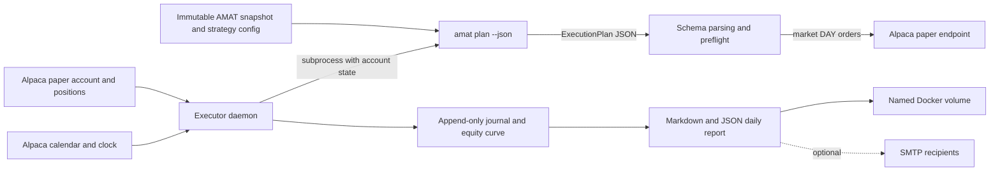

# AMAT Executor

For current cross-system installation, API contracts and contribution guidance, start with the [workspace documentation](../README.md#table-of-contents). Dated reports and deployment observations below require their original local evidence and do not describe a fresh clone.

Paper-trading execution, scheduling, reconciliation, and reporting for the
AMAT strategy on Alpaca.

The [trade performance monitor](../amat/docs/trade-performance-monitoring.md) records
per-instruction execution evidence and matured price outcomes alongside the daily report.
Durable inputs live in `STATE_ROOT/trade-observations/`; `executor trades --state-root PATH`
rebuilds local JSON/Markdown without broker access. AMAT's `./research trades FILE...` command
combines the same records alongside backtests in an interactive report.

> [!IMPORTANT]
> This service is **paper trading only**. The Alpaca paper hostname is a source
> constant, the live hostname is prohibited by tests, and every broker request
> reasserts the expected host. Paper results are optimistic and are not a
> forecast of live performance.

The opt-in staged executor uses a versioned durable batch contract for original
authorization, cumulative fills, residual intent, cash commitments and expiry.
See [Execution batch v1](docs/execution-batch-v1.md) for its fields, restart behavior,
configuration and the remaining event-level simulation parity work.

## Contents

- [Project overview](#project-overview)
- [Current measured performance](#current-measured-performance)
- [System architecture](#system-architecture)
- [Repository guide](#repository-guide)
- [Getting started](#getting-started)
- [Configuration](#configuration)
- [Using the CLI](#using-the-cli)
- [Running with Docker](#running-with-docker)
- [Development and testing](#development-and-testing)
- [Group contribution workflow](#group-contribution-workflow)
- [Operations, state, and recovery](#operations-state-and-recovery)
- [Safety guarantees](#safety-guarantees)
- [Known limitations](#known-limitations)

## Project overview

AMAT is deliberately split into two codebases with different responsibilities:

- `amat` owns research, market-data validation, backtesting, strategy decisions,
  and the provenance of those decisions. It cannot place orders.
- `executor` owns the exchange calendar, paper account state, order submission,
  durable execution records, end-of-day performance reports, and scheduling.

The only contract between them is the inert JSON artifact emitted by
`amat plan --json`. The executor invokes that command as a subprocess and
parses the result; it never imports the `amat` Python package. This keeps the
research system read-only while making the order-capable process small,
auditable, and dependency-light.

At runtime the daemon performs two scheduled phases using Alpaca's exchange
calendar rather than hardcoded weekdays or market hours:

| Phase | Default schedule | Responsibility |
|---|---|---|
| Submit | 10 minutes before the session opens | Read account and positions, build a fresh AMAT plan, run preflight checks, and submit DAY market orders |
| Report | 15 minutes after the session closes | Read final account state, append one equity observation, write Markdown/JSON reports, optionally email the report, and prune old artifacts |

A delayed morning phase may catch up until `SUBMIT_CUTOFF_MINUTES` before that
session's close. It records the delay so an intraday fill is not represented as
an opening fill. Alpaca's calendar naturally handles holidays and half-days.
On restart the daemon requests a 14-calendar-day lookback, marks every skipped
phase in the seven-trading-day audit horizon as missed exactly once, and never
submits an order for a session whose submit window has already closed.

## Current measured performance

These figures were read from the running Docker container and its named state
volume. They are a dated operational snapshot, not static project claims.

### Paper-account results

Snapshot source: `/var/lib/amat-executor/reports/2026-08-27.json`, generated
`2026-08-27T20:15:00Z`. The service then had an operational gap before its
2026-09-07 recovery; the gap-aware reporter suppresses annualized and tail
statistics until uninterrupted observations resume.

| Metric | Measured value |
|---|---:|
| Observed sessions | 9 (`2026-08-17` through `2026-08-27`) |
| Starting equity | $100,769.59 |
| Ending equity | $101,009.34 |
| Net change | +$239.75 |
| Total return | +0.2379% |
| Latest observed-period return | +0.1622% |
| Maximum observed drawdown | -0.1777% |
| Annualized volatility | Suppressed after extended observation gap |
| Sharpe ratio, assuming 0% cash return | Suppressed after extended observation gap |
| Best session | +0.2733% |
| Worst session | -0.1702% |
| Positive return intervals | 3 of 8 |
| Ending cash | $64,190.66 |
| Ending gross exposure | 36.45% |
| Ending positions | 9 |

> [!WARNING]
> Nine sessions is **not a meaningful statistical sample**. The report marks
> samples below 20 sessions accordingly. In particular, the annualized
> and tail metrics are unavailable after the extended observation gap; drawdown
> describes only this short observation window and is not expected performance.

The `2026-08-27` rebalance sold IEF and filled, but the submit phase started
84 minutes late. The report warns that its fill reflects an intraday price and
is not directly comparable with the backtest's assumed opening fill. The plan
also appended 12 sessions beyond the frozen snapshot manifest, and its code
revision was undetected because the mounted AMAT checkout did not expose usable
Git metadata. Both points matter when reviewing provenance.

### Container health and resource use

Docker was recovered and checked on `2026-09-07`:

| Metric | Measured value |
|---|---:|
| Container status | Running and healthy after forced recreation |
| Paper broker account | Active and trading permitted |
| Strategy/snapshot | v6 / `alpaca-sip-2026-08-11` |
| Current plan | Valid; three intents for the next session |
| Persistent executor state | about 17 MiB |
| Equity observations | 9 |
| Retained broker orders | 13 of 13 filled |
| Journal records | 55,235 valid NDJSON records at audit time |

The high journal-record count is historical, not normal throughput: 41,456
`phase_missed` and 13,696 `report_written` entries came from the earlier
scheduler-ledger defect described in `tests/test_daemon.py`. The defect is fixed
and the journal now rotates at 32 MiB, retaining one prior generation.

To refresh these measurements:

```bash
docker compose ps
docker stats amat-executor --no-stream
docker compose exec -T executor \
  tail -1 /var/lib/amat-executor/equity_curve.ndjson
docker compose exec -T executor \
  cat /var/lib/amat-executor/daemon_state.json
```

## System architecture



The end-to-end flow is:

1. `cli.py` loads validated environment settings from `config.py`.
2. `daemon.py` asks `broker/alpaca_paper.py` for the authoritative exchange
   clock and session calendar.
3. At submit time, the daemon fetches the paper account and current positions.
4. `plan_source.py` passes those values to the separate `amat plan` process and
   validates its JSON schema, dates, quantities, and version.
5. `submit.py` refuses unsafe plans, resolves fractionable/whole-share sizing,
   clamps sells to holdings, creates deterministic client order IDs, and sends
   approved intents through the one broker adapter.
6. `journal.py` durably records decisions, refusals, submissions, and one
   end-of-day equity point per session.
7. `report/metrics.py` computes gap-aware return/risk statistics and reconciles
   plan intents with broker orders/fills. `report/daily.py` writes Markdown plus
   JSON, and `report/email.py` optionally delivers the persisted report.

## Repository guide

The following inventory covers the maintained source, configuration, build,
and test files in this repository. Runtime-generated files are listed
separately because they should not be committed.

### Root files

| File | What it does |
|---|---|
| `README.md` | Project overview, setup, operations, architecture, metrics, and contribution workflow |
| `.env.example` | Safe configuration template for paper credentials, strategy paths, scheduler settings, dry-run mode, and optional SMTP delivery |
| `.gitignore` | Excludes credentials, local state, backups, Python caches, virtual environments, and build artifacts |
| `Dockerfile` | Builds the Python 3.12 image, installs pinned `uv`, `tini`, Git, and the executor, creates writable state paths, and runs as UID 10001 |
| `docker-compose.yml` | Defines the executor service, read-only AMAT mount, persistent volumes, UTC environment, health check, bounded logs, restart policy, and security options |
| `pyproject.toml` | Package metadata, `executor` console entry point, Python requirement, development dependencies, build backend, Ruff rules, and strict mypy settings |
| `pytest.ini` | Limits test discovery to `tests/` and makes `src/` importable during tests |
| `rebuild-restart.sh` | Safely backs up state and account observations, builds while the current daemon runs, recreates only the service, then verifies health and volume continuity |
| `uv.lock` | Reproducible locked dependency graph for development and packaging |

### Application package

| File | What it does |
|---|---|
| `src/executor/__init__.py` | Declares the package boundary and version |
| `src/executor/cli.py` | Implements `daemon`, `check`, `account`, `calendar`, `submit`, `report`, and `prune`; converts domain failures to a clean CLI exit |
| `src/executor/config.py` | Loads and validates environment-only configuration, redacts credentials, resolves AMAT paths, and pins the paper host |
| `src/executor/daemon.py` | Runs the market-aware scheduler, persists an idempotent completed-phase ledger, detects late/missed phases, coordinates submit/report work, and handles signals |
| `src/executor/errors.py` | Defines the executor's configuration, plan, broker, and reconciliation exception hierarchy |
| `src/executor/journal.py` | Appends fsynced audit events, rotates the verbose journal at 32 MiB, and maintains the unpruned equity curve |
| `src/executor/plan_source.py` | Runs `amat plan` as a subprocess, supplies account state and strategy inputs, extracts JSON, and converts it into typed, validated execution plans |
| `src/executor/submit.py` | Performs preflight safety checks, conservative quantity resolution, deterministic idempotency IDs, dry runs, and paper-order submission accounting |

### Broker package

| File | What it does |
|---|---|
| `src/executor/broker/__init__.py` | Exposes the broker adapter's account, position, order, clock, calendar, and client types |
| `src/executor/broker/alpaca_paper.py` | Contains the only network path capable of submitting orders; validates wire data, rate-limits calls, retries safe reads, never retries order POSTs, and only reaches Alpaca paper trading |

### Reporting package

| File | What it does |
|---|---|
| `src/executor/report/__init__.py` | Exposes report building, statistics, persistence, pruning, and email functions |
| `src/executor/report/metrics.py` | Computes gap-aware performance/risk statistics and plan-to-order execution reconciliation |
| `src/executor/report/daily.py` | Labels short/gapped samples, assembles daily Markdown/JSON reports, and prunes date-paired plans/reports |
| `src/executor/report/email.py` | Sends persisted reports through SMTP with TLS options; delivery failures are returned for journaling and never crash the trading loop |

### Tests

| File | What it verifies |
|---|---|
| `tests/test_boundary.py` | No `amat` imports, no live broker host, a non-configurable paper host, and exactly one order-submission module |
| `tests/test_config.py` | Required/default settings, path validation, SMTP parsing, dry-run parsing, and credential redaction |
| `tests/test_daemon.py` | Scheduler windows, half-days, late/missed phases, one-time execution, state-ledger migration/bounds, and restart behavior |
| `tests/test_integration.py` | Real offline AMAT v6 plan generation followed by plan-to-submit-to-report-to-prune behavior against a controlled fake broker |
| `tests/test_plan_source.py` | Plan subprocess arguments, JSON extraction, schema validation, versions, dates, quantities, and unrecognized holdings |
| `tests/test_report.py` | Equity/risk statistics, gap suppression, execution reconciliation, report content, idempotent observations, and retention pairing |
| `tests/test_submit.py` | Preflight refusals, long-only sizing, fractional rounding, deterministic IDs, dry runs, duplicates, submissions, and journaling |

### Generated and local-only files

| Path | Purpose |
|---|---|
| `.env` | Real deployment settings and credentials; never commit it |
| `.venv/` | Local Python environment created by `uv sync` |
| `state/daemon_state.json` | Bounded v2 ledger of completed submit/report phases |
| `state/journal.ndjson` | Current append-only audit journal |
| `state/journal.1.ndjson` | Previous journal generation after rotation |
| `state/equity_curve.ndjson` | One durable end-of-day account observation per trading session |
| `state/plans/YYYY-MM-DD.json` | Exact plan artifact used for a session |
| `state/reports/YYYY-MM-DD.md` | Human-readable daily report |
| `state/reports/YYYY-MM-DD.json` | Machine-readable daily report and metrics |
| `backups/rebuild-<timestamp>/` | State archive plus before/after paper-account observations created by `rebuild-restart.sh` |
| `.pytest_cache/`, `.mypy_cache/`, `.ruff_cache/`, `__pycache__/` | Disposable local tool caches |

In Docker, `state/` lives in the `executor-state` named volume at
`/var/lib/amat-executor`; the local `state/` directory is not the authoritative
state for the running container.

## Getting started

### Prerequisites

- Git
- Python 3.12 or newer
- [`uv`](https://docs.astral.sh/uv/)
- Docker Engine with the Docker Compose v2 plugin for container deployment
- Alpaca paper-trading credentials
- Alpaca market-data credentials used by the AMAT planning subprocess
- Access to the separate AMAT strategy repository and an immutable snapshot

### Clone the repositories

The Compose file expects `amat` and `executor` to be sibling directories.
Replace `<github-group>` with your GitHub organization or classroom group.

```bash
mkdir amat-workspace
cd amat-workspace

git clone https://github.com/<github-group>/amat.git amat
git clone https://github.com/<github-group>/amat-executor.git executor

cd executor
```

The resulting layout must be:

```text
amat-workspace/
├── amat/       # research, snapshots, strategy configuration, plan command
└── executor/   # this repository
```

If your group publishes the whole workspace as one repository instead, clone
that repository once and enter its `executor/` directory; keep the same sibling
layout because `docker-compose.yml` mounts `../amat` read-only.

### Install and validate locally

```bash
uv sync --locked
cp .env.example .env
chmod 600 .env
```

Edit `.env`, keep `DRY_RUN=true`, and point `SNAPSHOT` at an available AMAT
snapshot. Then load the variables and run the non-submitting check:

```bash
set -a
. ./.env
set +a

uv run executor check
```

`executor check` validates settings, reads the paper account and exchange
clock, and builds the exact strategy plan it would use. It never submits an
order.

## Configuration

All settings come from environment variables. Credentials are not accepted as
CLI flags, preventing them from appearing in shell history or process listings.

| Variable | Required | Code default | Description |
|---|---:|---|---|
| `ALPACA_PAPER_API_KEY` | Yes | None | Alpaca paper-trading API key |
| `ALPACA_PAPER_API_SECRET` | Yes | None | Alpaca paper-trading API secret |
| `ALPACA_MARKET_API_KEY` | For online planning | None | Market-data key inherited by `amat plan` |
| `ALPACA_MARKET_API_SECRET` | For online planning | None | Market-data secret inherited by `amat plan` |
| `SNAPSHOT` | Yes | None | Immutable AMAT snapshot directory to extend from |
| `AMAT_ROOT` | No | `/opt/amat` | AMAT repository root |
| `STRATEGY_CONFIG` | No | `$AMAT_ROOT/configs/strategy/amat_v6.toml` | Strategy configuration file |
| `NEWS_ASSETS` | No | Disabled | Optional short-lived candidate artifact produced by Newsdesk |
| `AMAT_PLAN_COMMAND` | No | `uv run --locked amat` | Command prefix used before the `plan` subcommand |
| `STATE_ROOT` | No | `/var/lib/amat-executor` | Journal, equity curve, plans, reports, and daemon ledger |
| `REPORT_RETENTION_DAYS` | No | `7` | Trading days of plan/report artifacts to retain |
| `PLAN_LEAD_MINUTES` | No | `10` | Minutes before open when submit becomes due |
| `REPORT_DELAY_MINUTES` | No | `15` | Minutes after close when reporting becomes due |
| `SUBMIT_CUTOFF_MINUTES` | No | `30` | Refuse automatic catch-up within this many minutes of close |
| `DRY_RUN` | No | `false` | Exact value `true` skips order POSTs; `.env.example` deliberately sets it to `true` |
| `AUTHORIZED_CONFIG_SHA256` | Yes | None | Comma-separated raw-file SHA-256 digests of strategy TOMLs this executor may trade. Compute with `sha256sum configs/strategy/amat_v6.toml` in the `amat` checkout. A plan from any other digest is refused, and the daemon refuses to start if `STRATEGY_CONFIG` is unlisted |
| `EXECUTOR_DISABLED` | No | `false` | `true` refuses every submission; reports keep running |
| `MAX_SESSION_NOTIONAL` | Yes | None | USD ceiling on the sum of intent reference notionals per session |
| `MAX_ORDERS_PER_SESSION` | Yes | None | Ceiling on intents per session |
| `MAX_SYMBOL_NOTIONAL` | Yes | None | USD ceiling per intent |
| `EQUITY_TOLERANCE` | No | `0.01` | Max relative gap between plan sizing equity and broker equity |
| `SMTP_HOST` | No | Disabled | SMTP relay; reports remain on disk when unset |
| `SMTP_PORT` | No | `587` | SMTP port; `465` selects implicit TLS |
| `SMTP_USERNAME` | No | Empty | Optional SMTP login and default sender |
| `SMTP_PASSWORD` | No | Empty | Optional SMTP password |
| `SMTP_STARTTLS` | No | `true` | Set `false` only for a trusted local relay |
| `REPORT_SENDER` | With SMTP | `SMTP_USERNAME` | From address |
| `REPORT_RECIPIENTS` | With SMTP | None | Comma-separated recipient list |

To enable news-driven candidates, refresh one stable file before the morning
plan, then set `NEWS_ASSETS` to its container path:

```bash
cd ../amat
uv run newsdesk --db data/news/news.sqlite3 discover-assets \
  --themes configs/news/themes.toml \
  --out outputs/news/assets.json
```

An expired configured news artifact fails planning closed. Leave `NEWS_ASSETS`
empty to preserve the strategy's static universe.

## Using the CLI

Run commands after loading `.env` locally, or prefix them with
`docker compose exec executor` in the container.

| Command | Behavior |
|---|---|
| `uv run executor check` | Validate configuration, broker access, current account state, and plan formation without submitting |
| `uv run executor daemon` | Run the continuous market-aware scheduler |
| `uv run executor account` | Print the paper account and positions as JSON |
| `uv run executor calendar` | Print the next two weeks of Alpaca sessions and early closes |
| `uv run executor submit` | Run the submit phase once for the current exchange date |
| `uv run executor submit --session YYYY-MM-DD` | Deliberately run submit for a specific session, with lateness recorded |
| `uv run executor report` | Record equity, write/mail a report, and prune artifacts once |
| `uv run executor report --session YYYY-MM-DD` | Run reporting for a specific session |
| `uv run executor prune` | Apply configured report/plan retention immediately |
| `uv run executor prune --retain-days N` | Apply a one-time retention override |

`submit` is order-capable when `DRY_RUN` is not exactly `true`. Run `check`
first and inspect the generated plan before any manual submit.

## Running with Docker

### Initial deployment

```bash
cp .env.example .env
chmod 600 .env
# Edit .env and leave DRY_RUN=true for initial sessions.

docker compose config --quiet
docker compose build executor
docker compose up -d executor
docker compose ps
docker compose logs -f executor
```

The Compose service:

- runs as an unprivileged user with `no-new-privileges`;
- uses UTC internally while interpreting broker sessions in New York time;
- mounts `../amat` read-only at `/opt/amat`;
- persists state, the AMAT environment, and the uv cache in named volumes;
- bounds JSON logs to five 10 MB files;
- uses `restart: unless-stopped` and a two-minute stop grace period;
- health-checks paper-account access every 15 minutes; and
- places `/tmp` on a 512 MiB tmpfs.

The Compose file does not currently set explicit CPU or memory limits. Add
limits only after measuring plan-build peaks; the idle sample above is not a
safe capacity target.

### Updates

Use the guarded update script once the service is already running:

```bash
./rebuild-restart.sh
```

It records the paper account, briefly pauses the writer to archive the named
state volume, builds while the old daemon remains active, gracefully recreates
only `executor`, verifies readiness and volume identity, then records the
account again. It does not call `docker compose down` or remove volumes.

## Development and testing

Install the locked environment:

```bash
uv sync --locked
```

Run the complete local quality gate before pushing:

```bash
uv run ruff format --check .
uv run ruff check .
uv run mypy src
uv run pytest -q
```

At the time of this README update, the suite passes with **135 tests** and
strict mypy reports no issues in 14 source files.

To apply formatting:

```bash
uv run ruff format .
```

New behavior should include tests at the closest boundary:

- scheduling/state changes in `test_daemon.py`;
- plan-contract changes in `test_plan_source.py`;
- order and sizing changes in `test_submit.py`;
- account/transport changes in integration or broker-focused tests;
- performance/reporting changes in `test_report.py`; and
- architectural safety rules in `test_boundary.py`.

## Group contribution workflow

The examples assume the default branch is `main`. Substitute the group's
actual default branch if it differs.

### 1. Synchronize your local default branch

```bash
git switch main
git pull --ff-only origin main
```

### 2. Create a focused branch

Use a short category and description. Do not work directly on `main`.

```bash
git switch -c feat/add-order-status-reporting
```

Suggested prefixes are `feat/`, `fix/`, `docs/`, `test/`, `refactor/`, and
`chore/`. Keep one logical change per branch so review and rollback remain
straightforward.

### 3. Make and validate the change

Never commit `.env`, account exports, state volumes, reports, or rebuild
backups. Before committing:

```bash
uv run ruff format --check .
uv run ruff check .
uv run mypy src
uv run pytest -q
git diff --check
git status --short
```

Review the actual patch with `git diff`. Changes affecting submission,
credentials, scheduling, state retention, or the AMAT plan contract deserve
extra tests and an explicit risk note in the pull request.

### 4. Commit and push

Write an imperative commit subject that describes the outcome:

```bash
git add README.md src tests
git commit -m "Add order status to daily reports"
git push -u origin feat/add-order-status-reporting
```

Stage only the files you intentionally changed; adjust the `git add` paths to
the work rather than copying the example blindly.

### 5. Open a pull request

Open the branch on GitHub and target `main`, or use GitHub CLI:

```bash
gh pr create --base main --head feat/add-order-status-reporting --fill
```

Every pull request should include:

- a concise summary of what changed and why;
- the user/operator-visible behavior;
- tests and exact validation commands run;
- safety and rollback considerations;
- configuration, state-schema, or deployment changes;
- screenshots or report excerpts when output formatting changes; and
- linked issue(s), if applicable.

Do not include credentials, complete account numbers, or sensitive broker
payloads in the PR description, screenshots, fixtures, or logs.

### 6. Review and merge

- Request review from at least one teammate familiar with the affected area.
- Resolve comments with code or a written rationale; do not silently dismiss
  safety questions.
- Re-run the quality gate after conflict resolution or meaningful updates.
- Keep the branch current with `main` according to the group's merge policy.
- Merge only after required checks and approvals pass.
- Delete the remote branch after merge and update your local `main`.

For order-path changes, reviewers should confirm that the executor remains
paper-only, order POSTs are not retried, client order IDs remain idempotent,
and sells cannot cross a long position into a short.

## Operations, state, and recovery

### Persistent data

The `executor-state` volume contains:

- `daemon_state.json`: bounded completed-phase ledger used for restart
  idempotency;
- `journal.ndjson`: verbose append-only audit trail, rotated at 32 MiB to one
  previous generation;
- `equity_curve.ndjson`: unpruned end-of-day performance history;
- `plans/`: exact daily plan artifacts; and
- `reports/`: daily Markdown and JSON reports.

`REPORT_RETENTION_DAYS` prunes date-named plan and report files together. It
does not prune the journal or equity curve. Non-date files are left alone.

### Health and logs

```bash
docker compose ps
docker compose logs --tail=100 executor
docker compose exec -T executor executor account
docker compose exec -T executor \
  cat /var/lib/amat-executor/daemon_state.json
docker compose exec -T executor \
  tail -5 /var/lib/amat-executor/equity_curve.ndjson
```

### Manual recovery

Use explicit session dates for a deliberately recovered phase:

```bash
docker compose exec -T executor executor submit --session YYYY-MM-DD
docker compose exec -T executor executor report --session YYYY-MM-DD
```

Before a manual submit, confirm the session, inspect `executor check`, verify
the plan has not expired, and confirm whether `DRY_RUN` is enabled. A restart
is not a substitute for choosing the intended recovery action.

## Safety guarantees

These properties are enforced by code and tests:

| Guarantee | Enforcement |
|---|---|
| Paper endpoint only | Constant host, per-request assertion, and source scan for the live hostname |
| No direct AMAT imports | AST scan over every executor module |
| One submission boundary | Only `broker/alpaca_paper.py` may contain the orders endpoint |
| No blind order retries | Safe reads retry transient failures; order POSTs execute once |
| Plan freshness | Expired plans and pre-earliest-session plans are refused |
| Account safety | Blocked/non-active accounts are refused |
| Universe reconciliation | Any unrecognized holding refuses the entire plan |
| Long-only behavior | Sells are clamped to current holdings and cannot create shorts |
| Conservative rounding | Non-fractionable and wire-precision quantities round down |
| Idempotent intent | Deterministic client order IDs prevent the same plan from doubling a position |
| Restart-safe scheduling | Completed phases use a durable bounded ledger |
| Performance integrity | At most one equity observation per session; short/gapped samples are labeled and misleading annualization is suppressed |
| Execution reconciliation | Reports match intents to orders/fills and permanently journal the aggregate result |
| Credential hygiene | Secrets come from the environment and are redacted from representations |

## Known limitations

- Paper fills do not model real spreads, market impact, or adverse selection.
- The current performance history has only nine observations and an extended
  operational gap.
- The default v6 strategy carries a documented hindsight-selection caveat
  around removing TLT; paper time is out-of-sample evidence, not a cure for
  that caveat.
- Current plan provenance reports an undetected code revision when the mounted
  AMAT checkout lacks accessible Git metadata.
- The current snapshot extension is newer than its frozen manifest and those
  appended sessions are explicitly outside the manifest's digest coverage.
- SMTP delivery is best-effort. The durable on-disk report is authoritative.
- The project is marked proprietary in `pyproject.toml`; do not redistribute
  it unless the GitHub group provides a separate license or policy.
# September 2026 operational upgrade

Normal operation needs only `executor run` (also the default for `executor`)
and `executor status`. In Docker, use `docker compose up -d` and
`docker compose exec executor executor status`. Configuration stays in `.env`;
plans are built automatically when a trading session is due. Existing diagnostic
commands remain compatible and are listed by `executor --advanced-help`.

The daemon refreshes `STATE_ROOT/order-registry.json` on each monitoring tick
(at most approximately four minutes apart, plus broker/request processing).
An outstanding order while the broker clock reports a closed market receives
the registry state `pending_market_closed`. This includes partial fills and
pending cancellations, with filled and remaining quantities preserved. Its
`broker_status` remains separate; market closure never means canceled or filled.
Terminal broker states remain terminal. Missing observations are marked
`observation_unavailable`, and failed refreshes preserve the previous timestamp.
State changes are journaled, and daily/trade reports retain both statuses.
These observations do not authorize resubmission, cancellation or trading.

The local Compose deployment selects `amat_v13_return_target.toml` through its
private environment file and authorizes that file's exact SHA-256. The engine
name remains `v1-frozen`; the strategy version emitted by the plan is `13.0.0`.
The snapshot starts in 2016 and the planner retains its complete history for
the five-session ranking schedule.

Execution caps accept positive values or an explicit `unlimited` value. This
does not remove strategy allocation constraints, configuration authorization,
the equity-drift check, or the kill switch. Boolean execution switches accept
only `true` or `false`; malformed values fail closed.

Submission processes share a state-directory lock. Retries reuse the archived
session plan to preserve client order IDs after partial fills. The broker
calendar must confirm that the plan uses the preceding exchange session.
Unrelated open orders block submission. Do not delete a session plan to force
replanning while its broker orders may exist.

The Docker healthcheck verifies account connectivity only. A healthy container
can still be disabled or unable to reconcile its portfolio. Daily reports label
plan-to-order reconciliation explicitly, match deterministic client order IDs,
and report unavailable inputs and unreadable history. The separate automatic portfolio monitor checks cash/share changes from an observed
baseline; daily plan reports do not imply that broader scope.


Automatic portfolio monitoring now writes `portfolio-monitor.json` and maintains
`portfolio-baseline.json` in `STATE_ROOT`. The first stable observation records a
baseline; later cycles reconcile cash and shares using paginated account activity.
`executor status` includes this result and flags observations older than twelve
minutes as stale. JSON output adds `portfolio` and `freshness` without changing
existing order fields.

The monitor accounts for partial/full buy/sell fills and documented cash-only
activities, including dividends, fees, interest, deposits and withdrawals. It
uses each fill activity's quantity, not the order's cumulative fill quantity.
Tolerances are $0.01 cash and 0.000001 shares, recorded with every successful check.
A discrepancy never resets the baseline. Missing pages, broker failures, changed
baseline activity, account changes, concurrent snapshot changes and unsupported
corporate actions produce `observation_unavailable`. Last successful reconciliation
time is retained separately. No monitor state grants order authority.

Scope is incremental changes from the observed baseline, not pre-baseline history,
strategy ownership, market valuation or tax/settlement accounting. Broker endpoints
are not atomic: two reads reject visible races but cannot prove absence of delayed
posting. Activity pagination is bounded to 100 pages of 100; reaching the bound
fails explicitly. Baseline compaction and share corporate-action adapters remain
follow-up work; the monitor does not silently truncate history or reset evidence.

The daemon also maintains `deployment-registry.sqlite3` and exposes its observations
through `executor status` (or `executor status --json`). It retains plan evidence
for order attribution and reports persistent operational incidents automatically.
`paper_approved` means the configured digest is authorized; `active` means a matched
fill has been observed; `watch` means an operational incident needs review.
These states do not establish research validation or imply submission is enabled.
Monitoring has no order or allocation authority. Missing data leaves confirmed
incidents unresolved. Statistical signal-decay monitoring awaits a frozen baseline.

Verified checkpoints now compact the active baseline's activity map while retaining
its full proof chain. The original activity audit window remains covered; exhausted
queries split into overlapping bounded windows and conflicting overlaps fail closed.
`operations.json` also reports the observed operational window: twenty completed
qualifying sessions, each with at least thirty minutes of distinct, healthy open-market
observations. This is not a return-performance gate. Legacy REST stock-action
quantities remain unsupported; the strict share adapters use the separately documented
activity-stream leg schema, which is not yet connected to the paper REST account.


## October 8 VPS hardening

Use [VPS_RUNBOOK.md](VPS_RUNBOOK.md) for the handoff, backup/restore, dry-run validation, runtime stop and uncertain-order recovery procedure. New safeguards include durable pre-POST receipts, persistent retry budgets, fresh reconciliation and clock checks, account binding, singleton daemon/report locks, a runtime STOP_SUBMISSIONS interlock, a progress watchdog and read-only container limits.

`executor health` checks daemon progress without broker calls. `executor health --ready` additionally checks local order readiness (explicit unlimited caps remain supported); it never enables orders. `executor reconcile-submissions` resolves only broker-confirmed original order identities. Missing DRY_RUN now defaults to true. The current Compose health check supersedes the older account-connectivity-only check described above.

Mailgun HTTPS delivery is available through `MAILGUN_DOMAIN`, `MAILGUN_API_KEY`, `MAILGUN_REGION`, `REPORT_SENDER`, and `REPORT_RECIPIENTS`. The same provider handles daily reports and durable, rate-limited operational alerts. See the Mailgun section of the VPS runbook. No Mailgun secret or recipient has been fabricated.

### Telegram and unattended operation

Set `TELEGRAM_BOT_TOKEN` and `TELEGRAM_CHAT_ID` in the private `.env` file.
Telegram becomes the primary incident-alert channel when configured; daily
reports also go to Telegram. Long reports are shortened to fit a single message;
the full report remains in the state volume. `executor notification-test` sends
a test to the primary configured channel. Tokens are excluded from planner
subprocesses, representations and transport error text.

Telegram uses a five-second network timeout, refuses redirects, and does not
blindly retry an ambiguously accepted POST. Repeated identical incident alerts
are suppressed for an hour across restarts. Notification transport failure does
not abort the trading phase; missing notification configuration is a readiness
warning, not an order gate. Existing daily email remains optional.

There is no recurring operator approval or mandatory email setup. Configured
execution caps remain unlimited. Essential account, state, reconciliation,
exchange-window and uncertain-order protections remain enforced. A whole-host
or network outage needs an external monitor: a bot running only on the failed
VPS cannot report that outage itself. Trading mode is still explicitly controlled
by `DRY_RUN` and `EXECUTOR_DISABLED`; notification setup does not change them.

## Optional SSH interface

Install `uv sync --extra remote` to use `executor.remote.SSHRunner`. The broker/daemon core still has no third-party dependencies. SSH callers supply a private operator-owned configuration containing host, port, username, key_path, key_passphrase, known_hosts, connect_timeout, command_timeout and max_output_bytes. `SSHRunner(config).run(command)` returns stdout, stderr, exit_code, status, truncation and timing fields. Explicit key-only authentication rejects unknown or changed host keys. Commands have bounded combined stdout/stderr and a wall-clock deadline. The caller owns redaction and command authorization; the dashboard only accepts registered diagnostic names. Closing a timed-out channel does not guarantee termination of a remote process.

The default Compose budget targets a 1 GB VPS: 640 MiB RAM, 1 GiB combined RAM/swap, one CPU and a 128 MiB tmpfs. Override `EXECUTOR_MEMORY_LIMIT`, `EXECUTOR_MEMORY_SWAP_LIMIT` and `EXECUTOR_CPU_LIMIT` for larger hosts. Heavy research should run separately from the executor.

## Separate Alpaca live executor (local implementation)

The live implementation and rollout plan are in
[the Alpaca live implementation plan](../docs/alpaca-live-implementation-plan.md).
`TRADING_MODE` defaults to `paper`; `live` selects a separate pinned adapter and
requires `ALPACA_LIVE_API_KEY`, `ALPACA_LIVE_API_SECRET`, an expected
`ALPACA_LIVE_ACCOUNT_NUMBER` and finite execution caps. The live order transport
requires `LIVE_TRADING_ENABLED=true`, `DRY_RUN=false` and `EXECUTOR_DISABLED=false`.
Account binding, reconciliation, durable submission receipts and runtime stop
interlocks continue to apply.

Compose defines `executor-live` with container name `amat-executor-live` under
an explicit `live` profile, separate state and runtime volumes, and a private
`.env.live` file. Use `.env.live.example` as the configuration reference. Ordinary
paper startup excludes this service. Never reuse paper state for live trading.
The dashboard has a separate read-only live status panel; updating its remote
helper is part of a future deployment. This change does not deploy or start live
trading. The earlier paper-only boundary descriptions above describe the original
paper adapter; the default paper endpoint remains pinned.
